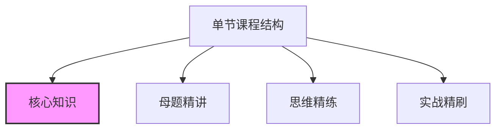
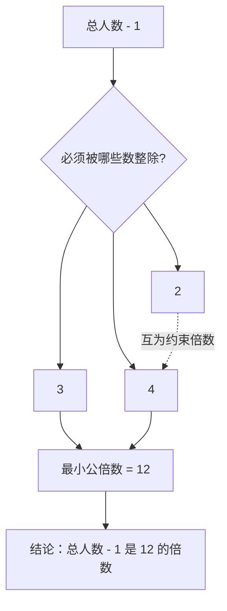
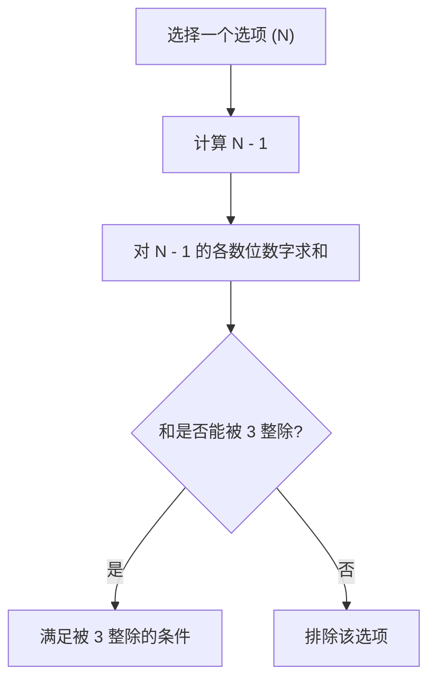
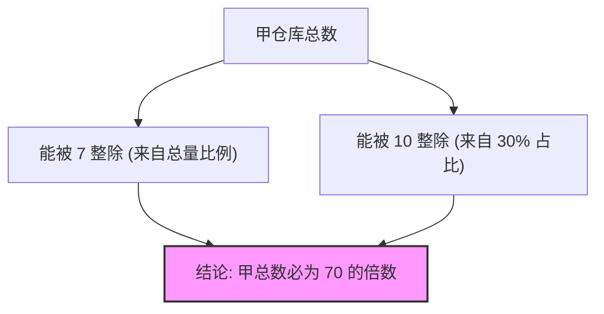
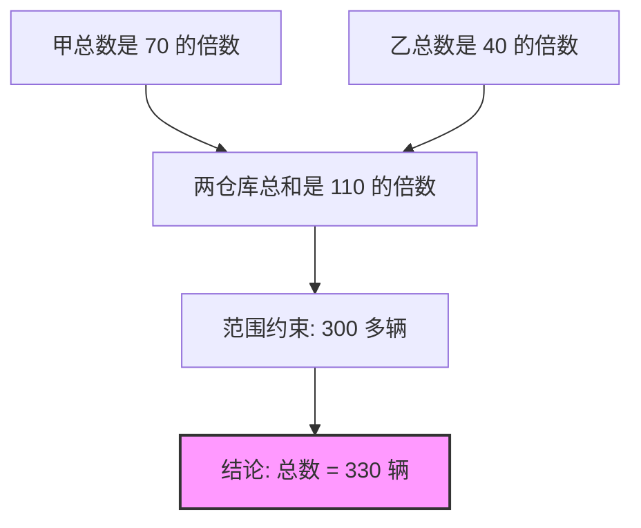
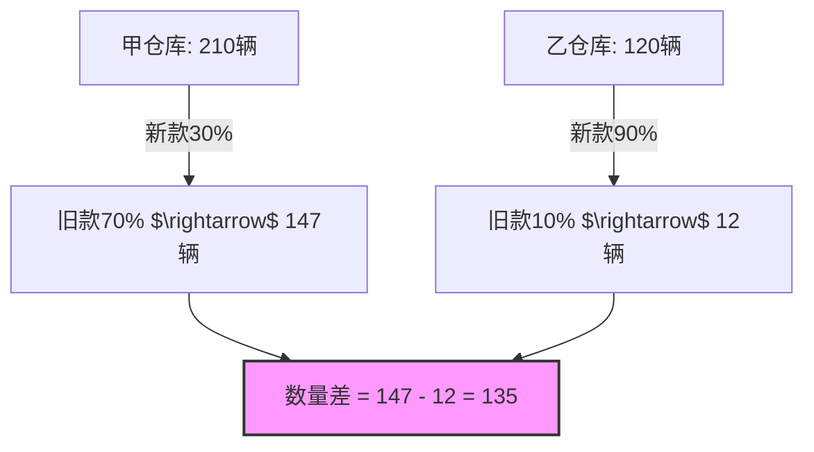

[▶ 视频 00:00:00](https://www.bilibili.com/video/BV1ohMx6xE5h?t=0)
[▶ 视频 00:00:05](https://www.bilibili.com/video/BV1ohMx6xE5h?t=5)
## 27 考季新版《数量关系大满贯》学习指南

- 本指南旨在指导学生如何有效学习新版课程
- **学习指南涵盖内容**:
    - 01 大满贯研发理念
    - 02 大满贯课程体系
    - 03 大满贯学习规划
[▶ 视频 00:00:42](https://www.bilibili.com/video/BV1ohMx6xE5h?t=42)
### 两版课程的使用指南

- 涉及 26 考季与 27 考季两版《数量关系大满贯》如何配合使用

### 大满贯研发理念

- **命题难度趋势**
    - 命题难度不再是单纯的简单
    - 而是变得更加科学合理
- **难度的体现维度**
    - 从理解题意上
    - 从选取方法上
[▶ 视频 00:00:54](https://www.bilibili.com/video/BV1ohMx6xE5h?t=54)
[▶ 视频 00:01:01](https://www.bilibili.com/video/BV1ohMx6xE5h?t=61)
### 解题效率与核心目标

- **效率目标**
    - 在选取正确方法的基础上，追求**解题速度最快**与**效率最高**
- **学习价值**
    - 学过者：能在考场上解决相当一部分题目
    - 未学过者：缺乏应对此类题目的机会

### 大满贯课程体系

- **1. 培养读题能力**
    - 核心在于**准确理解题意**
[▶ 视频 00:01:18](https://www.bilibili.com/video/BV1ohMx6xE5h?t=78)
- 既要**准确理解题意**
    - 还要**高效快速**
- **[为什么做题会卡点/没思路？]** 因为在读题时无法建立逻辑联系
    - 单句与单句之间无法建立联系
    - 条件与条件之间无法建立联系
- **提升路径**
    - 通过分析经典题目来提升题目的预读能力
[▶ 视频 00:01:51](https://www.bilibili.com/video/BV1ohMx6xE5h?t=111)
### 核心研发理念：整合与筛选

- **考点整合思维**
    - 不追求对考点的细致拆解
    - 追求考点的**整合化**，旨在通过一套**核心思维**解决一整类题型
- **经典题目的筛选**
    - 课程的第三个核心理念在于对经典题目的严选与筛选
[▶ 视频 00:02:11](https://www.bilibili.com/video/BV1ohMx6xE5h?t=131)
[▶ 视频 00:02:31](https://www.bilibili.com/video/BV1ohMx6xE5h?t=151)
### 经典题目的选择

- **避免无效刷题**
    - 自学或缺乏规划时，容易通过随机组题进行专项练习
    - **[潜在问题]** 随机题目可能并不适合个人提升，导致在不合适的题目上浪费过多时间和精力去研究、琢磨
- **大满贯的题目精选**
    - 课程涵盖的总题量约为 **400 道**
    - 核心目标是让学生通过课程将每一道题都“吃透”
- **学习效果预期**
    - 能够帮助学生达到入门水平
    - 对于学习比较扎实的同学，甚至能达到对数学思维“开窍”的效果
[▶ 视频 00:03:03](https://www.bilibili.com/video/BV1ohMx6xE5h?t=183)
[▶ 视频 00:03:08](https://www.bilibili.com/video/BV1ohMx6xE5h?t=188)
[▶ 视频 00:03:18](https://www.bilibili.com/video/BV1ohMx6xE5h?t=198)
### 课程体系构成

- **15 节核心内容**
    - 涵盖的内容基本对应近年来国考、省考及市考中的核心高频考点
- **单节课程的标准结构**
    - 每一节课的呈现形式基本相似，包含以下四个模块：
        - **核心知识**
            - **[设计理念]** 直接将对应题型/考点中最核心的数学理论知识与方法体现在讲义中，旨在节省学生手抄笔记的时间
        - **母题精讲**
        - **思维精练**
        - **实战精刷**

[▶ 视频 00:03:22](https://www.bilibili.com/video/BV1ohMx6xE5h?t=202)
[▶ 视频 00:04:02](https://www.bilibili.com/video/BV1ohMx6xE5h?t=242)
### 大满贯课程体系结构

每一节课均由以下四个标准化模块组成，旨在实现从知识到能力的闭环学习：

- **核心知识**
    - 旨在**节省手抄笔记的时间**
    - 将对应题型/考点中最核心的数学理论知识及核心方法直接体现在讲义上
- **母题精讲**
    - 选取难度适中且具有**高度代表性**的经典题目
    - 主要采用近几年的真题进行讲解
- **思维精练**
    - **[学习进阶]** 题目设计会具有适当的灵活性与变化
    - 通过适当提升难度，引导学生完成从基础到进阶的学习过程
- **实战精刷**
    - 提供实战精刷题目的视频讲解
    - **目标**：让学生紧跟讲师思路，确保总结的方法论能够真正**学以致用**，实现方法与思维的落地
[▶ 视频 00:04:30](https://www.bilibili.com/video/BV1ohMx6xE5h?t=270)
[▶ 视频 00:04:39](https://www.bilibili.com/video/BV1ohMx6xE5h?t=279)
## 大满贯学习规划

### 1. 课前预习的重要性

- **[心态建设]** 题目做不出来是正常现象
- **[预习操作]**
    - 先自主阅读讲义中的**核心知识**部分
    - 完整地阅读后续的所有题目（包括母题精讲题与思维精练题）
- **[核心价值]**
    - 课前预习本质上是一次**读题能力的训练**
    - 通过初步尝试，实现对题目逻辑的初步感知

### 2. 如何做好课后复盘

- **复盘的核心目的**
    - 旨在更加**准确、清晰地认识自己**
- **复盘的四个观点**
    - 旨在分享复盘时哪些内容是最重要且最需要的（具体观点将在后续展开）
[▶ 视频 00:05:09](https://www.bilibili.com/video/BV1ohMx6xE5h?t=309)
### 课后复盘的四个核心观点

- **复盘的目标**
    - 旨在更加准确、清晰地认识自己
- **复盘的重点内容**
    - **关注薄弱点**：重点查看并复盘那些“不懂”和“犯错”的地方
    - **巩固正确内容**：即便当时做对了，也不代表过一段时间依然能掌握，因此巩固正确内容同样重要
- **复盘的频率要求**
    - **[关键区别]** 强调的是“复盘回顾”而非单纯“听课”
    - 要求对于本课程，至少要完整地进行 **2 遍** 的复盘回顾

### 关于数量关系的刷题标准

- **核心衡量标准**
    - 在不看讲解的情况下，能否在脑海中形成一个**完整且正确**的思路
    - **[进阶要求]** 最好配合“动脑 + 动手”，能够将题目思路完整地复现出来
[▶ 视频 00:05:37](https://www.bilibili.com/video/BV1ohMx6xE5h?t=337)
[▶ 视频 00:06:07](https://www.bilibili.com/video/BV1ohMx6xE5h?t=367)
[▶ 视频 00:06:19](https://www.bilibili.com/video/BV1ohMx6xE5h?t=379)
### 刷题的局限性

- **[核心观点]** 刷题只能解决**速度**问题
- **[局限性]** 刷题绝对无法解决从“**不会**”到“**会**”的本质跨越

### 26 与 27 版课程的配合建议

- **针对已学完 26 版的同学**
    - 将 27 版课程作为**复盘**及**刷题工具书**使用
- **针对未学过 26 版的同学**
    - 建议直接跟随 **27 版新版课程**进行学习

### 学习 16 字真言

- **核心原则**：一定要把方法落地，做到**学以致用**
- **学习逻辑**：
    - 学以致用
    - 学而实习
    - 循序渐进
    - 持之以恒
[▶ 视频 00:06:37](https://www.bilibili.com/video/BV1ohMx6xE5h?t=397)
[▶ 视频 00:06:47](https://www.bilibili.com/video/BV1ohMx6xE5h?t=407)
[▶ 视频 00:00:00](https://www.bilibili.com/video/BV1ohMx6xE5h?p=2&t=0)
### 学习“16字真言"

- **核心方法论**：
    - **学以致用**：学到的方法必须去实际应用
    - **学而实操**：通过不断的训练来内化方法
    - **循序渐进**：遵循学习的逻辑顺序逐步深入
    - **持之以恒**：保持长期的学习节奏

### 数量关系学习建议

- **保持学习频率**
    - **[核心原则]** 坚持持之以恒，每天都要进行学习，即使进度较慢
    - **[建议强度]** 每天哪怕只做 10 道题目，也要坚持到考前
    - **[预期效果]** 这种持续性的积累会在考前带来全新的感受，帮助数量关系不再成为拖后腿的科目，甚至使其成为强势科目

---

## 27 考季数量关系大满贯：第一讲 和差倍比问题（一）
[▶ 视频 00:00:08](https://www.bilibili.com/video/BV1ohMx6xE5h?p=2&t=8)
### 和差倍比问题（一）的讲解核心

- **两大核心知识点**
    - 整除思维
    - 比例分数思维
- **底层逻辑**
    - **[本质]** 不管使用哪种思维方式或方法，这三讲（和差倍比问题一、二、三）的本质都是**方程**
[▶ 视频 00:00:32](https://www.bilibili.com/video/BV1ohMx6xE5h?p=2&t=32)
### 为什么要培养特定思维方式

- **[超越简单问题]** 培养整除思维和比例分数思维的目标，不是为了处理简单的题目
    - 对于简单问题，直接使用方程的方法虽然看起来思路简化且速度快，但并不具备长期的竞争优势
- **[应对中高难度题]** 面对中等难度或偏难的题目时，传统的解题逻辑会遇到瓶颈
    - **[速度瓶颈]** 如果依然沿用“设未知数 $\rightarrow$ 列方程 $\rightarrow$ 解方程”的模式，在处理复杂题目时解题速度将无法得到有效提升
[▶ 视频 00:00:56](https://www.bilibili.com/video/BV1ohMx6xE5h?p=2&t=56)
[▶ 视频 00:01:16](https://www.bilibili.com/video/BV1ohMx6xE5h?p=2&t=76)
### 整除思维

- **定义**
    - 若整数 "a" 除以大于 0 的整数 "b"，商为整数，且余数为零，则称 "a" 能被 "b" 整除（或称 "a" 能整除 "b"）
    - **示例**：$6 ÷ 3 = 2$
- **整除与除法的关系**
    - 除法是指两数相除且没有余数的情况
    - **示例**：$6 ÷ 4 = 1.5$
    - **[关系]** 整除是除的一种特殊情况
[▶ 视频 00:01:20](https://www.bilibili.com/video/BV1ohMx6xE5h?p=2&t=80)
### 整除与除尽的关系

- **[核心关系]** 整除是除尽的一种特殊情况
- **[思维命名原因]**
    - 因为整除与除尽之间存在这种包含关系
    - 所以本节定义为“整除思维”，而非“倍数思维”
[▶ 视频 00:01:44](https://www.bilibili.com/video/BV1ohMx6xE5h?p=2&t=104)
### 整除思维与倍数关系的辨析

- **[概念辨析]** 倍数关系并不一定满足整除关系
    - **示例**：$6 ÷ 4 = 1.5$
    - 虽然 6 是 4 的 1.5 倍，两者存在倍数关系，但它们之间并不满足**整除**关系
- **[术语严谨性]** 采用“整除思维”而非“倍数思维”
    - 因为整除是对数量关系更严谨的描述，必须满足商为整数且余数为零的条件
[▶ 视频 00:02:08](https://www.bilibili.com/video/BV1ohMx6xE5h?p=2&t=128)
### 整除的性质

- **[核心作用]** 性质是实际做题时的核心工具
- **[学习方法]** 通过具体事例展开讲解，以帮助更好地理解各项性质
[▶ 视频 00:02:32](https://www.bilibili.com/video/BV1ohMx6xE5h?p=2&t=152)
- **基于最简比的推导**
    - **[前提条件]** 必须在两个正整数 $a$ 与 $b$ 的**最简比**关系下进行推导
    - **示例**：若 $\frac{a}{b} = \frac{5}{8}$
        - $a$ 一定能被 5 整除
        - $b$ 一定能被 8 整除
        - $(a+b)$ 一定能被 13 整除
        - $(b-a)$ 一定能被 3 整除
[▶ 视频 00:03:17](https://www.bilibili.com/video/BV1ohMx6xE5h?p=2&t=197)
[▶ 视频 00:03:21](https://www.bilibili.com/video/BV1ohMx6xE5h?p=2&t=201)
### 同一个比例关系下，分子分母要同放缩

- **[核心逻辑]** 在维持比例关系不变的前提下，分子和分母必须进行同步的缩放
- **[反例推导]** 假设比例关系为 $\frac{a}{b} = \frac{5}{8}$
    - 如果将分子 $a$ 扩大 2 倍（即 $a$ 取 10）
    - 分母 $b$ **不能**仅仅取 8
    - **[结论]** 因为如果 $b$ 不随之扩大 2 倍，原本的 $5:8$ 比例关系就会被破坏
[▶ 视频 00:04:02](https://www.bilibili.com/video/BV1ohMx6xE5h?p=2&t=242)
### 比例缩放的同步性要求

- **[核心细节]** 在实际做题中，必须保证分子和分母的同步变化，以维持比例关系不变
    - **示例**：若 $\frac{a}{b} = \frac{5}{8}$
        - 当分子 $a$ 变为 $10$时（即在$5$的基础上乘以$2$ 倍）
        - 分母 $b$ 也必须变为 $16$（即在$8$的基础上乘以$2$ 倍）
    - **[避坑指南]** 这是做题时极易忽略的小细节，必须提前建立“同步缩放”的意识

### 比例关系的构建预告

- **[核心思路]** 比例关系并非总是直接给出，有时需要根据题目中的等量关系进行构建
- **[后续内容]** 下一节将详细讨论如何利用等量关系来构建比例关系
[▶ 视频 00:04:11](https://www.bilibili.com/video/BV1ohMx6xE5h?p=2&t=251)
### 比例关系的构建

- **[两种获取方式]**
    - **直接给出**：题目中已直接给出比例关系，可直接结合整除性质判断位置量
    - **根据等量关系构建**：需要根据题干的文字表述，通过逻辑推导构建出比例模型
- **构建示例**
    - **题干描述**：甲比乙的 4 倍多 10
    - **[转化逻辑]**：通过该描述可以进一步推导出甲与乙之间的数量关系，从而构建出比例关系
[▶ 视频 00:04:33](https://www.bilibili.com/video/BV1ohMx6xE5h?p=2&t=273)
### 文字语言向数学信息的转化

- **[核心技巧]** 将文字中的“**比**”字看作“**=**”号
    - 这是将自然语言转化为数学等式最简单且高效的方法
- **[示例应用]** 理解“甲比乙的 4 倍多 10”
    - **转化逻辑**：将“比”转化为“=”
    - **数学表达**：$\text{甲} = \text{乙} \times 4 + 10$
[▶ 视频 00:05:20](https://www.bilibili.com/video/BV1ohMx6xE5h?p=2&t=320)
### 从等量关系构建最简比

- **[转化步骤]** 在完成文字到数学语言的初步翻译后，需要通过变形构建最简比
- **[推导过程]** 以“甲比乙的 4 倍多 10”为例
    - **第一步（建立等量关系）**：$\text{甲} = \text{乙} \times 4 + 10$
    - **第二步（变形以求比值）**：将方程变形，通过移项和除法提取比例
        - $\text{甲} - 10 = \text{乙} \times 4$
        - $\frac{\text{甲} - 10}{\text{乙}} = 4$
    - **第三步（转化为比例形式）**：将 $4$写成分数$\frac{4}{1}$
        - 此时可以得到一个关于 $(\text{甲}-10)$ 与 $\text{乙}$ 的比例关系：$(\text{甲}-10) : \text{乙} = 4 : 1$
- **[核心逻辑]** 通过这种变形，可以将复杂的文字描述转化为可以直接利用整除性质进行位置量判断的比例模型
[▶ 视频 00:05:21](https://www.bilibili.com/video/BV1ohMx6xE5h?p=2&t=321)
### 从等量关系提取最简比的实战应用

- **[整体思想的应用]** 在处理复杂的等量关系时，可以将部分变量视为一个“整体”来简化思考
    - **示例分析**：对于 $\frac{\text{甲} - 10}{\text{乙}} = 4$
        - 将 $(\text{甲} - 10)$ 看作一个整体
        - 将 $\text{乙}$ 看作另一个整体
    - **[核心结论]** 这种转化能让整除关系在脑海中迅速浮现：$(\text{甲} - 10)$ 一定能被 $4$ 整除
- **[解题重心转移]** 在实际题目中，考察的核心往往不是单个变量（如 $\text{乙}$），而是经过变形后的整体与另一个变量之间的比例关系
    - **[重要性]** 这是数量关系中一种非常常见且高效的建模方式，必须熟练掌握
[▶ 视频 00:05:45](https://www.bilibili.com/video/BV1ohMx6xE5h?p=2&t=345)
### 处理百分比差异的比例关系

- **[常见题型设计]** 题目经常通过描述位置量之间的百分比差异来设计条件
    - **示例描述**：谁比谁多百分之几，或谁比谁少百分之几
- **[新示例引入]**
    - **题干描述**：甲比乙多 25%
    - **[学习目标]** 学习如何将此类百分比描述转化为可用的比例模型
[▶ 视频 00:06:32](https://www.bilibili.com/video/BV1ohMx6xE5h?p=2&t=392)
### 翻译数学信息的两种判断方法

- **方法一：基于关键词的逻辑翻译**
    - **[核心逻辑]** 通过识别特定的文字词汇，将其直接映射为数学符号
    - **[翻译规则]**
        - 将“**比**”视为“**=**” (等号)
        - 将“**多**”视为“**+**” (加号)
    - **[示例应用]** 针对“甲比乙的 4 倍多 10”
        - “比” $\rightarrow$ $=$

        - “多” $\rightarrow$ $+$

        - 最终得到：$\text{甲} = \text{乙} \times 4 + 10$
[▶ 视频 00:06:33](https://www.bilibili.com/video/BV1ohMx6xE5h?p=2&t=393)
### 百分比差异的数学转化

- **[转化逻辑]** 理解“多百分之几”的本质含义
    - **示例**：甲比乙多 25%
    - **理解方式**：这里的“多 25%”是指在乙的基础上增加了乙的 25%
    - **数学表达**：$\text{甲} = \text{乙} + 0.25\text{乙} = 1.25\text{乙}$
- **[构建最简比]** 将倍数关系转化为比例模型
    - **推导过程**：由 $\text{甲} = 1.25\text{乙}$ 进一步整理
    - **转化结果**：得到甲与乙的最简比为 $\text{甲} : \text{乙} = 1.25 : 1 = 5 : 4$
[▶ 视频 00:06:58](https://www.bilibili.com/video/BV1ohMx6xE5h?p=2&t=418)
### 百分比差异的最简比转化与应用

- **[转化结果]**
    - 通过将“甲比乙多 25%”转化为 $\text{甲} = 1.25\text{乙}$
    - 进一步整理得到最简比：$\text{甲} : \text{乙} = 5 : 4$
- **[核心应用]**
    - **利用整除性质**：一旦获得最简比 $5:4$，就可以结合题目给出的具体条件，利用整除性质快速锁定或判断位置量

### 翻译数学信息的第二种方法预告

- **[学习目标]** 提高反应速度
- **[内容预告]** 针对“甲比乙多 25%”这类描述，存在一种比第一种（基于“比”和“多”的逻辑翻译）更快速的第二种处理方式，将在后续展开讲解
[▶ 视频 00:07:22](https://www.bilibili.com/video/BV1ohMx6xE5h?p=2&t=442)
### 快速翻译百分比信息的第二种方法

- **核心逻辑**：将百分比转化为最简分数，并利用“被比较量”作为基准进行快速建模
- **操作步骤**（以“甲比乙多 25%”为例）
    - **第一步：分数化**
        - 将 $25\%$在脑海中快速转换为最简分数$\frac{1}{4}$
    - **第二步：确定基准（被比较量）**
        - 记住：分数的**分母**即为“被比较的量"
        - 在此例中，乙是“被比较量”，对应分母 $4$
    - **第三步：构建比例**
        - 根据“多 $\frac{1}{4}$”的描述，乙取 $4$个单位，甲则比乙多$\frac{1}{4}$ 个乙
        - 计算甲的量：$4 \times \frac{1}{4} = 1$
        - 得到甲的量为 $4 + 1 = 5$
    - **结论**：直接得出 $\text{甲} : \text{乙} = 5 : 4$
[▶ 视频 00:07:46](https://www.bilibili.com/video/BV1ohMx6xE5h?p=2&t=466)
### 第二种方法的优势与解题效率

- **[速度优势]** 相比于第一种基于“比”和“多”的逻辑翻译，第二种通过百分数直接转分数的建模方式能更快得出最简比结论
    - **示例回顾**：对于“甲比乙多 25%”，直接将 $25\%$转化为$\frac{1}{4}$，迅速锁定乙为$4$个单位，甲为$5$个单位，得出$\text{甲} : \text{乙} = 5 : 4$
- **[解题关键]** 快速反应能力是处理数量关系题目的基石
    - **[警示]** 如果在处理这类基础建模步骤时反应过慢，或者仍需在草稿纸上进行冗长的计算过程，那么在面对更复杂的数量关系题目时将会非常困难
[▶ 视频 00:08:10](https://www.bilibili.com/video/BV1ohMx6xE5h?p=2&t=490)
[▶ 视频 00:08:27](https://www.bilibili.com/video/BV1ohMx6xE5h?p=2&t=507)
### 整除性质的总结与进阶

- **第一条性质的复习**
    - **[核心结论]** 在最简比关系 $\frac{a}{b} = \frac{5}{8}$ 下，不仅差值满足整除，和值也同样满足
        - $(b-a)$ 一定能被 $3$ 整除
        - $(a+b)$ 一定能被 $13$ 整除
    - **[适用范围]** 该性质在处理两数之**差**或两数之**和**时均能成立
- **第二条性质预告**
    - **[内容引入]** 涉及当一个位置量同时满足多个整除条件时的复合性质
    - **[示例展示]** 若一个量 $a$ 既能被 $3$整除，又能被$4$ 整除
        - $\Rightarrow a$ 一定能被 $12$ 整除
[▶ 视频 00:08:34](https://www.bilibili.com/video/BV1ohMx6xE5h?p=2&t=514)
### 整除的性质第二条：复合整除关系

- **核心结论**
    - 若一个位置量同时满足多个不同的整除条件，则该量一定能被这些整除数的**最小公倍数**整除
- **实战案例分析**
    - **已知条件**：位置量 $a$ 能被 $4$整除，且能被$6$ 整除
    - **推导过程**：
        - $4$与$6$的最小公倍数是$12$
    - **结论**：$a$ 一定能被 $12$ 整除
- **[思维进阶]**
    - 这种性质可以帮助我们在面对多个约束条件时，快速锁定位置量更高级别的整除特征，从而简化计算或缩小范围
[▶ 视频 00:09:07](https://www.bilibili.com/video/BV1ohMx6xE5h?p=2&t=547)
### 复合整除性质中的常见误区

- **[错误直觉]** 看到“a能被3整除且能被4整除 $\Rightarrow$ a能被12整除”时，容易误以为结论是直接将两个数相乘（$3 \times 4 = 12$）
- **[关键前提：互质]**
    - 只有当两个整除数**互质**时，才能直接使用它们的乘积作为新的整除数
    - **示例**：$3$和$4$互质，所以结论是$12$
- **[反例辨析]** 针对“a能被4整除且能被6整除”的情况
    - **错误做法**：直接计算 $4 \times 6 = 24$，认为$a$一定能被$24$ 整除
    - **正确逻辑**：因为 $4$和$6$**并不互质**（它们有公约数$2$）
    - **结论**：必须使用 $4$和$6$的最小公倍数，即$12$，而非它们的乘积$24$
[▶ 视频 00:09:34](https://www.bilibili.com/video/BV1ohMx6xE5h?p=2&t=574)
### 复合整除性质的精确表述与书写

- **[核心结论]** 针对“a能被4整除且能被6整除”的案例
    - $a$ 一定能被 $4$和$6$ 的最小公倍数整除
    - 即 $a$ 一定能被 $12$ 整除
- **整除符号的书写**
    - 在数学表达中，整除可以使用一条竖线表示
    - **示例**：若 $12$整除$a$，书写为$12 \mid a$
[▶ 视频 00:09:46](https://www.bilibili.com/video/BV1ohMx6xE5h?p=2&t=586)
### 整除性质的表达与进阶

- **整除符号的使用**
    - 在数学表达中，整除可以用一条竖线表示
    - **示例**：若 $12$能整除位置量$a$，可以书写为$12 \mid a$
    - **逻辑等价性**：$12 \mid a$与 “$a$可以被$12$ 整除” 表达的是同一个意思
- **整除性质第三条预告**
    - **核心内容**：涉及余数的变化与整除之间的关系
    - **初步观察**：若 $a$ 除以 $4$余$1$，则可以推导出：
        - $(a-1)$ 能被 $4$ 整除
        - $(a+3)$ 能被 $4$ 整除
    - **[学习建议]** 学习知识点时不要拆得太细，避免增加备考压力，应注重整体逻辑的把握
[▶ 视频 00:10:10](https://www.bilibili.com/video/BV1ohMx6xE5h?p=2&t=610)
### 整除的性质第三条：余数与整除的关系

- **[核心逻辑]** 余数可以作为构造整除关系的桥梁
- **[示例分析]** 若位置量 $a$ 除以 $4$的余数是$1$
    - **方法一（减去余数）**：将 $a$ 减去其余数，即可得到一个能被 $4$ 整除的数
        - 即 $(a - 1)$ 能被 $4$ 整除
    - **方法二（补足差额）**：将 $a$ 加上“除数与余数的差”，即可得到下一个能被 $4$ 整除的数
        - 计算过程：$4 - 1 = 3$
        - 即 $(a + 3)$ 能被 $4$ 整除
- **[总结公式]** 若 $a \div n$ 的余数为 $r$
    - $(a - r)$ 一定能被 $n$ 整除
    - $(a + (n - r))$ 一定能被 $n$ 整除
[▶ 视频 00:10:34](https://www.bilibili.com/video/BV1ohMx6xE5h?p=2&t=634)
### 余数与整除关系的直观理解

- **[方法一] 减去余数（去杂质思维）**
    - **逻辑**：如果 $a$ 除以 $4$余$1$，说明$a$的整体中多出了一个$1$。若把这个多余的$1$减掉，剩下的部分就一定能被$4$ 整除。
    - **结论**：$(a - 1)$ 能被 $4$ 整除
- **[方法二] 补足差额（凑整思维）**
    - **逻辑**：余数 $1$代表在凑成一个完整的$4$的过程中，还差$3$个才能凑满下一堆。我们可以从外部“调过来”$3$ 个，把缺口补齐。
    - **结论**：$(a + 3)$ 能被 $4$ 整除
[▶ 视频 00:11:13](https://www.bilibili.com/video/BV1ohMx6xE5h?p=2&t=673)
### 余数与整除关系的决策应用

- **[如何选择构造方式]**
    - 虽然 $(a - r)$ 和 $(a + (n - r))$ 都能构造出能被 $n$ 整除的数，但具体推导哪一个结论，取决于**题目的具体要求**
- **[实战场景模拟]**
    - **场景描述**：一个班级有一堆同学，每 $4$人一组，最后余$1$ 人
    - **数学建模**：
        - 总人数 $a$ 除以 $4$的余数是$1$
        - 根据性质，可以推导出：
            - $a - 1$ 能被 $4$整除（即：去掉多余的那个人，剩下的正好能凑成若干个$4$ 人组）
            - $a + 3$ 能被 $4$整除（即：再补上$3$个人，整体正好能凑成若干个完整的$4$ 人组）
[▶ 视频 00:11:22](https://www.bilibili.com/video/BV1ohMx6xE5h?p=2&t=682)
### 实际场景下的整除关系推导

- **[实战案例]** 某班学生每 $4$人一组，最后余$1$ 人
    - **数学建模**：设总人数为 $a$，则 $a \div 4$ 的余数为 $1$
- **[根据题意选择推导路径]**
    - **情形一：讨论“去掉多余人员”后的情况**
        - **逻辑**：假设从班级中除掉那 $1$ 名多余的同学
        - **结论**：剩余人数 $(a - 1)$ 一定能被 $4$ 整除
    - **情形二：讨论“补足缺口”后的情况**
        - **逻辑**：假设从其他班级调来 $3$ 名新同学加入本班，以凑成完整的组
        - **结论**：总人数 $(a + 3)$ 一定能被 $4$整除，从而正好实现每$4$ 人一组
[▶ 视频 00:11:47](https://www.bilibili.com/video/BV1ohMx6xE5h?p=2&t=707)
[▶ 视频 00:12:08](https://www.bilibili.com/video/BV1ohMx6xE5h?p=2&t=728)
### 整除思维核心性质总结

- **[核心回顾]** 本节课总结了针对近年真题考情的整除思维三条核心性质：
    - **性质一**：涉及比例关系下的加减整除关系（通过最简比推导）
    - **性质二**：复合整除关系（一个数能同时被多个数整除，则一定能被它们的最小公倍数整除）
    - **性质三**：余数与整除的关系（通过“减去余数”或“补足差额”构造整除关系）
- **[后续学习重点]**
    - 性质本身并不难，真正的挑战在于**实战应用**
    - 接下来的学习阶段将通过具体的**真题练习**，展示如何识别题目信息并灵活运用这些性质来解题
[▶ 视频 00:12:11](https://www.bilibili.com/video/BV1ohMx6xE5h?p=2&t=731)
### 整除运用的核心价值

- **[核心目的]** 通过判定未知量是否具备整除关系，实现高效解题
- **[优势]**
    - 能够进一步**缩小未知量的取值范围**
    - 在某些情况下甚至能直接**锁定唯一答案**
    - **提高解题速度**：无需再依赖传统的“设未知数 $\rightarrow$ 列方程 $\rightarrow$ 解方程”这一繁琐流程

### 整除思维的应用环境

- **① 文字描述整除**
    - 识别题目中的特定关键词，例如：
        - “倍"
        - “每"
        - “平均"
        - 或其他明显的整除相关词汇
- **② 数据体现整除**
    - 识别题目中出现的非整数数据形式，例如：
        - 分数
        - 百分比
        - 比例等
[▶ 视频 00:12:35](https://www.bilibili.com/video/BV1ohMx6xE5h?p=2&t=755)
### 培养整除思维的敏感性

- **[核心策略]** 在复盘过程中，应有意识地结合题型特征进行训练，从而培养对整除关系的快速反应能力。
- **[训练维度]**
    - **文字特征识别**：通过观察题干中暗示整除逻辑的特定词汇（如“倍”、“每”、“平均”等）来建立直觉。
    - **数据特征识别**：通过识别题目中非整数形式的数据（如分数、百分比、比例等）来捕捉潜在的整除关系。
[▶ 视频 00:12:59](https://www.bilibili.com/video/BV1ohMx6xE5h?p=2&t=779)
### 培养整除思维的敏感性

- **[核心意识]** 当题目中直接出现“整除”或暗示整除关系的特征时，必须养成主动尝试用整除思维分析未知量的意识。若缺乏这种敏感度，往往会错失快速解题的机会。
- **[避坑指南]** 避免在面对此类题目时，习惯性地直接进入“设未知数 $\rightarrow$ 列方程 $\rightarrow$ 解方程”的传统繁琐流程，从而导致解题效率低下。
[▶ 视频 00:13:23](https://www.bilibili.com/video/BV1ohMx6xE5h?p=2&t=803)
[▶ 视频 00:13:47](https://www.bilibili.com/video/BV1ohMx6xE5h?p=2&t=827)
### 常见数字的快速判定

- **[核心方法]** 在实际考试中，判断一个数能否被另一个数整除，最快的方法通常是**直接除法**
- **[特殊情况]** 除非该数字具有非常明显的整除特征，例如：
    - **11**：具有特定的整除判定规则
    - **3 或 9**：可以通过各位数字之和来快速判定
[▶ 视频 00:14:11](https://www.bilibili.com/video/BV1ohMx6xE5h?p=2&t=851)
### 考场实战中的判定策略

- **[核心观点]** 在高压的考试环境下，**直接除法**通常是最快且最可靠的方法
    - **[原因]** 记忆过多的特殊规则（如 11 的判定规则，或 3、9 的数字之和判定法）可能会增加大脑的认知负担，反而导致反应变慢或出错
    - **[应用建议]** 除非数字具有极其明显的特征，否则应优先选择直接除法来快速验证整除关系
[▶ 视频 00:14:35](https://www.bilibili.com/video/BV1ohMx6xE5h?p=2&t=875)
[▶ 视频 00:14:51](https://www.bilibili.com/video/BV1ohMx6xE5h?p=2&t=891)
### 整除思维理论回顾总结

- **核心掌握点**：
    - 最重要的是掌握整除的**核心性质**
    - 建立对题目**应用环境**的清晰概念
- **后续学习规划**：
    - 进入**母题精讲**阶段
    - **学习目标**：通过最具代表性、最经典的母题，将理论知识转化为实战解题能力
[▶ 视频 00:14:59](https://www.bilibili.com/video/BV1ohMx6xE5h?p=2&t=899)
## 母题精讲

- **[学习阶段说明]**
    - 难度梯度：母题精讲 $\rightarrow$ 实战精刷（难度逐渐递增）
    - 母题特点：具有代表性、经典，难度适中
- **[实战案例 1]** (2026 年广东事业单位真题)
    - **题干信息**：
        - 某志愿组织向图书馆捐赠一批图书
        - 文学类书籍比艺术类的 $\mathbf{2}$ **倍多** $500$ 册
        - 自然科学类书籍比文学类的 $\mathbf{2}$ **倍少** $1500$ 册
        - 艺术类书籍的 $\mathbf{3}$ **倍多** $1000$ 册
    - **待求量**：自然科学类书籍有（ ）册
    - **选项**：
        - A. $1500$
        - B. $3500$
        - C. $5500$
        - D. $7500$
    - **[关键观察]** 题干中红字标出的“倍数”表述是解题的核心切入点，提示需要运用整除思维进行建模。
[▶ 视频 00:15:24](https://www.bilibili.com/video/BV1ohMx6xE5h?p=2&t=924)
### 实战案例 1 的解题思路分析

- **[第一步] 培养思维敏感性**
    - 观察题干：当题干充斥着描述“倍数关系”的文字时，应立即意识到可以尝试使用整除思维
    - **[核心目的]** 通过分析未知量的整除关系，来寻求比传统“设未知数”更高效的解题路径
[▶ 视频 00:15:48](https://www.bilibili.com/video/BV1ohMx6xE5h?p=2&t=948)
- **[第二步] 提取关键信息并建立等量关系**
    - **识别目标**：本题要求求解的是“自然科学类书籍”的数量
    - **定位描述**：相关信息位于题干的后半部分
    - **构建数学模型**：
        - 题干描述：“自然科学类书籍比文学类的 2 倍少 1500 册”
        - **[建模技巧]** 将“比”看作等号，构建如下等式：

          $$\text{自然科学类} = \text{文学类} \times 2 - 1500$$

          *(注：此处根据题干逻辑，应理解为“自然科学类 = 文学类的 2 倍 - 1500”)*
[▶ 视频 00:16:30](https://www.bilibili.com/video/BV1ohMx6xE5h?p=2&t=990)
- **[第三步] 提取关键信息并建立完整的数学等式**
    - **识别目标**：根据题干，需要建立关于“自然科学类”书籍数量的数学关系
    - **翻译规则**：
        - “比” $\rightarrow$等号 ($=$)

        - “少” $\rightarrow$减号 ($-$)

        - “多” $\rightarrow$加号 ($+$)

    - **构建模型**：根据题干中关于“自然科学类”的两句描述，可以写出如下等式：
        - 描述 1：“自然比文学 2 倍少 1500” $\rightarrow$ $\text{自然} = \text{文学} \times 2 - 1500$

        - 描述 2：“自然比艺术 3 倍多 1000” $\rightarrow$ $\text{自然} = \text{艺术} \times 3 + 1000$

> **[学习建议]** 当你对文字逻辑足够熟悉时，这个转化过程可以在脑海中瞬间完成，无需在草稿纸上逐行书写。
[▶ 视频 00:16:36](https://www.bilibili.com/video/BV1ohMx6xE5h?p=2&t=996)
### 实战案例 1 的解题思路分析（续）

- **[第四步] 评估条件的解题价值**
    - **目标**：判断已建立的等量关系中，哪一个更适合结合选项进行整除判定
    - **分析第一个关系**：
        - 根据等式：$\text{自然} = \text{文学} \times 2 - 1500$
        - 变形为：$\text{自然} + 1500 = \text{文学} \times 2$
        - **[结论]**：由于选项（1500, 3500, 5500, 7500）在加 1500 后都能被 2 整除，该条件对快速锁定答案几乎没有帮助
    - **[核心思维] 培养解题敏感性**
        - 做题时应快速识别哪些条件是“低价值”的，从而将精力集中在能通过整除特征快速排除选项的高价值条件上
[▶ 视频 00:17:16](https://www.bilibili.com/video/BV1ohMx6xE5h?p=2&t=1036)
- **[第五步] 提取高价值的整除关系**
    - **分析第二个条件**：
        - 题干描述：“自然科学类书籍比艺术类的 3 倍多 1000 册"
        - **数学转化**：在脑海中快速反应，将其转化为比例形式：

          $$\frac{\text{自然} - 1000}{\text{艺术}} = 3$$

        - **[核心发现] 识别整除关系**：
            - 观察等式结构，最核心的整除关系在于：

              $$\text{自然} - 1000 \text{ 必须能被 } 3 \text{ 整除}$$

            - **[解题价值]**：相比第一个条件，这个关系能够通过对选项进行简单的“减 1000 后看能否被 3 整除”的操作，极大地缩小甚至锁定答案范围。
[▶ 视频 00:17:25](https://www.bilibili.com/video/BV1ohMx6xE5h?p=2&t=1045)
- **[第六步] 利用整除关系验证选项**
    - **核心判定条件**：根据高价值关系 $\frac{\text{自然} - 1000}{\text{艺术}} = 3$，答案必须满足：

      $$\text{自然} - 1000 \text{ 必须能被 } 3 \text{ 整除}$$

    - **快速验证过程**：
        - **A. 1500**：$1500 - 1000 = 500$，不能被 3 整除$\Rightarrow$ 排除
        - **B. 3500**：$3500 - 1000 = 2500$，不能被 3 整除$\Rightarrow$ 排除
        - **C. 5500**：$5500 - 1000 = 4500$，能被 3 整除$\Rightarrow$ **正确答案**
        - **D. 7500**：$7500 - 1000 = 6500$，不能被 3 整除$\Rightarrow$ 排除
    - **[总结]** 通过简单的减法和整除判定，无需复杂的代数运算即可锁定选项 C。
[▶ 视频 00:17:48](https://www.bilibili.com/video/BV1ohMx6xE5h?p=2&t=1068)
### 整除思维的实战价值总结

- **核心目标**：实现解题的“又快又准"
    - 这种思维能让你在面对中高难度题目时，不再依赖繁琐的设未知数或列方程过程
    - 对于掌握熟练的同学，可以在 10 到 20 秒内快速锁定答案
- **思维本质**：通过性质总结构建模型 $\rightarrow$ 识别高价值整除特征 $\rightarrow$ 快速验证选项
[▶ 视频 00:18:12](https://www.bilibili.com/video/BV1ohMx6xE5h?p=2&t=1092)
### 实战案例 2 的解题思路分析

- **初步观察**
    - 题目类型：广东真题
    - **[解题策略]** 观察题干文字描述，寻找是否具备使用整除思维的特征（如暗示倍数、分组、余数等关键词）
[▶ 视频 00:18:37](https://www.bilibili.com/video/BV1ohMx6xE5h?p=2&t=1117)
- **识别关键信息**
    - 题干描述了两种分组情况：
        - 情况 1：每个团队由 3 名社工组成 $\rightarrow$ **剩余 2 名**
        - 情况 2：每个团队由 4 名社工组成 $\rightarrow$ **同样剩余 2 名**
    - **[核心信号]**：题目中明确出现了“剩余”这一关键词，这直接指向了我们之前学习过的**整除性质第三条（余数与整除的关系）**。
- **建立数学模型**
    - 根据余数性质，可以将上述文字描述转化为关于“社工总数”的整除关系：
        - 情况 1：$\text{总数} - 2$ 必须能被 3 整除
        - 情况 2：$\text{总数} - 2$ 必须能被 4 整除
    - **[进阶思维]**：由于 $\text{总数} - 2$ 同时满足被 3 和 4 整除，根据复合整除性质，它一定能被 3 和 4 的最小公倍数（即 12）整除。
[▶ 视频 00:19:01](https://www.bilibili.com/video/BV1ohMx6xE5h?p=2&t=1141)
- **建立余数与整除的关联**
    - 将题干中的分组描述转化为标准的除法余数式：
        - **条件 1**：每 3 人一组，剩余 2 人 $\Rightarrow$ $\text{总人数} \div 3 \text{ 余 } 2$
        - **条件 2**：每 4 人一组，同样剩余 2 人 $\Rightarrow$ $\text{总人数} \div 4 \text{ 余 } 2$
    - **[核心逻辑]**：通过这种转化，将原本的文字描述变成了可以直接进行整除运算的数学模型，为下一步寻找“总人数 - 2”这一共同特征做准备。
[▶ 视频 00:19:44](https://www.bilibili.com/video/BV1ohMx6xE5h?p=2&t=1184)
### 实战案例 2 的解题思路分析（续）

- **利用余数性质进行数学转化**
    - 根据整除性质第三条，如果一个数除以 $n$ 余 $r$，那么该数减去 $r$ 后一定能被 $n$ 整除
    - **针对案例中的两种情况进行转化**：
        - **情况 1**：总人数 $\div 3$ 余 $2$ $\Rightarrow$ $\text{总人数} - 2$必须能被$3$ 整除
        - **情况 2**：总人数 $\div 4$ 余 $2$ $\Rightarrow$ $\text{总人数} - 2$必须能被$4$ 整除
    - **[核心结论]**：通过这种转化，我们将“余数”问题成功转化为了两个关于“$\text{总人数} - 2$”的整除条件。
[▶ 视频 00:19:48](https://www.bilibili.com/video/BV1ohMx6xE5h?p=2&t=1188)
- **结合性质进行复合推导**
    - **[核心步骤]** 将“$\text{总人数} - 2$”视为一个整体位置量
    - **[逻辑链条]**
        - 根据性质三：$\text{总人数} - 2$ 是 3 的倍数，且 $\text{总人数} - 2$ 是 4 的倍数
        - 根据性质二（复合整除）：既然该整体量既能被 3 整除，又能被 4 整除，那么它一定能被 3 和 4 的最小公倍数整除
    - **[推导结论]**

        $$\text{总人数} - 2 \text{ 一定能被 } 12 \text{ 整除}$$
[▶ 视频 00:20:25](https://www.bilibili.com/video/BV1ohMx6xE5h?p=2&t=1225)
- **结合性质得出最终整除特征**
    - 将“$\text{总人数} - 2$”视为一个整体位置量
    - **[逻辑推导]**
        - 该整体既能被 3 整除，又能被 4 整除
        - 根据性质二，该整体一定能被 3 和 4 的最小公倍数整除
        - 即：$$\text{总人数} - 2 \text{ 一定能被 } 12 \text{ 整除}$$
- **利用选项进行代入排除**
    - **[解题策略]** 整除思维往往需要结合选项的代入排除来完成最终锁定
    - **验证选项 A (32)**：
        - $32 - 2 = 30$
        - $30$不能被$12$整除$\Rightarrow$ **排除 A**
    - **[后续步骤]** 继续对剩余选项进行同样的减 2 并判定是否为 12 倍数的操作，即可快速锁定正确答案。
[▶ 视频 00:20:37](https://www.bilibili.com/video/BV1ohMx6xE5h?p=2&t=1237)
- **验证剩余选项**
    - **验证选项 B (34)**：
        - $34 - 2 = 32$
        - $32$不能被$12$整除$\Rightarrow$ **排除 B**
    - **验证选项 C (36)**：
        - $36 - 2 = 34$
        - $34$不能被$12$整除$\Rightarrow$ **排除 C**
    - **验证选项 D (38)**：
        - $38 - 2 = 36$
        - $36$可以被$12$整除$\Rightarrow$ **锁定 D**
- **[结论]**：该题正确答案为 **D**
[▶ 视频 00:21:01](https://www.bilibili.com/video/BV1ohMx6xE5h?p=2&t=1261)
### 整除思维的实战进阶

- **[核心目标]**：通过熟练掌握整除性质的核心规律，将复杂的逻辑推理转化为简单的算术运算。
- **[实战表现]**：当真正理解并内化这些性质后，面对此类题目甚至可以实现**无需动笔**，直接在脑海中通过口算完成选项的快速代入与排除。
- **[复盘建议]**：在课后复盘时，应尝试一步步重新推导逻辑链条，通过刻意练习将“思维坎坷”转化为“直觉反应”。
[▶ 视频 00:21:25](https://www.bilibili.com/video/BV1ohMx6xE5h?p=2&t=1285)
[▶ 视频 00:21:42](https://www.bilibili.com/video/BV1ohMx6xE5h?p=2&t=1302)
### 实战案例 3 的解题思路分析

- **识别非整数数据特征**
    - **[观察重点]**：本题的切入点并非单纯依靠文字语言，而是通过题干中出现的**非整数数据形式**来识别
    - **具体特征**：
        - **百分数**：例如题干中的 `68%`
        - **倍数关系**：例如题干中的 `7 倍`
    - **[核心提示]**：在看到这类非整数数据时，应立刻产生使用整除思维进行分析的敏感性
[▶ 视频 00:21:49](https://www.bilibili.com/video/BV1ohMx6xE5h?p=2&t=1309)
### 实战案例 3 的解题思路分析（续）

- **明确问题目标**
    - **[核心步骤]** 在决定使用哪种整除思维之前，首先要看清问题问的是什么
    - **[本题目标]** 问题要求的是“这支服务队的**总人数**是多少人”
    - **[解题意义]** 明确了“总人数”这一位置量，才能针对性地寻找描述该量的整除特征或比例关系。
[▶ 视频 00:22:28](https://www.bilibili.com/video/BV1ohMx6xE5h?p=2&t=1348)
- **将百分数转化为比例关系**
    - **[核心转化]** 题干中提到的百分数描述（如“20至30岁的人数占总人数 68%”）必须转化为比例关系
    - **[数学表达]**

        $$\frac{\text{20至30岁的人数}}{\text{总人数}} = 68\%$$

    - **[解题逻辑]** 只有将这种非整数形式转化为比例关系，才能结合整除思维，通过观察分母或比例特征来锁定未知量的整除性质。
[▶ 视频 00:22:37](https://www.bilibili.com/video/BV1ohMx6xE5h?p=2&t=1357)
- **进一步转化百分数**
    - **[核心逻辑]**：比例关系是分析整除关系的基石。如果不将百分数转化为比例关系，就无法应用整除性质第一条进行分析。
    - **[转化过程]**：
        - 先写成 $\frac{68}{100}$
        - 进行约分：$$\frac{68}{100} = \frac{17}{25}$$
    - **[解题意义]**：通过约分得到最简分数 $\frac{17}{25}$，可以利用分母 $25$快速锁定“总人数”必须是$25$ 的倍数这一整除特征。
[▶ 视频 00:23:10](https://www.bilibili.com/video/BV1ohMx6xE5h?p=2&t=1390)
- **利用最简分数锁定整除特征**
    - **[逻辑推导]**：根据性质一，既然比例关系约分后为 $\frac{17}{25}$，且求的是“总人数”
    - **[结论]**：总人数必然能够被分母 $25$ 整除
- **[实战习惯] 结合选项快速判定**
    - **[解题策略]**：在进行整除特征分析的同时，应养成“同步看选项”的习惯
    - **[操作流程]**：

        1. 识别出未知量的整除特征（如：必须是 $25$ 的倍数）
        2. 直接观察选项中的数值
        3. 利用选项的数值特征进行快速验证，从而直接锁定答案

    - **[适用范围]**：这种“边分析边看选项”的思维在**数量关系**和**资料分析**两类题型中都非常通用且高效
[▶ 视频 00:23:45](https://www.bilibili.com/video/BV1ohMx6xE5h?p=2&t=1425)
- **利用选项快速排除**
    - **[解题逻辑]** 既然已知“总人数”必须是 $25$ 的倍数，那么可以直接观察选项，排除所有不符合该特征的数值
    - **选项验证过程**：
        - **选项 A (90)**：不是 $25$的倍数$\Rightarrow$ **排除 A**
        - **选项 B (120)**：不是 $25$的倍数$\Rightarrow$ **排除 B**
        - **选项 D (180)**：不是 $25$的倍数$\Rightarrow$ **排除 D**
    - **[结论]**：仅剩选项 **C (150)** 符合条件，直接锁定正确答案
- **[实战技巧总结]**
    - **同步观察习惯**：在数量关系和资料分析题型中，不要等算出完整结果再去对比选项，而应在识别出未知量的整除特征时，就同步利用选项进行快速判定
    - **应对特殊情况**：若遇到多个选项都符合整除特征的情况，才需要进一步进行更深层的逻辑推导或精确计算
[▶ 视频 00:23:49](https://www.bilibili.com/video/BV1ohMx6xE5h?p=2&t=1429)
### 实战案例 3 的解题思路分析（进阶）

- **应对特殊情况的思维策略**
    - **[假设场景]**：如果遇到所有选项都满足整除特征的情况（例如：四个选项全部都是 $25$ 的倍数）
    - **[应对方案]**：不要纠结于整除思维是否失效，而应**结合题目的其他已知条件**进行下一步分析
    - **[核心理念]**：
        - 学习整除思维的真正意义在于**培养解题方法和思维习惯**
        - 掌握这种思维是为了在大多数情况下实现快速解题，而非死磕单一手段
        - 这种思维是解题工具箱中的重要工具，而非唯一的解题路径
[▶ 视频 00:24:13](https://www.bilibili.com/video/BV1ohMx6xE5h?p=2&t=1453)
### 实战案例 4 的解题思路分析

- **识别非整数数据特征**
    - **[题目背景]**：这是一道最新的国考真题，题干篇幅较短
    - **[观察重点]**：题干中出现了非整数数据，例如 `35%`
    - **[解题第一步]**：一旦在脑海中识别出此类非整数特征，应立刻联想到使用整除思维进行分析
[▶ 视频 00:24:38](https://www.bilibili.com/video/BV1ohMx6xE5h?p=2&t=1478)
### 实战案例 4 的解题思路分析（续）

- **处理“差值型”问题目标**
    - **[常见困惑]** 当题目要求的不是某个单一的量（如“总人数”），而是两个量之间的差值（例如：“C比B多几台”）时，学生容易产生思维断层，觉得无法直接应用整除思维。
    - **[解题核心]** 即使目标是差值，依然可以利用整除思维进行分析：
        - **第一步**：识别出构成差值的各个组成量（如 C 和 B）。
        - **第二步**：分析这些组成量各自的整除特性。
        - **第三步**：通过这些特性推导出差值的特征，从而实现快速解题。
    - **[本题应用]** 在本题中，目标是求“C比B”的差值，解题的关键在于通过分析 B 和 C 各自的整除关系，进而锁定它们之间差值的可能取值范围。
[▶ 视频 00:25:02](https://www.bilibili.com/video/BV1ohMx6xE5h?p=2&t=1502)
- **[进阶思维] 处理“差值型”问题的策略**
    - **[核心难点]**：当题目要求的未知量是两个量之间的差值（如“C比B多/少多少”）时，差值本身可能无法直接利用整除特性进行判定
    - **[解题路径]**：通过分析组成差值的各个“组成量”来间接求解
        - **第一步**：识别出构成差值的各个位置量（如本题中的 B 和 C）
        - **第二步**：利用整除思维分析这些组成量的整除特性，从而锁定它们的具体数值
        - **第三步**：在已知 B 和 C 数值的情况下，通过简单的算术运算（减法）直接得出差值
    - **[本题逻辑示例]**
        - **已知条件**：总数共 $54$ 台
        - **目标**：求 C 与 B 的差值
        - **逻辑转换**：虽然不能直接对“差值”用整除，但如果能利用整除特性分析出 B 或 C 的具体数值，那么两者的差值自然就迎刃而解了
[▶ 视频 00:25:26](https://www.bilibili.com/video/BV1ohMx6xE5h?p=2&t=1526)
- **分析思维的转变：从“问题量”到“过程量”**
    - **[核心逻辑]**：当题目要求的目标量（问题量）无法直接应用整除特性时（例如：求两个量之间的差值），应将注意力转向构成该差值的各个组成部分（过程量）。
    - **[解题价值]**：通过分析过程量的整除特性，可以推算出过程量的具体数值，进而通过简单的减法运算得出最终答案。
- **识别关键比例关系**
    - **[题干信息拆解]**：
        - 题目描述：`其中采购A品牌电脑的台数比B品牌电脑少35%`
        - **[关键点]**：必须准确识别比例描述的对象。这里的 `35%` 是描述 **A 与 B** 之间的关系，而非其他量。
    - **[解题准备]**：这种对比例描述对象（谁比谁少/多）的敏感度和准确识别能力，是后续进行整除分析的前提。
[▶ 视频 00:25:51](https://www.bilibili.com/video/BV1ohMx6xE5h?p=2&t=1551)
### 实战案例 4 的比例转化应用

- **将百分数转化为最简分数**
    - **[核心操作]**：遇到题干中的百分数描述时，应第一时间将其转化为最简分数，以便利用整除特性
    - **[本题转化]**：
        - 题干条件：A 比 B 少 $35\%$
        - 快速转化：$35\% = \frac{7}{20}$
    - **[解题价值]**：通过最简分数的分母（如 $20$），可以建立起 A 与 B 之间的比例模型，进而利用整除思维分析各组成量的数值特征
[▶ 视频 00:26:14](https://www.bilibili.com/video/BV1ohMx6xE5h?p=2&t=1574)
- **将比例描述转化为最简整数比**
    - **第一步：百分数转分数**
        - 将题干中的 `35%` 转换为最简分数 $\frac{7}{20}$
    - **第二步：建立量之间的关系**
        - 将 B 看作基准量 $20$
        - 因为 A 比 B 少 $35\%$（即少了$\frac{7}{20}$），所以 A 的量为$20 - 7 = 13$
        - 得到 A 与 B 的最简整数比为 $13 : 20$
- **应用整除性质进行锁定**
    - **[核心结论]**：根据上述比例关系，**A 的数量一定能够被 13 整除**
    - **[解题价值]**：一旦确定了 A 必须是 13 的倍数，就可以结合题干的其他条件或选项进行极速筛选
[▶ 视频 00:26:45](https://www.bilibili.com/video/BV1ohMx6xE5h?p=2&t=1605)
### 实战案例 4 的比例联动性分析

- **保持比例关系的同步性**
    - **[核心原则]**：当 A 与 B 满足最简整数比 $13 : 20$ 时，这两个量是**联动**的。若要寻找实际数值，必须在比例的基础上进行等倍扩大。
    - **[错误思维陷阱]**：错误地认为可以只扩大其中一个量（例如只让 A 扩大两倍），而保持另一个量不变。这会破坏原有的比例关系，导致逻辑失效。
    - **[正确逻辑模型]**：
        - 如果 A 扩大 $k$ 倍，则 A 的实际值为 $13k$
        - 如果 B 扩大 $k$ 倍，则 B 的实际值为 $20k$
        - 此时 A 与 B 的比例依然保持为 $13k : 20k = 13 : 20$
- **结合已知总量进行约束**
    - **[已知条件]**：总数共 $54$ 台电脑
    - **[逻辑推导]**：
        - 由于 A 和 B 是总数的一部分，且 A 与 B 必须满足 $13 : 20$ 的比例关系
        - 因此，A 的数量必须是 $13$的倍数，而 B 的数量必须是$20$ 的倍数
        - 通过寻找满足 $13k + 20k \le 54$（其中$k$为正整数）的$k$ 值，可以快速缩小 A 和 B 的可能取值范围
[▶ 视频 00:27:14](https://www.bilibili.com/video/BV1ohMx6xE5h?p=2&t=1634)
### 实战案例 4 的数值锁定过程

- **纠正错误思维：比例的联动性**
    - **错误尝试**：尝试将 A 设为 $26$，B 设为$20$（即 A 扩大 2 倍，B 保持不变）
    - **错误原因**：A 与 B 处于 $13 : 20$ 的比例关系中，必须**同步**扩大。如果 A 扩大 2 倍，B 也必须同时扩大 2 倍，否则比例关系会失效。
- **利用总量约束锁定数值**
    - **[逻辑推导]**：
        - A 的实际值必须是 $13k$（$k$ 为正整数）
        - B 的实际值必须是 $20k$（$k$ 为正整数）
        - 总量约束：$A + B \le 54$（因为 A 和 B 只是三品牌中的两个）
    - **寻找最大倍数&#32;**$k$：
        - 当 $k=1$ 时：$A=13, B=20$，总和 $33 \le 54$（符合条件）
        - 当 $k=2$ 时：$A=26, B=40$，总和 $66 > 54$（**超过总量，不成立**）
    - **结论**：在满足总量不超过 $54$ 的前提下，A 和 B 已经没有进一步扩大的空间了。因此，A 和 B 的具体数值可以被唯一确定：
        - **A = 13 台**
        - **B = 20 台**
[▶ 视频 00:27:30](https://www.bilibili.com/video/BV1ohMx6xE5h?p=2&t=1650)
### 实战案例 4 的最终求解过程

- **计算剩余量 C**
    - **[已知条件]**：
        - 总量 = $54$ 台
        - A = $13$ 台
        - B = $20$ 台
    - **[计算逻辑]**：因为 A、B、C 三者之和等于总量，所以 $C = 54 - (13 + 20)$
    - **[计算结果]**：$C = 21$ 台
- **回答题目问题**
    - **[题目要求]**：比较 C 品牌与 B 品牌的数量关系
    - **[数值对比]**：
        - C = $21$ 台
        - B = $20$ 台
    - **[结论]**：$21$比$20$多了$1$ 台
    - **[最终选项]**：对应选项 C
[▶ 视频 00:27:50](https://www.bilibili.com/video/BV1ohMx6xE5h?p=2&t=1670)
### 母题精讲总结

- **进阶逻辑**
    - 从第一题到第四题，题目呈现出明显的**进阶性**
    - 变化主要体现在数据形式、变量关系以及问题的复杂度上
- **核心本质**
    - 尽管题目形式在变，但所有解题技巧和套路都**基于核心基础理论**
- **复盘建议**
    - 复盘时不要只看答案，要重点理清思路的演变过程
    - 观察题目是如何从基础的整除特征逐步演变为复杂的综合应用场景的
[▶ 视频 00:28:29](https://www.bilibili.com/video/BV1ohMx6xE5h?p=2&t=1709)
### 学习建议

- **关于学习节奏的调整**
    - **[现状说明]**：直播教学无法通过技术手段直接实现系统倍速，讲者只能通过加快语速和动作幅度来变相提速
    - **[应对策略]**：若基础较好或希望提高学习效率，建议通过**观看回放**的方式进行学习，以便利用播放器的倍速功能自由调节节奏
[▶ 视频 00:28:39](https://www.bilibili.com/video/BV1ohMx6xE5h?p=2&t=1719)
### 思维精练

- **阶段特征**
    - 在母题精讲的基础上进行了**难度提升**
    - 题目形式具有更高的**变化性**
- **思维精练 第 1 题**
    - **[题源]**：26 年四川新题
    - **[题干内容]**

        > 1. {26四川} 工厂甲、乙两个车间，如果从甲车间调 90 人到乙车间，则乙车间人数是甲车间的 2 倍；如果从乙车间调 9 人到甲车间，则甲车间人数是乙车间的 6 倍。问甲车间原来有多少人？

    - **[选项]**
        - A. 144
        - B. 153
        - C. 169
        - D. 197
[▶ 视频 00:29:14](https://www.bilibili.com/video/BV1ohMx6xE5h?p=2&t=1754)
### 思维精练 第 1 题 的初步拆解

- **[题干信息拆解]**
    - **条件 1**：若从甲车间调 90 人到乙车间 $\rightarrow$ 乙车间人数是甲车间的 **2 倍**
    - **条件 2**：若从乙车间调 9 人到甲车间 $\rightarrow$ 甲车间人数是乙车间的 **6 倍**
- **[核心任务]**
    - **求解目标**：甲车间原来有多少人？
- **[解题关键]**
    - **培养敏感度**：需要能够自主识别出题干中隐藏的“倍数关系”，这些关系是建立数学模型的核心线索。
[▶ 视频 00:29:27](https://www.bilibili.com/video/BV1ohMx6xE5h?p=2&t=1767)
### 思维精练 第 1 题 的条件价值评估

- **评估条件 1**
    - **内容**：若从甲车间调 90 人到乙车间 $\rightarrow$ 乙车间人数是甲车间的 **2 倍**
    - **[分析]**：该条件只能说明变化后的乙车间人数能被 2 整除，但对于求解目标“甲车间原来有多少人”并没有直接的整除约束或结论
    - **结论**：第一个条件在快速解题过程中**贡献度较低**，不是理想的突破口
- **寻找突破口**
    - **策略**：应将注意力转向第二个条件，寻找能与目标量（甲车间人数）建立更强整除联系的信息
[▶ 视频 00:30:01](https://www.bilibili.com/video/BV1ohMx6xE5h?p=2&t=1801)
### 思维精练 第 1 题 的突破口选择

- **锁定第二个条件**
    - **[原因]**：第二个条件描述了“甲车间人数是乙车间的 6 倍”。
    - **[关联性]**：这意味着经过人数变动后，甲车间的人数必须能够被 **6** 整除。
    - **[价值]**：由于我们的求解目标正是“甲车间原来有多少人”，这个整除特征能直接对目标量产生约束，从而建立起问题的数学联系。
[▶ 视频 00:30:21](https://www.bilibili.com/video/BV1ohMx6xE5h?p=2&t=1821)
### 思维精练 第 1 题 的数学建模

- **建立整除关系**
    - **[已知条件]**：从乙车间调 9 人到甲车间 $\rightarrow$ 甲车间人数是乙车间的 **6 倍**

    - **[数学表达]**：由于甲车间的人数在增加 9 人后变为乙车间的 6 倍，因此“甲车间原来的人数 + 9”这个整体量必须能够被 **6** 整除
    - **[数学模型]**：

        $$\text{甲原来的人数} + 9 \equiv 0 \pmod{6}$$

- **[解题意义]**：
    - 该模型直接将题目要求的未知量（甲原来的人数）与整除特征联系了起来
    - 我们可以通过检查选项中的数值，看哪个数值加上 9 之后能被 6 整除，从而快速锁定答案
[▶ 视频 00:30:39](https://www.bilibili.com/video/BV1ohMx6xE5h?p=2&t=1839)
### 思维精练 第 1 题 的数学建模与验证

- **[建立整除结论]**
    - 根据条件 2（从乙调 9 人到甲，甲是乙的 6 倍）
    - **数学表达**：$$\text{甲原来的人数} + 9 \equiv 0 \pmod{6}$$
    - **直观理解**：甲车间人数在增加 9 人后，该总量必须能被 6 整除
- **[解题策略：代入选项验证]**
    - **核心逻辑**：利用上述整除特征，直接对选项进行快速判定
    - **操作步骤**：

        1. 观察选项数值
        2. 将选项值代入“原人数 + 9”的表达式中
        3. 检查结果是否能被 6 整除

    - **[注意]**：此类题目的计算量并不大，关键在于能否准确识别并应用这一行核心结论
[▶ 视频 00:31:03](https://www.bilibili.com/video/BV1ohMx6xE5h?p=2&t=1863)
### 思维精练 第 1 题 的选项验证

- **[验证逻辑]**
    - **核心关注点**：直接针对“问题量”进行分析，即**甲原来的人数**
    - **应用模型**：检查 $\text{甲原来的人数} + 9$ 是否能被 $6$ 整除
- **[选项快速判定]**
    - **A 选项 (144)**：
        - 计算：$144 + 9 = 153$
        - 判定：$153 \div 6$不能整除$\rightarrow$ **排除**
    - **B 选项 (153)**：
        - 计算：$153 + 9 = 162$
        - 判定：$162 \div 6 = 27$ $\rightarrow$ **符合整除特征**
- **[提效技巧]**
    - **紧扣问题量**：不要被题干中提到的其他量（如“乙车间”）干扰，解题时只需盯着题目问的是什么，然后分析该量对应的核心整除关系即可。
[▶ 视频 00:31:44](https://www.bilibili.com/video/BV1ohMx6xE5h?p=2&t=1904)
### 思维精练 第 1 题 的选项验证（续）

- **[剩余选项验证]**
    - **A 选项 (144)**：
        - 计算：$144 + 9 = 153$
        - 判定：$153$是奇数，不可能是$6$的倍数$\rightarrow$ **排除**
    - **B 选项 (153)**：
        - 计算：$153 + 9 = 162$
        - 判定：$162 \div 6 = 27$ $\rightarrow$ **符合特征**
    - **C 选项 (169)**：
        - 计算：$169 + 9 = 178$
        - 判定：$178 \div 6$不能整除$\rightarrow$ **排除**
    - **D 选项 (197)**：
        - 计算：$197 + 9 = 206$
        - 判定：$206 \div 6$不能整除$\rightarrow$ **排除**
- **[总结：快速解题“三步法”]**

    1. **识别特征**：通过题干找出关键的整除约束关系（如：$\text{目标量} + \text{变动量} \equiv 0 \pmod{n}$）
    2. **代入计算**：将选项数值代入该关系式
    3. **快速判定**：利用整除性质（如奇偶性、末位数字等）直接排除不符合条件的选项
[▶ 视频 00:31:52](https://www.bilibili.com/video/BV1ohMx6xE5h?p=2&t=1912)
### 思维精练 第 1 题 的选项验证（终）

- **[完成判定]**
    - **B 选项 (153)**：
        - 计算：$153 + 9 = 162$
        - 判定：$162 \div 6 = 27$，能够被 6 整除$\rightarrow$ **锁定正确答案**
- **[进阶提效技巧：利用选项差值排除]**
    - **核心逻辑**：如果两个选项的数值差不是除数（本题中为 **6**）的整数倍，则它们不能同时满足整除条件。
    - **实例演示**：
        - 比较 **B 选项 (153)** 与 **C 选项 (169)**
        - 计算差值：$169 - 153 = 16$
        - 判定：$16$不是$6$ 的整数倍
        - **结论**：既然 B 满足整除特征，那么 C 一定不满足 $\rightarrow$ **快速排除 C**
    - **[注意]**：在最后一步除法判定时要细心，不要盲目追求“秒杀”而忽略了对除数特征的最终确认。
[▶ 视频 00:32:15](https://www.bilibili.com/video/BV1ohMx6xE5h?p=2&t=1935)
### 思维精练 第 1 题 的选项验证（进阶排除技巧总结）

- **[核心逻辑：差值判定法]**
    - **原理**：若两个选项满足整除条件，则它们的数值差必须是除数的整数倍。
    - **反向应用**：若已知一个选项（如 B）满足整除特征，而另一个选项与该选项的**计算结果差值**不是除数的整数倍，则该选项一定不满足条件。
- **[实战应用回顾]**
    - **排除 C**：$178 - 162 = 16$（非 6 的倍数）$\rightarrow$ **排除 C**
    - **排除 D**：$206 - 162 = 44$（非 6 的倍数）$\rightarrow$ **排除 D**
- **[提效价值]**
    - 在通过第一个符合条件的选项锁定答案后，无需对剩余选项进行逐一除法运算，通过差值判断即可实现“不用再算”的快速扫除。
[▶ 视频 00:32:40](https://www.bilibili.com/video/BV1ohMx6xE5h?p=2&t=1960)
[▶ 视频 00:33:03](https://www.bilibili.com/video/BV1ohMx6xE5h?p=2&t=1983)
### 思维精练 第 2 题 的初步分析

- **[题目背景]**
    - 26 年多省联考真题
- **[核心解题逻辑]**
    - 虽然题目形式会变得更加灵活，但解题的底层逻辑依然是运用之前掌握的整除性质
    - **关键点**：解题的关键在于能否根据题干信息，自主推导出那个能够进行整除分析的**核心结论**
[▶ 视频 00:33:04](https://www.bilibili.com/video/BV1ohMx6xE5h?p=2&t=1984)
### 思维精练 第 2 题 的题干信息拆解

- **[题目背景]**
    - 26 年多省联考真题
- **[关键数据提取]**
    - 学校总人数：**212** 名学生
    - 当前报名人数比例：**3 到 4 成**
- **[初步思维启发]**
    - 识别出“3 到 4 成”这一模糊比例特征，可以预见后续可能需要结合总人数 212 来进行范围估算或整除分析。
[▶ 视频 00:33:29](https://www.bilibili.com/video/BV1ohMx6xE5h?p=2&t=2009)
### 思维精练 第 2 题 的范围估算与初步筛选

- **[数值范围估算]**
    - **已知条件**：总人数为 **212** 人，报名人数占比为 **30% 到 40%**
    - **计算逻辑**：
        - $212 \times 30\% = 63.6$
        - $212 \times 40\% = 84.8$
    - **结论**：报名人数应在 **63.6 到 84.8** 之间
- **[初步选项筛选]**
    - **观察选项**：
        - A 选项 (76)：在范围内
        - B 选项 (80)：在范围内
        - C 选项 (82)：在范围内
        - D 选项 (90)：**超出范围** $\rightarrow$ **排除**
- **[注意]**
    - 虽然通过范围可以排除 D 选项，但这仅仅是初步的辅助手段
    - **核心解题逻辑**：必须回归到题目要求的整除关系进行深入分析，这才是锁定最终答案的关键。
[▶ 视频 00:34:07](https://www.bilibili.com/video/BV1ohMx6xE5h?p=2&t=2047)
### 思维精练 第 2 题 的数学建模

- **[核心目标识别]**
    - 题目要求求解的是：**已报名的人数**
- **[关键文字拆解]**
    - **“若再招 2 名学生”**：意味着在原有的“已报名人数”基础上，数量增加 2
    - **“可将其平均分成 3 或 4 组”**：意味着增加后的总量必须能够被 3 和 4 同时整除
- **[建立整除约束]**
    - 设已报名人数为 $x$
    - 则需满足：$x + 2$ 既能被 3 整除，也能被 4 整除
    - **[结论]**：$x + 2$ 必须是 3 和 4 的公倍数（即 12 的倍数）
[▶ 视频 00:34:38](https://www.bilibili.com/video/BV1ohMx6xE5h?p=2&t=2078)
### 思维精练 第 2 题 的整除关系建模

- **[核心整除约束]**
    - **逻辑拆解**：
        - 题目描述：“再招 2 名学生，可将其平均分成 3 或 4 组”
        - 转换模型：将“已报名人数”视为基数，增加 2 人后的**整体量**需满足特定的整除特征
    - **数学表达**：
        - $\text{已报名人数} + 2 = \text{整体量}$
        - 该“整体量”必须能够同时被 **3** 和 **4** 整除
- **[解题核心结论]**
    - 最终用于验证选项的核心关系是：**“已报名人数 + 2”必须是 3 和 4 的公倍数（即 12 的倍数）**
[▶ 视频 00:34:40](https://www.bilibili.com/video/BV1ohMx6xE5h?p=2&t=2080)
### 思维精练 第 2 题 的选项验证

- **[核心验证关系]**
    - $\text{已报名人数} + 2 = 12\text{ 的倍数}$
- **[选项逐一判定]**
    - **A 选项 (76)**：$76 + 2 = 78$（非 12 的倍数）$\rightarrow$ **排除**
    - **B 选项 (80)**：$80 + 2 = 82$（非 12 的倍数）$\rightarrow$ **排除**
    - **C 选项 (82)**：$82 + 2 = 84$（$84 \div 12 = 7$，符合条件）$\rightarrow$ **锁定正确答案**
    - **D 选项 (90)**：$90 + 2 = 92$（非 12 的倍数）$\rightarrow$ **排除**
- **[结论]**
    - 通过对所有选项进行整除特征验证，最终锁定正确答案为 **C 选项 (82)**。
[▶ 视频 00:35:17](https://www.bilibili.com/video/BV1ohMx6xE5h?p=2&t=2117)
### 思维精练 第 2 题 的选项验证

- **[验证过程]**
    - **核心约束**：$\text{已报名人数} + 2$ 必须能被 **12** 整除
    - **选项验证**：
        - A 选项 (76)：$76 + 2 = 78$（不能被 12 整除）$\rightarrow$ **排除**

        - B 选项 (80)：$80 + 2 = 82$（不能被 12 整除）$\rightarrow$ **排除**

        - C 选项 (82)：$82 + 2 = 84$（$84 \div 12 = 7$，符合条件）$\rightarrow$ **正确答案**

        - D 选项 (90)：$90 + 2 = 92$（不能被 12 整除）$\rightarrow$ **排除**

- **[学习心得]**
    - **计算能力的重要性**：在资料分析中，这种基础的数值验证计算是必须具备的技能
    - **学科关联**：数量关系与资料分析是相辅相成的，掌握了数量关系的计算逻辑，在处理资料分析时会具有“降维打击”般的优势
[▶ 视频 00:35:28](https://www.bilibili.com/video/BV1ohMx6xE5h?p=2&t=2128)
[▶ 视频 00:35:47](https://www.bilibili.com/video/BV1ohMx6xE5h?p=2&t=2147)
### 思维精练 第 3 题 的初步拆解

- **[题目来源]**：25 年联考真题
- **[题干信息]**
    - 某绿色有机农场总面积为 **61600 平方米**
    - 农场分为三个作物区：**玉米、大豆、谷子**
    - **比例关系 1**：玉米与大豆的面积比为 **7 : 2**
    - **比例关系 2**：大豆与谷子的面积比为 **6 : 1**
- **[求解目标]**
    - 求**玉米**的面积是多少平方米
[▶ 视频 00:35:53](https://www.bilibili.com/video/BV1ohMx6xE5h?p=2&t=2153)
### 学习心态建议

- **保持空杯心态**
    - 即使是已经掌握的知识点，也建议认真跟进学习，核心考点具有持续的巩固价值。

### 思维精练 第 3 题 的选项分析

| 选项 | 数值 |
| --- | --- |
| A | 46200 |
| B | 47200 |
| C | 48200 |
| D | 49200 |
[▶ 视频 00:36:36](https://www.bilibili.com/video/BV1ohMx6xE5h?p=2&t=2196)
### 思维精练 第 3 题 的深入拆解

- **[目标锁定]**
    - 求解目标：**玉米**的种植面积
- **[关键比例分析]**
    - 题干给出：$\text{玉米} : \text{大豆} = 7 : 2$
- **[应用整除思维]**
    - **[核心逻辑]**：利用比例关系中的分母特征进行整除判定
    - **[推导过程]**：
        - 因为 $\frac{\text{玉米}}{\text{大豆}} = \frac{7}{2}$
        - 这意味着玉米的面积与大豆的面积满足该比例关系
        - **[结论]**：结合整除性质，玉米的种植面积必须满足特定的整除约束（需结合后续具体数值进一步判定）
[▶ 视频 00:36:41](https://www.bilibili.com/video/BV1ohMx6xE5h?p=2&t=2201)
### 思维精练 第 3 题 的整除特征分析

- **[核心整除约束]**
    - **逻辑推导**：
        - 根据 $\frac{\text{玉米}}{\text{大豆}} = \frac{7}{2}$ 的比例关系
        - **结论**：玉米的种植面积一定能被 **7** 整除
- **[选项特征观察]**
    - **观察发现**：所有选项（A. 46200, B. 47200, C. 48200, D. 49200）均为**整百数**
- **[易错点警示]**
    - **关于整百数的整除判定**：
        - **误区**：认为一个数能否被 7 整除是由其末尾的“00”决定的
        - **事实**：末尾的零并不决定该数是否为 7 的倍数，需要结合前导数字进行整体判定
[▶ 视频 00:37:05](https://www.bilibili.com/video/BV1ohMx6xE5h?p=2&t=2225)
### 思维精练 第 3 题 的选项判定技巧

- **[简化判定逻辑]**
    - 对于整百数，能否被 7 整除是由其**前三位数字**决定的，而非末尾的两个零
    - **示例**：判定 46200, 47200, 48200, 49200 是否能被 7 整除，只需观察 **462, 472, 482, 492** 这四个三位数
- **[选项间差值规律]**
    - 观察选项前三位数字的间距：
        - 462 与 472 差 **10**
        - 472 与 482 差 **20**
        - 482 与 492 差 **30**
    - **[解题意义]**：识别这种数值分布规律可以帮助在快速验证时，通过其中一个选项的整除结果，结合差值快速判断其他选项的状态，从而进一步提升解题速度
[▶ 视频 00:37:29](https://www.bilibili.com/video/BV1ohMx6xE5h?p=2&t=2249)
### 思维精练 第 3 题 的选项判定技巧（进阶）

- **[核心判定逻辑]**
    - **唯一性原理**：在一个单选题中，如果存在多个选项都能被某个数（如 7）整除，那么这些选项之间的**差值也必须是该除数的整数倍**
    - **反向应用**：如果选项间的差值**不是**除数的整数倍，那么在所有选项中，最多只能有一个选项满足整除条件
- **[实战验证]**
    - **观察前三位数字**：462, 472, 482, 492
    - **计算差值**：
        - $472 - 462 = 10$
        - $482 - 472 = 10$
        - $492 - 482 = 10$
    - **对比除数**：
        - 差值 **10** 并不是 **7** 的倍数
        - **[结论]**：由于选项间的间距不符合 7 的倍数规律，因此这四个选项中**必然只有一个**能被 7 整除，无需逐一计算即可锁定答案范围
[▶ 视频 00:37:54](https://www.bilibili.com/video/BV1ohMx6xE5h?p=2&t=2274)
### 思维精练 第 3 题 的选项验证（终）

- **[解题策略]**：**代入排除法**
    - **[核心直觉]**：当意识到题目可以通过整除特征快速锁定唯一答案时，应立即转向选项验证，而不是浪费时间去列复杂的未知数方程。
- **[验证过程]**
    - **[判定标准]**：玉米面积必须能被 **7** 整除
    - **[快速验证]**：
        - 观察 A 选项前三位数字：**462**
        - 计算：$462 \div 7 = 66$
        - **[结论]**：A 选项满足整除条件，直接锁定答案为 A。
[▶ 视频 00:38:18](https://www.bilibili.com/video/BV1ohMx6xE5h?p=2&t=2298)
### 思维精练 第 3 题 的选项验证（进阶）

- **[排除逻辑的完备性]**
    - **无需验证 B、C、D 的原因**：
        - 已锁定 A 选项（46200）满足被 7 整除的条件。
        - 观察 B、C、D 与 A 之间的差值：它们与 46200 的差距都是**整十**的数字（即 1000 的倍数，在简化判定中表现为前三位数字的差值也是 10 的倍数）。
        - **结论**：由于差值（10）不是除数（7）的倍数，因此 B、C、D 必然都不满足整除条件。

---

### 思维精练 第 3 题 的深度思考预热

- **[潜在疑问]**
    - **关于“非整数”的顾虑**：
        - 有同学可能会担心：题目并没有明确说明每一份面积（例如大豆或稻谷的面积）必须是**整数平方米**。
        - **[思考方向]**：如果面积不是整数，整除思维的适用性会受到什么影响？（待后续展开）
[▶ 视频 00:38:41](https://www.bilibili.com/video/BV1ohMx6xE5h?p=2&t=2321)
### 思维精练 第 3 题 的严谨性分析

- **[潜在逻辑漏洞的澄清]**
    - **疑问**：如果题目没有明确说明每一份面积（如玉米面积除以 7 后的每一份）都是**整数平方米**，那么使用整除特征来判定选项是否严谨？
    - **题目的严谨之处**：本题的设计确保了逻辑的闭环。因为我们要判断的是“玉米面积”是否能被 7 整除，而题目背景隐含了每一份量都是整数的设定。
- **[数学性质拓展]**
    - **关于“整数除以 7”的观察**
        - 探讨一个整数在除以 7 时的特征（后续展开）
[▶ 视频 00:39:14](https://www.bilibili.com/video/BV1ohMx6xE5h?p=2&t=2354)
### 思维精练 第 3 题 的数学性质拓展

- **[整数除以 7 的两种必然情况]**
    - 当一个整数除以 7 时，结果只有两种可能：
        - **整除关系**：结果为整数
        - **除不尽**：结果会产生无限循环小数部分
    - **[结论]**：不存在其他中间状态
- **[逻辑严谨性说明]**
    - **针对“面积是否为整数”的疑虑**：
        - 虽然题目未明确说明每一份面积必须是整数平方米，但由于题目给出的**四个选项均为正整数**
        - **[应用逻辑]**：如果该面积不能被 7 整除，其结果必然是无限循环小数，这与选项中的整数特征直接矛盾
        - **[结论]**：因此，利用整除特征来快速锁定整数选项，在逻辑上是完全严谨的，无需过度担忧隐含的非整数前提
[▶ 视频 00:39:29](https://www.bilibili.com/video/BV1ohMx6xE5h?p=2&t=2369)
### 思维精练 第 3 题 的逻辑完备性总结

- **[题目的严谨性]**
    - 题目设计者在编写题目时已经考虑到了“面积是否为整数”的可能性
    - **[核心逻辑]**：既然题目要求利用“能被 7 整除”这一特征来快速锁定答案，那么它在逻辑上已经排除了通过“非整数面积”来干扰解题的可能性
- **[避坑指南]**
    - **不要过度思辨**：对于容易“想多”的同学，应避免在考试中因为纠结“每一份面积是否必须是整数平方米”而浪费解题精力
    - **[结论]**：直接利用整除特征进行判定是完全可靠的，无需在这些细节上消耗时间

---

### 思维精练 第 4 题 的初步拆解
[▶ 视频 00:39:54](https://www.bilibili.com/video/BV1ohMx6xE5h?p=2&t=2394)
- **题目背景**:
    - 25 年选调生考试真题
- **核心知识点**:
    - 总量关系
    - 比例关系
[▶ 视频 00:40:26](https://www.bilibili.com/video/BV1ohMx6xE5h?p=2&t=2426)
### 思维精练 第 4 题 的题干信息拆解

- **题目背景**:
    - 25 年选调生考试真题
    - **[难度提示]**：选调生考试的难度通常比国省考略高
- **核心信息提取**：
    - **总量信息**：甲、乙、丙三个单位共有 **100 多名**职工
    - **比例关系**：
        - 乙单位职工比丙单位多 14%
        - 丙单位职工比甲单位少 3 人
    - **求解目标**：三个单位共计有多少人？
- **[解题关键点]**
    - **警惕干扰比例**：题干中给出的“乙比丙多 14%”这一比例并非直接指向求解目标（总人数）。在利用整除思维时，应寻找能直接建立总量或关键量联系的突破口，从而提升解题效率，直奔要害。
[▶ 视频 00:40:46](https://www.bilibili.com/video/BV1ohMx6xE5h?p=2&t=2446)
### 思维精练 第 4 题 的题干信息拆解

- **题目背景**:
    - 25 年选调生考试真题
- **核心条件拆解**:
    - **总量范围**：甲、乙、丙三个单位共 100 多名职工
        - **[解读]**：意味着总人数在 100 到 200 之间
    - **比例关系**：甲单位职工比乙单位多 14%
    - **差值关系**：丙单位职工比甲单位少 3 人
- **[解题思路预判]**：
    - 面对这类典型的数量关系题，首先应根据比例关系（如“多 14%”）尝试推导出甲、乙两单位职工人数的最简比，从而建立数量联系。
[▶ 视频 00:41:29](https://www.bilibili.com/video/BV1ohMx6xE5h?p=2&t=2489)
### 思维精练 第 4 题 的比例关系转换

- **将百分比转化为最简分数**
    - 题干中“乙单位职工比甲单位多 14%”
    - **[转化过程]**
        - 将 $14\%$转换为分数：$$\frac{14}{100} = \frac{7}{50}$$
    - **[建立最简比]**
        - 以乙为基准（分母 $50$），则甲比乙多$\frac{7}{50}$
        - 这意味着如果乙的人数是 $50$，则甲的人数是$50 + 7 = 57$
        - **结论**：甲、乙两单位职工人数的最简比为 $57 : 50$
[▶ 视频 00:41:30](https://www.bilibili.com/video/BV1ohMx6xE5h?p=2&t=2490)
### 思维精练 第 4 题 的比例关系进阶分析

- **[已知条件回顾]**
    - **甲、乙最简比**：$57 : 50$
    - **差值约束**：乙比甲少 3 人
- **[核心思考点]**
    - **比例的进一步扩大**
        - 在保持比例关系不变的前提下，甲和乙的人数是否可以进一步扩大？
        - **[逻辑依据]**：由于甲和乙的人数必须是整数，且必须满足 $57:50$的比例，因此甲的人数必须能被$57$整除，乙的人数必须能被$50$ 整除。
        - **[目标]**：寻找一个倍数 $k$，使得甲为 $57k$，乙为$50k$，并满足题干中的差值条件。
[▶ 视频 00:42:06](https://www.bilibili.com/video/BV1ohMx6xE5h?p=2&t=2526)
### 思维精练 第 4 题 的数值确定

- **[比例系数的判定]**
    - 已知甲、乙最简比为 $57 : 50$
    - **[约束条件]**：总人数在 100 多人之间
    - **[逻辑推导]**：
        - 若比例系数 $k=1$，则甲为 $57$人，乙为$50$人，总计$107$ 人（符合“100 多人”的范围）
        - 若比例系数 $k=2$，则甲为 $114$人，乙为$100$人，总计$214$ 人（超过了“100 多人”的范围）
    - **[结论]**：在总量约束下，该比例无法再扩大，因此直接确定：
        - **甲单位**：$57$ 人
        - **乙单位**：$50$ 人
- **[丙单位人数的计算]**
    - 根据题干“丙单位职工比甲单位少 3 人”：
        - 丙 = 甲 - 3
        - 丙 = $57 - 3 = 54$ 人
[▶ 视频 00:42:32](https://www.bilibili.com/video/BV1ohMx6xE5h?p=2&t=2552)
### 思维精练 第 4 题 的最终验证

- **计算总人数**
    - 根据已求得的各单位人数：
        - 甲：$57$ 人
        - 乙：$50$ 人
        - 丙：$54$ 人
    - **总计**：$57 + 50 + 54 = 161$ 人
- **[进阶技巧] 利用尾数快速判定**
    - **观察法**：无需进行完整的加法运算，只需观察个位数（尾数）
    - **计算过程**：$7$(甲) +$0$(乙) +$4$(丙) =$11$
    - **结论**：最终答案的个位数必然是 **1**
    - **快速锁定**：在选项中直接寻找个位数为 1 的选项，即 **D. 161**
- **[核心总结]**
    - 本题（25 年选调生真题）的本质依然是**整除思维**的应用
    - 关键步骤在于将比例关系（多 14%）精准转化为分数（多 $\frac{7}{50}$），从而通过整除约束快速锁定数值范围
[▶ 视频 00:42:47](https://www.bilibili.com/video/BV1ohMx6xE5h?p=2&t=2567)
[▶ 视频 00:43:26](https://www.bilibili.com/video/BV1ohMx6xE5h?p=2&t=2606)
### 思维精练 第 4 题 的解题逻辑复盘

- **[核心原则] 明确“被比较量”的角色**
    - 在处理“甲比乙多 14%”这类描述时，**乙是基准量（被比较量）**
    - **[操作规范]**：将转换后的分数（$\frac{7}{50}$）中的分母$50$ 留给乙

    - **[推导过程]**
        - 设乙为 $50$ 人
        - 因为甲比乙多 $\frac{7}{50}$，所以甲 =$50 + 7 = 57$ 人

    - **[避坑指南]**：切记不要随意设定数值（例如错误地设甲为 $50$），必须严格依据题干中的比例逻辑进行推导，确保分母与被比较量一一对应。
[▶ 视频 00:43:30](https://www.bilibili.com/video/BV1ohMx6xE5h?p=2&t=2610)
### 比例份数思维

- 进入比例份数思维的专项讲解，旨在通过更深层的比例逻辑提升解题效率。
[▶ 视频 00:43:55](https://www.bilibili.com/video/BV1ohMx6xE5h?p=2&t=2635)
### 比例份数思维的核心地位

- **核心地位**
    - 比例份数思维是近年来数量关系考试中广泛应用于各种题型的**核心思维**。
- **学习意义**
    - 深入掌握该思维，能够显著提升处理各类比例问题的解题效率，是应对复杂数量关系的必备能力。
[▶ 视频 00:44:36](https://www.bilibili.com/video/BV1ohMx6xE5h?p=2&t=2676)
### 比例份数思维的核心知识

- **什么是比例份数思维**
    - **核心定义**：将比例关系中的各项（如 A 和 B）分别看作若干个相等的“份数"
    - **[操作流程]**
        - **第一步**：利用“份数”代替实际数值进行加、减、乘、除等运算，简化计算过程
        - **第二步**：根据题干给出的已知条件，计算出“1 份”所对应的具体实际量
    - **[示例理解]**
        - 若已知 $A : B = 3 : 7$
        - 则将 A 看作 $3$份，将 B 看作$7$份，利用这$3$份与$7$ 份进行数学运算
[▶ 视频 00:44:43](https://www.bilibili.com/video/BV1ohMx6xE5h?p=2&t=2683)
### 比例份数思维的本质

- **核心本质**：比例份数思维本质上也是一种方程思维
    - **不同点**：在传统方程中我们需要设定未知数 $x$ 和 $y$
    - **改进点**：在比例份数思维中，我们不再设 $x, y$，而是在脑海中为每一项加上一个单位，称为“份"
- **[示例演示]**
    - **已知条件**：$A : B = 3 : 7$
    - **思维转化**：
        - 将 $A$ 看作 $3$ 份
        - 将 $B$ 看作 $7$ 份
[▶ 视频 00:45:12](https://www.bilibili.com/video/BV1ohMx6xE5h?p=2&t=2712)
### 比例份数思维的运算优势

- **[操作空间的扩展]**
    - 引入“份”作为单位后，原本没有实际含义的比例关系可以进行大胆的**加、减、乘、除**运算
    - **[示例演示]**
        - 已知比例 $A : B = 3 : 7$
        - **加法运算**：$3$份 +$7$份 =$10$ 份
        - **减法运算**：$7$份 -$3$份 =$4$ 份
    - **结论**：通过这种转化，原本抽象的比例变成了具体的、可操作的数值模型，极大地提升了计算的灵活性和速度
[▶ 视频 00:45:31](https://www.bilibili.com/video/BV1ohMx6xE5h?p=2&t=2731)
### 比例份数思维的核心目标

- **[核心目的]**：单纯进行份数之间的加减乘除运算是不够的，其最终目的是为了**找到“1 份”所对应的具体实际量**
- **[解题逻辑]**
    - **第一阶段**：利用“份数”进行抽象运算（加、减、乘、除），处理比例关系并扩大操作空间
    - **第二阶段**：结合题干给出的具体数值条件，通过运算结果反推“1 份”的具体数值
    - **第三阶段**：利用“1 份”的实际量，计算出题目所要求的最终目标量
[▶ 视频 00:45:55](https://www.bilibili.com/video/BV1ohMx6xE5h?p=2&t=2755)
### 比例份数思维的应用环境

- **核心逻辑回顾**
    - 比例份数思维的核心在于：通过比例间的加减乘除运算，结合题目给出的具体条件，**找到“1 份”所对应的具体实际量**
    - **[重要性]**：这是整个思维能否闭环的关键，如果无法锁定“1 份”的实际量，题目将无法求解。
- **两大应用场景**
    - 比例份数思维主要应用于以下两类题目：
    - **第一类：题干中给出比例关系，并给出与该比例相关的实际量**
        - **[示例 1]**：已知 $A : B = 3 : 7$，且 $A$ 比 $B$ 少 $12$个。求$A$与$B$ 各是多少？
        - **[示例 2]**：已知 $A : B = 3 : 7$，$B : C = 2 : 3$，且 $A$ 有 $12$个。求$C$ 有多少？
[▶ 视频 00:46:25](https://www.bilibili.com/video/BV1ohMx6xE5h?p=2&t=2785)
### 比例份数思维应用案例演示

#### 第一类场景：结合比例关系与相关的实际量

- **[特征]** 题目不仅给出比例（如 $A:B=3:7$），还会给出一个与比例项相关的具体数值（如差值、总和等）。
- **[示例 1 解析]**
    - **已知条件**：$A:B=3:7$，且 $A$ 比 $B$ 少 $12$ 个
    - **思维转化（份数模型）**
        - 将 $A$ 看作 $3$ 份
        - 将 $B$ 看作 $7$ 份
    - **[核心逻辑]**
        - 通过比例关系确定两者的“份数差”：$7$份 -$3$份 =$4$ 份
        - 将“份数差”与“实际量”建立联系：这 $4$份正好对应题目中的$12$ 个
        - 进而锁定“1 份”的具体数值：$12 \text{ 个} \text{/} 4 \text{ 份} = 3 \text{ 个/份}$
[▶ 视频 00:46:57](https://www.bilibili.com/video/BV1ohMx6xE5h?p=2&t=2817)
#### 示例 1 的关键点：理解实际量的含义

- **[核心警示]**：必须准确理解题干中“带单位的实际量”的具体含义
    - **[错误理解]**：
        - 误认为 $12$个是$A$与$B$的总和 ($A + B = 12$)
        - 误认为 $12$个是$A$的量 ($A = 12$)
        - 误认为 $12$个是$B$的量 ($B = 12$)
    - **[正确理解]**：
        - 在“A 比 B 少 12 个”这一语境下，$12$个代表的是 **$A$与$B$ 之间的差值**
- **[为什么这很重要]**：
        - 只有准确理解了该数值对应的数学关系，才能将其与比例模型中对应的“份数差”建立联系，从而完成从“份数”到“实际量”的转化
[▶ 视频 00:47:08](https://www.bilibili.com/video/BV1ohMx6xE5h?p=2&t=2828)
#### 示例 1 的逻辑闭环：从比例到数值的转化

- **[思维逻辑的关键连接点]**
    - 仅仅学会将比例转化为“份数”是不够的，必须建立起**实际量**与**份数**之间的逻辑桥梁
    - **[思维断层的表现]**
        - 只看到比例关系（如 $A:B=3:7$），将其转化为“$A$ 是 $3$份，$B$是$7$ 份"
        - 虽然知道有了“份数”，但由于无法将题干中的“$12$ 个”与这些“份数”联系起来，导致解题思路中断
    - **[正确的思维路径]**

        1. **识别比例**：将 $A:B=3:7$ 转化为 $A$ 为 $3$份，$B$为$7$ 份
        2. **理解实际量**：明确“$A$ 比 $B$ 少 $12$个”意味着这$12$ 个对应的是两者的**差值**
        3. **建立联系**：通过“差值”联想到计算“份数差"
        4. **执行运算**：计算 $7$份 -$3$份 =$4$份，从而锁定这$4$份就等于$12$ 个

- **[总结]**
    - 比例份数思维的精髓在于：**通过寻找“实际量”对应的“份数关系”（如差值、总和等），实现从抽象比例到具体数值的跨越**
[▶ 视频 00:47:50](https://www.bilibili.com/video/BV1ohMx6xE5h?p=2&t=2870)
#### 示例 1 的逻辑闭环：从比例到数值的转化（续）

- **[核心结论]**：通过建立“份数差”与“实际量”的联系，可以锁定“1 份”的具体数值
    - **[计算过程]**
        - 识别份数差：$7$份 -$3$份 =$4$ 份
        - 建立对应关系：$4$份$\leftrightarrow$ $12$ 个
        - 推导单位份数：$1$份 =$12 \text{ 个} / 4 \text{ 份} = 3 \text{ 个}$
- **[万能求解能力]**：一旦锁定 **“1 份 = 3 个”**，题目后续提出的任何问题都变得极其简单
    - **[求解目标示例]**
        - 若求 $A$ 的量：$3$份$\times 3 = 9$ 个
        - 若求 $B$ 的量：$7$份$\times 3 = 21$ 个
        - 若求 $A$ 与 $B$ 的总和：$(3 + 7)$ 份 $\times 3 = 30$ 个
- **[思维总结]**
    - 比例份数思维的本质是**降维打击**：将复杂的比例关系简化为份数运算，通过锁定“1 份”这一关键锚点，实现对题目所有相关变量的快速、精准求解。
[▶ 视频 00:48:06](https://www.bilibili.com/video/BV1ohMx6xE5h?p=2&t=2886)
#### 示例 1 的计算完成

- **[计算流程]**
    - 建立份数差：$7$份 -$3$份 =$4$ 份
    - 锁定“1 份”：$12 \text{ 个} / 4 \text{ 份} = 3 \text{ 个/份}$
    - **[求解目标：A 与 B 的和]**
        - 总份数：$3$份 +$7$份 =$10$ 份
        - 实际总量：$10 \text{ 份} \times 3 \text{ 个/份} = 30 \text{ 个}$

#### 示例 2 的初步拆解

- **[特征]** 属于进阶题型，涉及多个比例的关联
- **[已知条件]**
    - $A : B = 3 : 7$
    - $B : C = 2 : 3$
    - $A$ 的实际量为 $12$ 个
- **[待求目标]**：$C$ 有多少？
- **[核心难点]**：需要识别出题干给出的“$12$个”是描述$A$的量，而非$A$与$B$的差值，并需要将$A:B$与$B:C$ 转化为统一的份数模型。
[▶ 视频 00:48:19](https://www.bilibili.com/video/BV1ohMx6xE5h?p=2&t=2899)
### 示例 2 的逻辑难点：比例不统一

- **[已知条件]**
    - $A:B = 3:7$
    - $B:C = 2:3$
    - $A$ 的实际量为 $12$ 个
- **[核心矛盾]**
    - **[问题所在]**：直接观察这两个比例，会发现它们在“份数”上无法直接衔接
    - **[具体表现]**：在第一个比例中，$B$ 占据了 $7$份，而在第二个比例中，$B$占据了$2$ 份
    - **[后果]**：由于 $B$ 的份数不一致，无法直接通过 $A$ 的量推导出 $C$ 的量，必须先解决比例统一的问题
[▶ 视频 00:48:44](https://www.bilibili.com/video/BV1ohMx6xE5h?p=2&t=2924)
### 示例 2 的逻辑难点：比例不统一（续）

- **[核心矛盾]**：比例关系中的中间变量（$B$）份数冲突
    - **[具体表现]**：
        - 在比例 $A:B = 3:7$ 中，$B$ 占据了 **$7$ 份**
        - 在比例 $B:C = 2:3$ 中，$B$ 占据了 **$2$ 份**
    - **[结论]**：由于 $B$ 的份数前后不一致（一会儿是 $7$，一会儿是$2$），这两个比例无法直接衔接，导致思维“说不通"
- **[解决方案]**：**统一比例关系（统一分数）**
    - **[核心目标]**：通过调整，使中间变量 $B$ 在所有比例中对应的“份数”变得完全一致
    - **[意义]**：只有统一了比例，才能将多个离散的比例关系合并为一个连续的、可以进行加减乘除运算的统一份数模型
[▶ 视频 00:49:31](https://www.bilibili.com/video/BV1ohMx6xE5h?p=2&t=2971)
### 示例 2 的解决方案：统一比例关系

- **[核心操作]**：寻找中间变量 $B$ 在不同比例中对应份数的**最小公倍数**
    - **[具体步骤]**：
        - 识别冲突份数：$B$ 在第一个比例中为 $7$份，在第二个比例中为$2$ 份
        - 确定目标份数：$7$与$2$的最小公倍数为$14$
        - 调整比例 $A:B$：$B$ 从 $7$变为$14$（乘以$2$），则$A$也必须乘以$2$
            - 变换后：$A:B = (3 \times 2) : (7 \times 2) = 6:14$
        - 调整比例 $B:C$：$B$ 从 $2$变为$14$（乘以$7$），则$C$也必须乘以$7$
            - 变换后：$B:C = (2 \times 7) : (3 \times 7) = 14:21$
- **[关键原则]**：**等比缩放**
    - **[要求]**：在同一个比例关系内，如果其中一个量进行了倍数变换，为了保持比例不变，该比例内的**所有其他量**都必须进行相同的倍数变换
    - **[示例]**：若 $A:B = 3:7$，当 $B$ 扩大 $2$倍变为$14$时，$A$必须也扩大$2$倍变为$6$
- **[统一后的模型]**：
    - 通过上述变换，将原本分离的比例合并为统一的份数链：

      $$A:B:C = 6:14:21$$

    - **[意义]**：现在 $A, B, C$ 处于同一个“份数体系”下，可以直接利用题干中 $A$ 的实际量（$12$ 个）来锁定“1 份”的具体数值。
[▶ 视频 00:49:32](https://www.bilibili.com/video/BV1ohMx6xE5h?p=2&t=2972)
#### 示例 2 的计算完成

- **[完成比例统一]**
    - **[操作回顾]**：通过对两个比例进行等比缩放，使中间变量 $B$ 的份数达到一致（$14$ 份）
        - 调整 $A:B$：$3:7 \xrightarrow{\times 2} 6:14$
        - 调整 $B:C$：$2:3 \xrightarrow{\times 7} 14:21$
    - **[最终连比]**：得到准确的三者连比为：

      $$A:B:C = 6:14:21$$

- **[思维衔接]**
    - **[结论]**：一旦比例关系实现了统一，所有的矛盾点都已消除，现在可以毫无阻碍地重新利用**比例份数思维**来求解目标量（$C$）
[▶ 视频 00:50:10](https://www.bilibili.com/video/BV1ohMx6xE5h?p=2&t=3010)
### 示例 2 的最终计算过程

- **[建立联系]**：利用统一后的比例关系与题干中的已知量进行对照
    - **[识别对应关系]**：题干给出 $A$ 的实际量为 $12$个，在统一后的比例$A:B:C = 6:14:21$中，$A$对应的是 **$6$ 份**
    - **[建立等式]**：$6$份$= 12$ 个
- **[得出核心结论]**：
    - **[计算“1 份”]**：通过简单的除法即可得出：

      $$1\text{ 份} = 12 \div 6 = 2\text{ 个}$$

- **[后续应用]**：一旦掌握了“$1$份$= 2$个”这一核心结论，题目要求的任何目标量（如求$B$、求$C$或求$A+B+C$）都可以通过直接乘以对应的份数轻松解决
[▶ 视频 00:50:21](https://www.bilibili.com/video/BV1ohMx6xE5h?p=2&t=3021)
- **[最终求解]**
    - **[目标]**：求 $C$ 的数量
    - **[计算]**：根据统一后的比例 $A:B:C = 6:14:21$ 以及已知的 $1 \text{ 份} = 2$ 个
    - **[结论]**：$C$ 对应 $21$份，则$C = 21 \times 2 = 42$ 个

---

### 比例份数思维的核心解题步骤

虽然两个示例看起来简单，但它们涵盖了处理比例问题的核心逻辑链条：

1. **建立统一模型**：如果存在多个比例，首先要通过等比缩放，将它们统一到一个连续的“份数链”中。
2. **识别实际量含义**：这是最关键的一步。必须明确题干给出的具体数值（实际量）究竟对应的是哪一个变量，以及它在比例模型中对应的是多少“份数”。
3. **锁定“1 份”**：通过“实际量 $\div$ 对应份数”的关系，计算出“1 份”所代表的具体数值。
4. **推导目标量**：一旦“1 份”的价值确定，题目要求的任何量（总和、差值或特定项）都可以通过简单的乘法直接得出。

> **核心精髓**：比例份数思维不仅在于赋予“份”这个单位，更重要的是要深刻理解**实际量的含义**及其与份数之间的逻辑联系。
[▶ 视频 00:50:55](https://www.bilibili.com/video/BV1ohMx6xE5h?p=2&t=3055)
### 比例份数思维的解题核心：明确实际量含义

- **[核心前提]**：必须明确题干中“带单位的实际量”具体代表哪个变量的数值
    - **[重要性]**：如果不清楚实际量对应的具体对象，就无法在比例模型中找到正确的“对应关系”
    - **[操作逻辑]**：

        1. 识别题干中的实际量（如“12个”、“3人”等）
        2. 判断该量是指向 $A$、$B$、$C$ 中的哪一个，还是指代两者的差值、和或比例关系
        3. 将该实际量与比例模型中对应的“份数”建立联系

- **[避坑指南]**：不要盲目进行计算，先通过“实际量 $\leftrightarrow$ 份数”的逻辑映射，确保找准了对应关系，再进行“求 1 份”的操作
[▶ 视频 00:51:08](https://www.bilibili.com/video/BV1ohMx6xE5h?p=2&t=3068)
[▶ 视频 00:51:10](https://www.bilibili.com/video/BV1ohMx6xE5h?p=2&t=3070)
## 比例份数思维的应用：正反比关系

在处理涉及 $M = A \times B$ 形式的题目时（例如工程问题、行程问题），需要掌握正反比关系的判定逻辑：

### 正反比的判定逻辑

- **[正比关系]**：当 $A$ 或 $B$ 其中一个变量**一定（固定）**时，$M$ 与另一个变量成正比
    - **数学表达**：$$\frac{M_1}{M_2} = \frac{B_1}{B_2}$$（当$A$ 一定时）
- **[反比关系]**：当 $M$ **一定（固定）**时，$A$ 与 $B$ 成反比
    - **数学表达**：$$\frac{A_1}{A_2} = \frac{B_2}{B_1}$$（当$M$ 一定时)
- **[应用场景]**：
    - 这种思维是解决**工程问题**和**行程问题**的重要铺垫
    - 在后续学习中，这些问题会大量运用正反比的原理进行快速求解
[▶ 视频 00:51:43](https://www.bilibili.com/video/BV1ohMx6xE5h?p=2&t=3103)
### 正反比关系中的核心逻辑

- **[核心关键]**：必须首先识别出模型中的**不变量**
    - 在 $M = A \times B$ 的等式中，找到那个保持不变的量是分析的前提
    - 如果无法准确识别不变量，就无法正确分析出变量之间是正比还是反比关系
[▶ 视频 00:52:01](https://www.bilibili.com/video/BV1ohMx6xE5h?p=2&t=3121)
### 正反比思维的应用路径

- **[解题核心步骤]**：

    1. **识别模型**：观察题目是否符合 $M = A \times B$ 的结构。
    2. **锁定不变量**：通过题干判断哪个量是**固定不变**的（是因数 $A$ 还是乘积 $M$）。
    3. **判定关系**：根据不变量的类型，直接套用正比或反比的比例关系进行计算。

- **[后续应用]**：该思维将作为解决**工程问题**（如：工作总量一定时，效率与时间成反比）和**行程问题**（如：路程一定时，速度与时间成反比）的核心逻辑基础。
[▶ 视频 00:52:20](https://www.bilibili.com/video/BV1ohMx6xE5h?p=2&t=3140)
### 整除思维与分数思维的关联

- **[思维相似性]**：整除思维与分数思维在逻辑本质上非常相似
    - 两者都旨在通过寻找数字间的特殊数学性质（如整除性或比例关系）来简化计算过程
- **[解题策略选择]**
    - **优先尝试整除思维**：当题目条件涉及整数、倍数或整除特征时，首选整除思维
    - **进阶使用分数思维**：当整除思维无法直接解决问题，或者题目明确给出比例/百分比关系时，再转向分数思维进行构造和计算
[▶ 视频 00:52:44](https://www.bilibili.com/video/BV1ohMx6xE5h?p=2&t=3164)
### 两种思维的题型特征对比

- **[特征重叠]**：整除思维与比例份数思维在题目表现形式上具有高度相似性。
    - **共同触发点**：当题目中出现非整除的数据形式（如**百分数**、**倍数**、**比例关系**等）时，这两种思维都可以作为切入点。
- **[逻辑关联]**：
    - **整除思维**侧重于通过数字的整除特性（如尾数、倍数关系）来快速锁定答案。
    - **比例份数思维**侧重于通过将比例转化为“份数”模型，将抽象关系转化为具体的数值运算。
[▶ 视频 00:53:09](https://www.bilibili.com/video/BV1ohMx6xE5h?p=2&t=3189)
### 思维选择的优先级总结

- **[核心原则]**：在面对数量关系题目时，应遵循**“整除优先，分数辅助”**的原则。
- **[执行逻辑]**：
    - **首选整除思维**：由于整除思维侧重于从整体特征进行快速比较，其解题效率通常更高。
    - **备选比例份数思维**：仅当整除思维无法有效解决问题，或者题目展现出极强的比例/分数特征（即对分数特征足够敏感）时，再转向使用比例份数思维进行构造计算。
[▶ 视频 00:53:32](https://www.bilibili.com/video/BV1ohMx6xE5h?p=2&t=3212)
### 母题精讲：26年广东真题案例

- **题干特征分析**：
    - 题目涉及多个百分数（如“风电装机容量占总装机容量的 40%”，“光伏装机容量占总装机容量的 35%”）
    - **[思维判断]**：虽然百分数看起来很像整除思维的触发点，但由于题目最终要求的是**“新能源的总装机容量（总量）”**，这类问题往往需要结合比例份数思维来求解。
- **题目内容展示**：

    > 例1.（26广东）未来五年，某市计划新增风电装机容量占新能源总装机容量的 40%，光伏装机容量占新能源总装机容量的 35%，其余为生物能。已知光伏装机容量比生物能多 120 兆瓦，则未来五年，该市新能源总装机容量为（ ）兆瓦。

    - **选项**：
        - A. 600
        - B. 800
        - C. 1000
        - D. 1200
[▶ 视频 00:53:57](https://www.bilibili.com/video/BV1ohMx6xE5h?p=2&t=3237)
### 案例实战：思维切换的判定

- **[思维失效判定]**：在当前真题案例中，尝试使用整除思维进行判断后，发现四个选项均无法被排除
    - **[结论]**：这标志着整除思维在此题中无法解决问题
- **[应对策略]**：当整除思维失效时，应结合**分数思维**进行求解

### 题干成分拆解

- 题目中明确提到了三类能源组成部分：

    1. 风电装机容量
    2. 光伏装机容量
    3. 生物能
[▶ 视频 00:54:27](https://www.bilibili.com/video/BV1ohMx6xE5h?p=2&t=3267)
### 题干成分占比分析

- **[构成关系]**：题目描述了新能源总装机容量由三部分组成：
    - 风电装机容量
    - 光伏装机容量
    - 生物能
- **[逻辑转化]**：通过题干中“其余为生物能”这一关键表述，可以建立整体与部分的关系：
    - **核心逻辑**：风电占比 + 光伏占比 + 生物能占比 = 100%
    - **计算推导**：既然风电占 40%，光伏占 35%，那么生物能的占比可以快速通过 $100\% - 40\% - 35\%$ 计算得出
[▶ 视频 00:54:46](https://www.bilibili.com/video/BV1ohMx6xE5h?p=2&t=3286)
### 能源占比的具体计算

- **[占比推导]**：基于总量为 100% 的逻辑，结合已知比例：
    - 风电装机容量：40%
    - 光伏装机容量：35%
    - **生物能占比**：$100\% - 40\% - 35% = 25\%$

### 寻找实际量与变量的关系

- **[关键突破点]**：不需要强求将所有比例都转化为最简分数，重点在于识别**实际量**（120 兆瓦）对应的变量关系。
- **[关系锁定]**：题干指出“光伏装机容量比生物能多 120 兆瓦”，因此这 120 兆瓦对应的正是**光伏**与**生物能**之间的差值关系。
- **[后续思路]**：通过光伏与生物能的占比差，可以直接建立起“份数差”与“120 兆瓦”的联系，从而求出总量。
[▶ 视频 00:55:25](https://www.bilibili.com/video/BV1ohMx6xE5h?p=2&t=3325)
### 比例份数模型的快速构建

- **[转化策略]**：不必急于将百分数化简为最简分数，可以直接将百分数视为以 100 为基准的“份数”关系
- **[具体转化过程]**：
    - **风电装机容量**：$40\% \rightarrow$ 即风电有 40 份，总装机容量为 100 份
    - **光伏装机容量**：$35\% \rightarrow$ 即光伏有 35 份，总装机容量依然为 100 份
- **[核心优势]**：通过这种方式，可以迅速将抽象的百分比转化为具体的、可运算的份数模型，同时保持了总量（100 份）的一致性，便于后续直接进行加减运算。
[▶ 视频 00:55:56](https://www.bilibili.com/video/BV1ohMx6xE5h?p=2&t=3356)
### 能源占比的份数转化与关系锁定

- **[生物能占比转化]**：
    - 基于总量为 100 份的逻辑，生物能的占比也可以直接转化为份数：
        - 生物能装机容量：$25\% \rightarrow$ 即生物能有 25 份，总装机容量为 100 份
- **[建立份数差与实际量的联系]**：
    - **识别关系**：题干中的实际量“120 兆瓦”描述的是**光伏**与**生物能**之间的关系。
    - **转化模型**：
        - 光伏装机容量：35 份
        - 生物能装机容量：25 份
        - **份数差**：$35\text{ 份} - 25\text{ 份} = 10\text{ 份}$
    - **核心结论**：这 10 份的差值正好对应题干给出的 120 兆瓦实际量。
[▶ 视频 00:55:57](https://www.bilibili.com/video/BV1ohMx6xE5h?p=2&t=3357)
### 案例实战：最终计算过程

- **[建立份数差关系]**：
    - 根据之前的拆解，光伏（35 份）与生物能（25 份）之间的差值为 10 份
    - 题干已知光伏比生物能多 120 兆瓦，因此：

      $$10\text{ 份} = 120\text{ 兆瓦}$$

- **[目标量转化]**：
    - 题目要求的是“新能源总装机容量”，在模型中对应的是 **100 份**
- **[快速求解逻辑]**：
    - 既然 10 份对应 120 兆瓦，那么 100 份（即总量）可以通过简单的比例关系得出：

      $$100\text{ 份} = 120 \times 10 = 1200\text{ 兆瓦}$$

    - **[解题技巧]**：在这种情况下，甚至不需要显式地先算出“1 份”是多少，直接利用 10 份到 100 份的 10 倍关系进行缩放，计算速度会更快。
[▶ 视频 00:56:28](https://www.bilibili.com/video/BV1ohMx6xE5h?p=2&t=3388)
### 比例份数思维的灵活应用

- **[思维进阶]**：在应用比例份数思维时，不必死板地遵循传统的数学转化步骤
    - **不必强求转化**：不需要非得把 $40\%$转化为$\frac{2}{5}$，或者把$35\%$转化为$\frac{7}{20}$
    - **直接份数化**：直接将百分数本身作为“份数”进行运算，能显著提升解题速度
- **[通透的解题逻辑]**：
    - 既然已知 $10\text{ 份} = 120\text{ 兆瓦}$
    - 那么总量 $100\text{ 份}$直接通过$120 \times 10$即可得出$1200\text{ 兆瓦}$
    - 这种直接利用比例关系进行缩放的思维，体现了对“份数”概念的深度理解和灵活运用
[▶ 视频 00:56:46](https://www.bilibili.com/video/BV1ohMx6xE5h?p=2&t=3406)
### 比例份数思维的通透解题逻辑

- **[核心思维]**：在脑中具备分数概念的前提下，解题的关键在于快速锁定**实际量的含义**。
    - 在本题中，实际量“120 兆瓦”对应的正是**光伏**与**生物能**之间的**差值**。
- **[跳过繁琐步骤]**：如果能直接将所有占比都看作是以 100 为基准的“份数”，就可以跳过以下步骤：
    - 不需要按部就班地去“统一比例关系”。
    - 不需要进行复杂的百分数化简（如将 $35\%$化为$\frac{7}{20}$）。
- **[高效路径总结]**：
    - 直接将所有占比视为相对于总量（100 份）的份数。
    - 识别出“份数差”与“实际量”的等量关系。
    - 通过份数比例直接缩放得出结果，从而实现“不耽误任何事”的高效解题体验。
[▶ 视频 00:57:10](https://www.bilibili.com/video/BV1ohMx6xE5h?p=2&t=3430)
### 考试实战中的思维保持

- **[灵活应对简单题]**：即使遇到逻辑非常直接、计算极其简单的真题，也应继续沿用高效的比例份数思维，而不是切换回繁琐的传统计算方式。
- **[维持高效习惯]**：保持对“份数”概念的敏感度，利用百分数直接作为份数的习惯，可以确保在任何难度梯度的题目中都能保持一致的解题节奏和速度。
[▶ 视频 00:57:34](https://www.bilibili.com/video/BV1ohMx6xE5h?p=2&t=3454)
### 真题案例的可靠性说明

- **[出处保障]**：所有讲解的案例（包括看似简单的广东真题）均有明确的官方出处，并非为了教学方便而随意编造的题目
- **[教学严谨性]**：确保题目逻辑严密，避免出现编造题目可能带来的逻辑漏洞，保证学生练习的质量与实战难度一致
[▶ 视频 00:57:59](https://www.bilibili.com/video/BV1ohMx6xE5h?p=2&t=3479)
[▶ 视频 00:58:07](https://www.bilibili.com/video/BV1ohMx6xE5h?p=2&t=3487)
### 案例实战：选项确认

- **[最终结果]**：
    - 根据之前的计算过程 $10\text{ 份} = 120\text{ 兆瓦}$，得出总量$100\text{ 份} = 1200\text{ 兆瓦}$
    - 对应选项为 **D**

---

### 母题精讲：24 年多省联考案例

- **[新案例引入]**：开始讲解 24 年多省联考的真题，该题型涉及比例变化与总量限制的结合。
- **[题干信息]**：
    - **初始状态**：运动会招募志愿者，第一次招募不足 100 人
    - **初始比例**：男女比例为 $11:7$
    - **变化过程**：补招若干名女性志愿者后
    - **最终比例**：男女比例变为 $4:3$
    - **求解目标**：问最多可能补招了多少名女性志愿者？
[▶ 视频 00:58:23](https://www.bilibili.com/video/BV1ohMx6xE5h?p=2&t=3503)
### 例 2 的题干信息拆解

- **场景设定**：运动会招募志愿者
- **初始状态**：
    - 招募人数限制：第一次招募**不足 100 人**
    - 初始男女比例：$11:7$
- **变化过程**：补招若干名女性志愿者
- **最终状态**：
    - 最终男女比例：$4:3$
- **求解目标**：问最多可能补招了多少名女性志愿者？

**[备选选项]**

- A. 3
- B. 5
- C. 6
- D. 10
[▶ 视频 00:58:47](https://www.bilibili.com/video/BV1ohMx6xE5h?p=2&t=3527)
### 例 2 的题干信息深度解析

- **[关键约束条件]**：
    - 题干明确给出了一个实际量的范围：第一次招募人数**不到 100 人**
    - **[重要性]**：这个范围限制是后续通过比例份数思维锁定具体数值的核心依据
- **[初始状态]**：
    - 男女比例为 $11:7$
    - 这意味着初始总人数必须是 $11 + 7 = 18$ 的倍数
- **[变化过程与结果]**：
    - 动作：**补招了若干名女性志愿者**（即增加女性人数，男性人数不变）
    - 最终比例：男女比例变为 $4:3$
    - **[逻辑推导]**：由于只增加了女性，比例关系必然会发生改变，不可能维持原有的 $11:7$
[▶ 视频 00:59:10](https://www.bilibili.com/video/BV1ohMx6xE5h?p=2&t=3550)
### 例 2 的分数思维解析

- **[思维路径]**：面对此类比例变化问题，应优先利用**分数思维**进行建模，而非盲目代入选项（因为在不知道具体数值前，代入法效率极低）。
- **[两次比例关系]**：
    - **第一次（初始状态）**：男女性人数之比为 $11:7$
    - **第二次（补招女性后）**：男女性人数之比变为 $4:3$
- **[变化逻辑]**：
    - 动作：**补招了若干名女性志愿者**
    - **[关键点]**：由于补招的是女性，**男性志愿者的人数保持不变**。这是后续统一比例关系、寻找“不变量”的核心逻辑基础。
[▶ 视频 00:59:35](https://www.bilibili.com/video/BV1ohMx6xE5h?p=2&t=3575)
### 例 2 的分数思维进阶解析

- **[思维核心]**：具备“分数思维”意味着能敏锐地观察到变化过程中的**不变量**。
- **[识别不变量]**：
    - **变化过程**：补招了若干名女性志愿者。
    - **逻辑推导**：在这个过程中，**男性志愿者的人数没有变化**。
- **[建立联系]**：
    - 既然男性人数不变，那么在两次不同的比例关系中，**男性所对应的“份数”必须通过倍数变换达到统一**。
    - 第一次比例（初始）：男 : 女 = $11 : 7$
    - 第二次比例（补招后）：男 : 女 = $4 : 3$
    - **下一步策略**：利用“男性人数不变”这一关键点，通过寻找男性份数（11 与 4）的最小公倍数来统一比例关系。
[▶ 视频 00:59:59](https://www.bilibili.com/video/BV1ohMx6xE5h?p=2&t=3599)
### 例 2 的比例统一过程

- **[识别矛盾]**：
    - 初始比例：男 : 女 = $11 : 7$
    - 补招后比例：男 : 女 = $4 : 3$
    - **[问题]**：由于男性人数不变，这两个比例中“男”对应的份数（11 与 4）不一致，无法直接比较。
- **[统一份数]**：
    - 寻找男性份数（11 与 4）的最小公倍数，即 **44**。
    - **[比例缩放]**：
        - 初始比例：将 $11 : 7$扩大 4 倍$\rightarrow$男 : 女 =$44 : 28$
        - 补招后比例：将 $4 : 3$扩大 11 倍$\rightarrow$男 : 女 =$44 : 33$
- **[避坑指南]**：
    - **千万不要丢三落四**：在同一个比例关系下进行缩放时，必须确保**所有项**（男和女）都乘以相同的倍数，否则比例关系会被破坏。
[▶ 视频 01:00:23](https://www.bilibili.com/video/BV1ohMx6xE5h?p=2&t=3623)
### 例 2 的比例统一完成

- **[比例缩放细节]**：
    - 初始比例（男 : 女 = $11 : 7$）需扩大 4 倍$\rightarrow$男 : 女 =$44 : 28$
    - 补招后比例（男 : 女 = $4 : 3$）需扩大 11 倍$\rightarrow$男 : 女 =$44 : 33$
- **[状态对比]**：
    - 在第一次招募（总人数 $< 100$ 人）时，女性志愿者占 **28 份**
    - 补招若干名女性志愿者后，女性志愿者变为 **33 份**
    - **[结论]**：补招的女性志愿者人数对应了 $33 - 28 = 5$ 份
[▶ 视频 01:00:47](https://www.bilibili.com/video/BV1ohMx6xE5h?p=2&t=3647)
### 例 2 的最终计算与选项排除

- **补招人数（份数视角）**：
    - 初始女性份数：$28$ 份
    - 补招后女性份数：$33$ 份
    - **结论**：补招的女性志愿者人数对应了 $33 - 28 = 5$ 份
- **[快速排除法]**：
    - 因为补招的人数必须是 $5$的倍数（即$5$ 份），我们可以直接观察选项：
        - A. 3（不能选，因为 3 不是 5 的倍数）
        - B. 5
        - C. 6
        - D. 10
    - **[逻辑点]**：在已知变化量为 $5$份的情况下，如果选项中的数值不能被$5$ 整除，则该选项一定错误。
[▶ 视频 01:01:11](https://www.bilibili.com/video/BV1ohMx6xE5h?p=2&t=3671)
### 例 2 的选项排除与验证

- **[进一步排除]**：
    - 基于补招人数必须是 $5$ 的倍数这一逻辑，选项 **A (3)** 和 **C (6)** 均不符合，可以被直接排除。
- **[剩余选项验证]**：
    - 排除后剩下 **B (5)** 和 **D (10)** 两个选项。
    - **[下一步策略]**：当进入这种“二选一”的局面时，需要结合题目具体的提问要求（例如题目问的是“最多”还是“最少”）进行选项代入验证。
[▶ 视频 01:01:35](https://www.bilibili.com/video/BV1ohMx6xE5h?p=2&t=3695)
### 例 2 的选项验证过程

- **[解题策略]**：由于题目提问的是“**最多**可以补招多少名女性志愿者”，因此在面对剩余选项时，应优先验证较大的数值。
- **[验证选项 D (10人)]**：
    - **假设**：如果补招的人数是 10 人（即选项 D）。
    - **建立联系**：已知补招人数对应了 $5$份，若$5$份$= 10$人，则$1$份$= 2$ 人。
    - **[逻辑推导]**：
        - 初始状态：男 $44$份，女$28$份$\rightarrow$总人数$= 44 + 28 = 72$ 人
        - 补招后：男 $44$份，女$33$份$\rightarrow$总人数$= 44 + 33 = 77$ 人
        - **[验证结论]**：由于 $77 < 100$，符合题干“第一次招募不到 100 人”的限制条件。
- **[验证选项 B (5人)]**：
    - **假设**：如果补招的人数是 5 人（即选项 B）。
    - **建立联系**：若 $5$份$= 5$人，则$1$份$= 1$ 人。
    - **[逻辑推导]**：
        - 初始状态：总人数 $= 44 + 28 = 72$ 人
        - 补招后：总人数 $= 44 + 33 = 77$ 人
        - **[验证结论]**：虽然也符合“不到 100 人”的条件，但因为题目要求的是“**最多**”，在 5 和 10 两个都符合条件的选项中，应优先选择较大的 10。
- **[最终答案]**：**D**
[▶ 视频 01:02:09](https://www.bilibili.com/video/BV1ohMx6xE5h?p=2&t=3729)
### 例 2 的最终验证与结论

- **[代入验证过程]**：
    - 补招人数为 5 份，我们需要验证哪个选项能使总人数符合题干要求。
    - **尝试选项 B (5)**：
        - 若补招 5 人 $\rightarrow$ $5$份$= 5$人$\rightarrow$ $1$份$= 1$ 人
        - 初始总人数：男 ($11 \times 4 = 44$人) + 女 ($7 \times 4 = 28$人)$= 72$ 人
        - **[结论]**：$72 < 100$，符合题干“不到 100 人”的限制条件。
    - **尝试选项 D (10)**：
        - 若补招 10 人 $\rightarrow$ $5$份$= 10$人$\rightarrow$ $1$份$= 2$ 人
        - 初始总人数：男 ($11 \times 4 = 44$人) + 女 ($7 \times 4 = 28$人)$= 72$人$\rightarrow$ **[错误，此处计算逻辑应为基于 1 份=2 人]**
        - **[修正逻辑]**：若 $1$份$= 2$人，则初始总人数$= (11 + 7) \times 4 = 72$份？不，应基于初始比例$11:7$且$1$份为$2$ 人：
            - 初始总人数 $= (11 + 7) \times 4$ 的倍数？不对，看之前的比例统一：初始男 44 人，女 28 人，总计 $44 + 28 = 72$ 人。
            - **[重新校验 D 选项]**：若 $1$份$= 2$人，初始总人数$= (11 + 7) \times 4 = 72$人。等等，如果$1$份$= 2$人，那么初始人数是$72$还是$144$？
            - **[关键逻辑]**：根据之前的统一比例，初始总份数是 $44 + 28 = 72$份。若$1$份$= 2$人，则初始总人数$= 72 \times 2 = 144$ 人。
            - **[判定]**：$144 > 100$，违反了题干“不到 100 人”的限制。
- **[最终结论]**：
    - 只有选项 **B (5)** 满足所有条件。
    - **[核心总结]**：在处理此类题目时，**“范围限制条件”**（如“不到 100 人”）是排除干扰选项、锁定最终答案的关键武器。
[▶ 视频 01:02:41](https://www.bilibili.com/video/BV1ohMx6xE5h?p=2&t=3761)
### 例 2 的选项验证过程（续）

- **[重新验证选项 D (10人)]**：
    - **假设**：补招人数为 10 人（即选项 D），对应 $5$份，则$1$份$= 2$ 人。
    - **计算初始总人数**：
        - 初始总份数：$44$(男) +$28$(女) =$72$ 份
        - 初始实际总人数：$72 \times 2 = 144$ 人
    - **[结论]**：计算结果 $144$ 人与题干中“**第一次招募不到 100 人**”的限制条件**直接矛盾**，因此选项 D 错误。
- **[最终决策]**：
    - 由于选项 D 导致初始人数超过 100 人，排除 D。
    - **验证选项 B (5人)**：
        - 若 $5$份$= 5$人，则$1$份$= 1$ 人。
        - 初始总人数：$72 \times 1 = 72$人（符合$< 100$ 的条件）。
    - **[正确答案]**：**B**
[▶ 视频 01:02:48](https://www.bilibili.com/video/BV1ohMx6xE5h?p=2&t=3768)
### 例 2 的解题总结

- **[解题核心技巧]**：
    - **利用范围限制**：题干中“第一次招募**不到 100 人**”是一个关键的约束条件，用于校验代入选项后的结果是否合理。
    - **快速锁定答案**：当通过初步分析或排除法使选项仅剩两个（如 B 和 D）时，只需通过验证否定其中一个，即可直接确定另一个为正确答案，无需进行繁琐的二次验证。
- **[本题考点复盘]**：
    - **比例统一（分数思维）**：通过寻找“不变量”（男性人数）来统一不同阶段的比例关系。
    - **试代选项**：结合题目具体的要求（如“最多”）与限制条件（如“不到 100 人”）进行高效验证。
[▶ 视频 01:03:12](https://www.bilibili.com/video/BV1ohMx6xE5h?p=2&t=3792)
### 例 2 的经典价值总结

该题是一道非常经典的综合性题目，其核心考察点在于：

- **比例统一（分数思维）**：通过寻找不变量来统一不同阶段的比例关系。
- **选项代入验证**：能够根据题目的具体提问要求（如“最多”）灵活选择验证策略。
- **题干条件的深度把握**：不仅要理解比例，更要充分利用题干中的限制条件（如“不到 100 人”）来排除不符合逻辑的选项。
[▶ 视频 01:03:22](https://www.bilibili.com/video/BV1ohMx6xE5h?p=2&t=3802)
[▶ 视频 01:04:00](https://www.bilibili.com/video/BV1ohMx6xE5h?p=2&t=3840)
### 例 3 (26广东)

- **题目描述**：
    - 某蓄电池可以同时供 20 台设备运行 5 天
    - 在供 20 台设备运行 12 小时后，又新增了 5 台设备
    - 若所有设备每天的耗电量相等，则该蓄电池还可以供这些设备运行（ ）天
- **选项**：
    - A. 3.5
    - B. 3.6
    - C. 3.8
    - D. 4.0
- **难度等级**：中等难度
[▶ 视频 01:04:16](https://www.bilibili.com/video/BV1ohMx6xE5h?p=2&t=3856)
### 例 3 (26广东) 题目分析

- **题目特征**：
    - 不同于给出明确比例关系的数据
    - 采用描述性语言描述动态过程（蓄电池供电过程中的设备增减与时间变化）
- **已知条件**：
    - 一块蓄电池可以同时供 20 台设备运行 5 天
    - 在供 20 台设备运行 12 小时后，又新增了 5 台设备
    - 所有设备每天的耗电量相等
- **求解目标**：
    - 该蓄电池还可以供这些设备（即 25 台设备）运行多少天？
- **选项**：
    - A. 3.5
    - B. 3.6
    - C. 3.8
    - D. 4.0
[▶ 视频 01:04:41](https://www.bilibili.com/video/BV1ohMx6xE5h?p=2&t=3881)
### 例 3 (26广东) 题目细节拆解

- **已知运行状态**：
    - 初始状态：$20$台设备运行$5$ 天
    - 当前进度：$20$台设备已经运行了$12$ 小时
- **[高效读题技巧]**：
    - 读题时要快速建立“时间”与“设备量”的联系
    - 题目中提到的“$5$天”与“$12$小时”实际上是针对同一组设备（$20$ 台）的两个不同时间维度，这是后续计算剩余电量/时间的逻辑起点
[▶ 视频 01:05:04](https://www.bilibili.com/video/BV1ohMx6xE5h?p=2&t=3904)
### 例 3 (26广东) 关键单位转换

- **[时间单位统一]**：
    - 必须将“一天”视为完整的 **24 小时**（即从 0 点到 24 点），否则无法进行后续的比例或总量计算。
- **[当前进度转换]**：
    - 题目中提到“20 台设备已经运行了 12 小时”。
    - **[转换逻辑]**：
        - 因为 $12 \text{ 小时} \text{ 是 } 24 \text{ 小时 的一半}$
        - 所以，这相当于 20 台设备已经运行了 **0.5 天**
[▶ 视频 01:05:29](https://www.bilibili.com/video/BV1ohMx6xE5h?p=2&t=3929)
### 例 3 (26广东) 剩余电量分析

- **[剩余运行时间计算]**：
    - **已知条件**：蓄电池总共可供 20 台设备运行 $5$ 天。
    - **当前进度**：20 台设备已经运行了 $0.5$ 天（即 12 小时）。
    - **[逻辑推导]**：
        - 如果设备数量**保持不变**（仍为 20 台）
        - 剩余可运行天数 = 总天数 - 已运行天数
        - 计算结果：$5 - 0.5 = 4.5$ 天
    - **[备考建议]**：
        - 读题时要具备预判性，即使题目后面提到了设备增减，也要先理清“在当前状态下，如果不发生变化，还能撑多久”这个逻辑基准点。
[▶ 视频 01:05:52](https://www.bilibili.com/video/BV1ohMx6xE5h?p=2&t=3952)
### 例 3 (26广东) 设备量与耗电量变化

- **设备数量的变化**：
    - 初始阶段：$20$ 台设备
    - 变更后：新增 $5$台设备，总计变为 **$25$ 台设备**
- **耗电量前提**：
    - 题干强调“所有设备每天的耗电量相等"
    - **[理解要点]**：这意味着在计算总电量或剩余运行时间时，可以直接将所有设备视为具有相同“耗电权重”的单位，方便进行总量与时间的比例转换。
[▶ 视频 01:06:40](https://www.bilibili.com/video/BV1ohMx6xE5h?p=2&t=4000)
### 例 3 (26广东) 耗电量核心关系分析

- **[核心逻辑]**：理解“所有设备每天的耗电量相等”这一条件，其本质是建立一个关于“总量”的等量关系
- **[核心公式]**：

  $$\text{总电量} = \text{每天的耗电量} \times \text{运行天数}$$

    - **[理解要点]**：
        - 在处理这类题目时，必须先明确“总电量”是一个不变量
        - 题目中提到的设备增减、时间变化，实际上是在改变“每天的耗电量”这一项，从而通过公式推导出新的“运行天数”
[▶ 视频 01:06:41](https://www.bilibili.com/video/BV1ohMx6xE5h?p=2&t=4001)
### 例 3 (26广东) 剩余电量与比例关系

- **[核心不变量]**：
    - 无论设备数量如何变化（是继续用 20 台还是增加到 25 台），在运行了 0.5 天之后，蓄电池**剩余的总电量**是保持不变的
- **[变量间的比例关系]**：
    - 在总电量固定的前提下，需要识别“每天耗电量”与“运行天数”之间的数学关系
    - **[逻辑结论]**：
        - 每天耗电量越大 $\rightarrow$ 运行天数越短
        - 每天耗电量越小 $\rightarrow$ 运行天数越长
        - 即：**每天耗电量与运行天数成反比例关系**
[▶ 视频 01:07:27](https://www.bilibili.com/video/BV1ohMx6xE5h?p=2&t=4047)
### 例 3 (26广东) 变量关系的阶段化对比

- **[核心结论]**：
    - 在剩余总电量保持不变的情况下
    - **每天耗电量**与**运行天数**成 **反比**
- **[过程对比]**：
    - 为了计算最终结果，可以将整个过程划分为“前”与“后”两个阶段进行对比
    - **前**：原有的状态（使用 20 台设备）
    - **后**：变更后的状态（增加 5 台设备，变为 25 台设备）
    - **[关键点]**：虽然设备数量变了，但每台设备每天消耗的电量是相同的
[▶ 视频 01:07:49](https://www.bilibili.com/video/BV1ohMx6xE5h?p=2&t=4069)
### 例 3 (26广东) 阶段比例关系推导

- **[建立耗电量比例]**：
    - 每天的耗电量直接取决于设备个数
    - **前**（原状态）：$20$ 台设备
    - **后**（变更后）：$25$ 台设备
    - **耗电量比例**：
        - 前 : 后 = $20 : 25$= **$4 : 5$**
- **[建立天数比例]**：
    - 因为“每天耗电量”与“运行天数”成**反比**
    - 所以，天数的比例需要将耗电量的比例“倒过来”
    - **天数比例**：
        - 前 : 后 = **$5 : 4$**
- **[逻辑总结]**：
    - 通过设备量的变化，我们已经确定了两个阶段运行天数的比例关系，接下来只需结合已知条件即可求出具体数值。
[▶ 视频 01:07:53](https://www.bilibili.com/video/BV1ohMx6xE5h?p=2&t=4073)
### 例 3 (26广东) 比例数值的具体对应

- **[建立比例与实际数值的联系]**：
    - 根据之前的推导，在剩余总电量不变的情况下，“前”与“后”阶段的运行天数比例为 **$5 : 4$**
    - **[确定基准值]**：
        - “前”阶段（20 台设备）在运行 0.5 天后，剩余可运行天数为 **$4.5$ 天**
    - **[逻辑映射]**：
        - 比例中的 **“$5$份”**$\leftrightarrow$实际的 **$4.5$ 天**
        - 接下来只需通过这个对应关系，即可求出比例中“$4$ 份”所代表的具体天数
[▶ 视频 01:08:17](https://www.bilibili.com/video/BV1ohMx6xE5h?p=2&t=4097)
[▶ 视频 01:08:42](https://www.bilibili.com/video/BV1ohMx6xE5h?p=2&t=4122)
### 例 3 (26广东) 最终数值计算

- **[计算步骤]**：
    - 根据之前的映射关系：
        - $5$份$\leftrightarrow$ $4.5$ 天
        - 推导出 **$1$份** =$4.5 \div 5 =$**$0.9$ 天**
    - 计算变更后的运行天数（“后”阶段，即 $4$ 份）：
        - $4$份$\times 0.9$天/份 = **$3.6$ 天**
- **[结论]**：
    - 答案选 **B. 3.6**

### 例 3 (26广东) 解题思维总结

- **[题型本质]**：
    - 这类题目表面上是数学计算，但核心其实是**言语理解问题**
    - **[关键在于读题]**：
        - 只要通过读题识别出“设备量”与“运行时间”之间是**正反比关系**，就能迅速建立数学模型进行求解
        - 识别出逻辑关系比单纯的计算过程更为重要
[▶ 视频 01:09:05](https://www.bilibili.com/video/BV1ohMx6xE5h?p=2&t=4145)
### 例 3 (26广东) 物理量建模直觉

- **[生活化建模]**：
    - 避免将此类题目过度数学化，应将其转化为直观的生活常识
    - **[物理量关系]**：
        - 将蓄电池视为一个“能量池”，其“总电量”是固定的总量
        - 该总量可以通过“设备群体的日耗电量” $\times$ “运行天数”来直观表达
[▶ 视频 01:09:30](https://www.bilibili.com/video/BV1ohMx6xE5h?p=2&t=4170)
### 例 3 (26广东) 快速解题技巧总结

- **[核心提速点]**：
    - 掌握此类题目的本质是**正反比模型**的应用，一旦识别出“总电量不变”这一前提，即可跳过复杂的代数运算，直接通过比例关系快速求解。
    - **[解题路径]**：

        1. 识别**不变量**（剩余总电量）。
        2. 确定**变量关系**（设备量 $\rightarrow$每天耗电量$\rightarrow$ 运行天数）。

        1. 利用**比例转换**（耗电量比例 $\rightarrow$ 天数比例）直接得出答案。
[▶ 视频 01:09:54](https://www.bilibili.com/video/BV1ohMx6xE5h?p=2&t=4194)
[▶ 视频 01:10:16](https://www.bilibili.com/video/BV1ohMx6xE5h?p=2&t=4216)
### 例 3 (26广东) 总结回顾

- **[核心模型]**：
    - 总电量 = 每天耗电量 $\times$ 运行天数
    - 在总电量不变的前提下，这构成了一个典型的**正反比模型**
- **[解题直觉]**：
    - 不需要进行复杂的代数运算，只需通过题目中的设备量变化，快速推导出耗电量比例，进而通过反比关系得出天数比例即可

---

## 三、思维经验

### 思维经验例题 1 (26山东)

- **[题目描述]**：
    - 一共 $120$ 人参加飞盘和跳绳比赛
    - 跳绳和飞盘都参加的人是跳飞盘的 $\frac{1}{3}$，是跳绳的 $\frac{1}{4}$
    - 若跳绳可以单人或两人跳，两人可以共用一根绳，问至少需要准备多少根绳？
[▶ 视频 01:10:34](https://www.bilibili.com/video/BV1ohMx6xE5h?p=2&t=4234)
- **[核心逻辑：言语理解 vs 数学计算]**：
    - 题目不仅仅是数学问题，更是“言语理解”问题
    - 必须通过对文本描述的精确拆解，判断不同群体之间是否存在**交叉（重叠）**部分
- **[群体关系识别]**：
    - 若题目描述的是三个完全不同的群体（例如：只参加飞盘、只参加跳绳、两个都参加），则它们是互斥的，没有交叉
    - 如果无法准确读懂“只...”与“都...”的区别，容易错误地套用容斥原理，将不相关的群体混为一谈
[▶ 视频 01:12:19](https://www.bilibili.com/video/BV1ohMx6xE5h?p=2&t=4339)
### 思维精炼：例 1 (26山东)

- **[题目描述]**：
    - 一共 $120$ 人参加飞盘和跳绳比赛
    - 跳绳和飞盘都参加的人是只飞盘的 $\frac{1}{3}$，是只跳绳的 $\frac{1}{4}$
    - 若跳绳可以单人或两人跳，两人可以共用一根绳，问至少需要准备多少根跳绳？
- **[群体关系拆解]**：
    - 根据题目的字面意思，人群被明确划分为三个互斥的类别，不存在交叉部分：
        - `跳+飞`：既参加跳绳又参加飞盘的人
        - `只飞`：只参加飞盘的人
        - `只跳`：只参加跳绳的人
- **[比例关系建模]**：
    - 根据“跳+飞”与“只飞”的关系：
        - `跳+飞` = $\frac{1}{3}$ `只飞`
        - 建立份数关系：`跳+飞` 为 $1$份，`只飞` 为$3$ 份
    - 根据“跳+飞”与“只跳”的关系：
        - `跳+飞` = $\frac{1}{4}$ `只跳`
        - 建立份数关系：`跳+飞` 为 $1$份，`只跳` 为$4$ 份
[▶ 视频 01:12:42](https://www.bilibili.com/video/BV1ohMx6xE5h?p=2&t=4362)
### 思维精炼：例 1 (26山东) 份数与人数对应

- **[比例关系深化]**：
    - 需准确识别主语：题目中“都参加的人”是主语
    - 根据“都参加的人是只跳绳的 $\frac{1}{4}$”：
        - 若 `跳+飞` 为 $1$份，则 `只跳` 为$4$ 份
    - 此时，各群体的份数已统一为：
        - `跳+飞`：$1$ 份
        - `只飞`：$3$ 份
        - `只跳`：$4$ 份
- **[总量建模]**：
    - 由于这三个群体是互斥的，总份数即为各部分份数之和：
        - $1 + 3 + 4 = 8$ 份
    - 将总份数与题目给出的总人数 $120$ 人对应：
        - $8$份 =$120$ 人
        - $1$份 =$15$ 人
- **[各部分人数计算]**：
    - `跳+飞`：$1 \times 15 = 15$ 人
    - `只飞`：$3 \times 15 = 45$ 人
    - `只跳`：$4 \times 15 = 60$ 人
[▶ 视频 01:13:39](https://www.bilibili.com/video/BV1ohMx6xE5h?p=2&t=4419)
### 思维精炼：例 1 (26山东) 绳子数量最优化

- **[核心问题]**：
    - 跳绳的人员可以“单人跳”或“两人跳（共用一根绳）”
    - 目标：计算“至少”需要准备多少根绳子
- **[优化策略：如何让绳子最少？]**：
    - **[核心逻辑]**：要使绳子数量尽可能少，就要尽量减少“浪费”
    - 避免让每个人都单独使用一根绳子，而是尽可能让两人共用一根绳
    - 即：**尽可能增加“两人跳”的人数**
- **[计算步骤]**：
    - 1. 确定参与跳绳的总人数（根据前文计算得出为 $60$ 人）
    - 2. 采用“两人一组”的分配方式进行计算
[▶ 视频 01:14:57](https://www.bilibili.com/video/BV1ohMx6xE5h?p=2&t=4497)
### 思维精炼：例 1 (26山东) 最终计算

- **[参与跳绳的总人数]**：
    - 包含“跳+飞”的人群和“只跳”的人群
    - $15 + 60 = 75$ 人
- **[绳子数量最优化计算]**：
    - 为了使绳子最少，应尽可能采用“两人共用一根绳”的模式
    - 计算方式：$\frac{75}{2} = 37.5$ 根
    - **[结果取舍]**：由于绳子必须是整数，且要满足所有人都参与，因此需要向上取整，即准备 $38$ 根绳子（对应选项 D）
- **[复盘总结：言语理解的重要性]**：
    - 这类题目的难点不在于数学计算的复杂程度，而在于对题目意思的**理解深度**
    - **核心风险点**：如果第一步对人群关系理解错误（例如错误地认为三个群体存在交叉关系并套用容斥原理），那么后续的比例建模和数值计算都会完全偏离正确方向
    - **解题建议**：在动笔计算前，务必先通过阅读文本理清逻辑关系，确保“模型”本身是正确的
[▶ 视频 01:15:32](https://www.bilibili.com/video/BV1ohMx6xE5h?p=2&t=4532)
[▶ 视频 01:16:29](https://www.bilibili.com/video/BV1ohMx6xE5h?p=2&t=4589)
### 思维精炼：例 2 (25考)

- **[题目描述]**：
    - 三个部门的人数比例为 $5:3:3$
    - 最少调动 $12$ 个人，可以使各部门人数相同
    - 问：三个部门的总人数在哪个范围内？
- **[核心陷阱：理解“调动”的含义]**：
    - **[关键点]**：必须通过言语理解判断这 $12$ 个人是如何“调动”的
    - **错误理解**：如果理解为“从外部调入 $12$个人”，那么这$12$ 个人是新增总量，题目逻辑会完全改变
    - **正确逻辑**：通常指在现有人员范围内进行内部重新分配，即总人数保持不变
[▶ 视频 01:17:15](https://www.bilibili.com/video/BV1ohMx6xE5h?p=2&t=4635)
### 思维精炼：例 2 (25考) 调动含义与建模

- **[辨析“调动”的本质含义]**：
    - **核心逻辑**：题目中的“最少调动 12 个人”是指在现有三个部门的人员范围内进行**内部重新分配**（将多出的人员调往人数较少的部门）。
    - **如何判断是“内部调动”而非“外部调入”？**
        - 若是“从外部调入”，总人数会发生变化。
        - 题目问的是“三个部门的**总人数**在哪个范围内”，如果总量增加了，题目通常会明确说明“原总人数加上调入的人数”。
        - 既然题目没有提及总人数的变化，则应视为内部人员的移动。
- **[建立人数比例模型]**：
    - 为了直观分析，为三个部门设定代号 $A, B, C$：
    - 根据题目给出的比例 $5:3:3$，建立份数模型：
        - 部门 $A$：$5$ 份
        - 部门 $B$：$3$ 份
        - 部门 $C$：$3$ 份
- **[“人数相同”的数学含义]**：
    - **[关键推论]**：通过内部调动使各部门人数相同，意味着**总人数可以被平均分成三份**。
    - 这为后续利用总量与各部分比例的关系进行计算提供了逻辑前提。
[▶ 视频 01:18:24](https://www.bilibili.com/video/BV1ohMx6xE5h?p=2&t=4704)
### 思维精炼：例 2 (25考) 统一比例关系

- **[核心逻辑：建立总人数的概念]**：
    - 题目要求调动后“三个部门人数相同”，这意味着**总人数必须能被 $3$ 整除**。
    - 此时，我们需要对比两个阶段的总份数：
        - **调动前**：根据比例 $5:3:3$，总份数为$5 + 3 + 3 = 11$ 份。
        - **调动后**：为了满足人数相同，总份数应为 $3$份（或$3$ 的倍数）。
- **[数学处理：统一比例基数]**：
    - 由于 $11$份与$3$ 份不统一，无法直接进行计算，需要寻找两者的**最小公倍数**进行转换。
    - **转换方法**：
        - 将调动前的 $11$份扩大$3$倍$\rightarrow$变为$33$ 份
        - 将调动后的 $3$份扩大$11$倍$\rightarrow$变为$33$ 份
    - **统一后的比例模型**：
        - 调动前总人数：$33$ 份
        - 调动后总人数：$33$ 份
        - *(注：通过这种方式，我们将不同阶段的“总量”建立在了一个可以互相比较的数学基准之上)*
[▶ 视频 01:19:14](https://www.bilibili.com/video/BV1ohMx6xE5h?p=2&t=4754)
### 思维精炼：例 2 (25考) 份数与实际人数的对应

- **[统一比例后的各部门状态]**：
    - 在统一基数为 $33$ 份后，各部门的具体份数如下：
        - 部门 $A$：$15$ 份
        - 部门 $B$：$9$ 份
        - 部门 $C$：$9$ 份
        - *(注：此时总份数为 $15 + 9 + 9 = 33$ 份)*
    - 调动后的状态（人数相同）：
        - 每个部门均为 $11$ 份
- **[利用“调动人数”建立对应关系]**：
    - **[观察变化]**：由于是内部调动，人数最多的部门 $A$ 必然是调出人员的来源。
    - **[份数差值计算]**：
        - 部门 $A$ 从 $15$份减少到$11$份$\rightarrow$调出了$15 - 11 = 4$ 份
    - **[建立数学等式]**：
        - 题目已知调动人数为 $12$人，即：$4$份$= 12$ 人
        - 推导出：$1$份$= 3$ 人
- **[最终总人数计算]**：
    - 总人数对应的总份数为 $33$ 份
    - 计算过程：$33 \text{ 份} \times 3 \text{ 人/份} = 99$ 人
- **[结论]**：
    - 总人数为 $99$人，对应选项 B ($90-100$)
[▶ 视频 01:19:34](https://www.bilibili.com/video/BV1ohMx6xE5h?p=2&t=4774)
- **[最终计算逻辑回顾]**：
    - **[建立统一基数]**：
        - 调动前总份数：$11$ 份
        - 调动后（因三个部门人数相同）：总人数必须是 $3$的倍数，视为$3$ 份
        - 寻找最小公倍数：$11$与$3$的最小公倍数为$33$
        - 统一后的总人数为 $33$ 份
    - **[通过“调出份数”对应“调动人数”]**：
        - **[核心技巧]**：在内部调动中，只需要关注人数较多的部门（部门 $A$）减少了多少份，这部分减少的人数就等于题目给出的“调动人数”。
        - 部门 $A$ 的变化：从 $15$份$\rightarrow$变为$11$ 份
        - 调出份数：$15 - 11 = 4$ 份
        - 建立等量关系：$4$份$= 12$人$\rightarrow$ $1$份$= 3$ 人
    - **[得出结论]**：
        - 总人数 $= 33 \text{ 份} \times 3 \text{ 人/份} = 99$ 人
        - 对应选项：**B. 90-100**
- **[解题感悟：言语理解的重要性]**：
    - 这类题目本质上不是深奥的数学问题，而是考察对题目语义的精准理解。
    - 必须通过言语分析确认“调动”是**内部重新分配**，从而确定总量不变，并以此为前提建立比例模型。
[▶ 视频 01:20:32](https://www.bilibili.com/video/BV1ohMx6xE5h?p=2&t=4832)
[▶ 视频 01:21:20](https://www.bilibili.com/video/BV1ohMx6xE5h?p=2&t=4880)
### 思维精炼：例 2 (25考) 调动逻辑的深度辨析

- **[为何无需分析部门 B 和 C]**：
    - **[逻辑核心]**：题目中的“调动人数”是指从一个或多个部门中“叫出来”的人数，这些人的去向就是其他部门。
    - **[简化计算]**：既然是内部调动，人数最多的部门 $A$ 减少的份数，必然对应了调动给 B 和 C 的总人数。
    - **[避免重复计算]**：如果再去分析 B 部门增加了多少、C 部门增加了多少，实际上是在重复计算同一个“调动”动作，这属于言语理解上的逻辑冗余。

---

### 思维精炼：例 3 (26联考) 题目呈现
[▶ 视频 01:21:43](https://www.bilibili.com/video/BV1ohMx6xE5h?p=2&t=4903)
### 思维精炼：例 3 (26联考) 题目拆解

- **[已知条件：数量比例]**：
    - 快充桩与慢充桩的数量比为 $3:1$
    - **[建模方式]**：可以设定快充桩为 $3$份，慢充桩为$1$份，总份数为$4$ 份
- **[已知条件：充电效率/时间上限]**：
    - 快充桩：每台车充电不超过 $30$ 分钟
    - 慢充桩：每台车充电不超过 $120$ 分钟
- **[关键条件：满负荷运行]**：
    - **[言语理解]**：这句话的本质含义是要求我们将充电桩的效率视为一个“上限值”
    - **[数学建模]**：在计算时，可以假设充电桩每天 $24$ 小时不停歇地按照其时间上限进行充电服务，从而计算出每台桩每天能服务的车辆上限
[▶ 视频 01:23:24](https://www.bilibili.com/video/BV1ohMx6xE5h?p=2&t=5004)
### 思维精炼：例 3 (26联考) 单桩日服务量计算

- **[基于“满负荷运行”的建模]**：
    - **[核心逻辑]**：将题目中的“时间上限”转化为“单桩每天能服务的车辆数上限”。
    - **[计算方法]**：$\text{单桩日服务量} = \frac{24 \text{ 小时}}{\text{单车最大充电时长}}$

- **[具体计算过程]**：
    - **快充桩**：
        - 单车充电时长：$0.5$小时（即$30$ 分钟）
        - 计算：$\frac{24}{0.5} = 48 \text{ 辆/天}$

    - **慢充桩**：
        - 单车充电时长：$2$小时（即$120$ 分钟）
        - 计算：$\frac{24}{2} = 12 \text{ 辆/天}$

- **[下一步思路]**：
    - 利用“份数思维”，将单桩的“日服务量”与“充电桩数量”结合，建立起总服务车辆数（$312$ 辆）的等量关系。
[▶ 视频 01:24:18](https://www.bilibili.com/video/BV1ohMx6xE5h?p=2&t=5058)
### 思维精炼：例 3 (26联考) 分数思维与实际量转换

- **[单桩日服务量计算]** (基于“满负荷运行”假设):
    - **快充桩**：$\frac{24 \text{ 小时}}{0.5 \text{ 小时/辆}} = 48 \text{ 辆/天/桩}$

    - **慢充桩**：$\frac{24 \text{ 小时}}{2 \text{ 小时/辆}} = 12 \text{ 辆/天/桩}$

- **[利用分数思维建模]**：
    - **[建立比例关系]**：根据数量比 $3:1$，设定快充桩为$3$份，慢充桩为$1$ 份
    - **[计算总份数对应的服务量]**：
        - 将“份数”直接参与运算，模拟方程思路但更快速：
        - 总服务量（份数表示）$= 48 \times 3' + 12 \times 1' = 156 \text{ 份}$
- **[建立“份数”与“实际量”的对应关系]**：
    - **[已知条件]**：总服务车辆数为 $312$ 辆
    - **[求取比例常数]**：
        - $156 \text{ 份} = 312 \text{ 辆}$
        - $\rightarrow 1 \text{ 份} = 2 \text{ 辆}$
- **[最终求解]**：
    - 总充电桩数量（份数）$= 3' + 1' = 4 \text{ 份}$
    - 总充电桩数量（实际量）$= 4 \text{ 份} \times 2 \text{ 辆/份} = 8 \text{ 个}$
    - 对应选项：**A. 8**
[▶ 视频 01:25:17](https://www.bilibili.com/video/BV1ohMx6xE5h?p=2&t=5117)
### 思维精炼：例 3 (26联考) 最终计算与总结

- **[建立“份数”与“实际量”的对应关系]**：
    - **[已知份数总计]**：根据数量比 $3:1$，总份数为$3' + 1' = 4'$ 份
    - **[已知实际总量]**：总服务车辆数为 $312$ 辆
    - **[根据模型推导]**：通过之前的计算得知 $156$份对应$312$ 辆
    - $\rightarrow 1' = 2$ 辆
- **[最终求解]**：
    - **[目标]**：求充电桩总个数
    - **[计算]**：$4' \times 2 \text{ 辆/份} = 8$ 个
    - 对应选项：**A. 8**
- **[解题感悟：份数思维的优势]**：
    - **[本质]**：通过份数进行加减乘除，本质上是简化了方程的运算过程，但比列方程组更快速。
    - **[实战技巧]**：在掌握模型后，最后一步的核心计算（如 $4 \times 2$）完全可以在脑中口算完成，实现“秒杀”。
[▶ 视频 01:25:33](https://www.bilibili.com/video/BV1ohMx6xE5h?p=2&t=5133)
### 实战轻刷的学习建议

- **[定位]**：
    - 实战轻刷属于**进阶难度**的部分，并非基础课件
    - 应当将其视为一种练习手段，而不是单纯的知识点讲解
- **[学习方法]**：
    - 建议先提前独立完成题目
    - 必须**配合讲解**进行学习，通过讲解来查漏补缺，实现取长补短

### 课程安排与后续说明

- **[直播时间]**：
    - 每天晚上 $7$ 点进行直播
- **[学习资源]**：
    - 提醒尚未领取电子版讲义的同学及时领取，以便配合学习
[▶ 视频 01:26:36](https://www.bilibili.com/video/BV1ohMx6xE5h?p=2&t=5196)
[▶ 视频 01:27:00](https://www.bilibili.com/video/BV1ohMx6xE5h?p=2&t=5220)
[▶ 视频 00:00:00](https://www.bilibili.com/video/BV1ohMx6xE5h?p=3&t=0)
[▶ 视频 00:00:06](https://www.bilibili.com/video/BV1ohMx6xE5h?p=3&t=6)
### 实战轻刷：例 1 (26考)

- **[题目条件]**：
    - 公司人数是 **5 的倍数**
    - 总人数 **> 1000**
    - **分组情况**：
        - 按每组 4 人分组，最后余 3 人
        - 按每组 3 人分组，最后余 2 人
        - 按每组 2 人分组，最后余 1 人
- **[目标]**：
    - 求该公司的**最少人数**
- **[初步分析]**：
    - 观察分组余数规律：
        - $4 - 3 = 1$
        - $3 - 2 = 1$
        - $2 - 1 = 1$
    - **[关键发现]**：所有分组方式的“余数”与“组数”之差都等于 $1$。这意味着如果总人数加上$1$人，就能同时被$4$、$3$、$2$ 整除。
[▶ 视频 00:00:12](https://www.bilibili.com/video/BV1ohMx6xE5h?p=3&t=12)
- **[条件分析]**：
    - **已知条件**：
        - 人数是 $5$ 的倍数
        - 总人数 $> 1000$
    - **分组细节（注意表述方式）**：
        - 每 $4$人一组，**少**$3$ 人
        - 每 $3$人一组，**少**$2$ 人
        - 每 $2$人一组，**少**$1$ 人
    - **[关键辨析]**：
        - 题目使用的是“**少**”而非“**余**”。
        - 虽然在数学逻辑上，“每 $4$人一组少$3$人”等价于“每$4$人一组余$1$ 人”，但在阅读题目时必须精准捕捉这种排比关系的描述方式，以防在更复杂的变体题中产生误判。
[▶ 视频 00:00:35](https://www.bilibili.com/video/BV1ohMx6xE5h?p=3&t=35)
### 实战轻刷：例 1 (26考) 深入解析

- **[“少”与“余”的逻辑等价性]**：
    - **[场景 1]**：每 $4$人一组，**少**$3$ 人
        - 意味着最后一组只有 $1$ 人
        - $\rightarrow$等价于：每$4$人一组，**余**$1$ 人

    - **[场景 2]**：每 $3$人一组，**少**$2$ 人
        - 意味着最后一组只有 $1$ 人
        - $\rightarrow$等价于：每$3$人一组，**余**$1$ 人

    - **[场景 3]**：每 $2$人一组，**少**$1$ 人
        - 意味着最后一组只有 $1$ 人
        - $\rightarrow$等价于：每$2$人一组，**余**$1$ 人

- **[核心建模思路]**：
    - 所有的分组条件最终都可以统一转化为“**余 $1$ 人**”的模型
    - 这意味着：总人数 $+ 1$ 应该能同时被 $4$、$3$、$2$ 整除
[▶ 视频 00:00:59](https://www.bilibili.com/video/BV1ohMx6xE5h?p=3&t=59)
### 实战轻刷：例 1 (26考) 建模转化

- **[数学模型转化]**：
    - 将题目描述的“余数”情况转化为同余表达式：
        - 每 $4$人一组，余$1$人$\rightarrow$ $\text{总人数} \equiv 1 \pmod 4$
        - 每 $3$人一组，余$1$人$\rightarrow$ $\text{总人数} \equiv 1 \pmod 3$
        - 每 $2$人一组，余$1$人$\rightarrow$ $\text{总人数} \equiv 1 \pmod 2$
- **[核心解题策略：减去余数]**：
    - **[逻辑]**：既然总人数除以 $4, 3, 2$都余$1$，那么如果我们把这个“余$1$”给减掉，剩下的部分就能被$4, 3, 2$ 同时整除。
    - **[操作]**：
        - 设总人数为 $N$
        - 令 $N - 1$ 为目标值
        - $N - 1$ 必须是 $4, 3, 2$ 的公倍数
    - **[目标]**：通过寻找 $4, 3, 2$的最小公倍数，再加回$1$，即可快速锁定符合分组条件的候选人数。
[▶ 视频 00:01:24](https://www.bilibili.com/video/BV1ohMx6xE5h?p=3&t=84)
### 实战轻刷：例 1 (26考) 核心结论总结

- **[核心结论]**：
    - 既然总人数除以 $4, 3, 2$都余$1$
    - 则**总人数&#32;**$- 1$ 必须能够同时被 $2, 3, 4$ 整除
- **[数学关系图示]**：

- **[后续思路]**：
    - 下一步将结合题目的其他性质（如人数是 $5$ 的倍数）来进一步锁定具体的总人数
[▶ 视频 00:01:49](https://www.bilibili.com/video/BV1ohMx6xE5h?p=3&t=109)
### 实战轻刷：例 1 (26考) 简化公倍数计算

- **[寻找最小公倍数 (LCM)]**：
    - **目标**：确定“总人数 $- 1$”这一整体量必须满足的整除条件
    - **已知条件**：该量必须同时被 $2, 3, 4$ 整除
- **[优化计算技巧]**：
    - **识别约束倍数**：由于 $2$和$4$之间存在倍数关系（$4$是$2$的倍数），因此$4$已经隐含了对$2$ 的整除要求
    - **简化步骤**：只需寻找剩余互质数字（$3$和$4$）的最小公倍数即可
    - **计算过程**：
        - $\text{LCM}(2, 3, 4) = \text{LCM}(3, 4) = 12$
- **[最终结论]**：
    - **总人数&#32;**$- 1$**&#32;必须能被 $12$ 整除**

[▶ 视频 00:02:12](https://www.bilibili.com/video/BV1ohMx6xE5h?p=3&t=132)
### 实战轻刷：例 1 (26考) 利用整除关系快速验证选项

- **[验证策略]**：
    - 虽然可以通过逐一计算选项来寻找答案，但利用之前推导出的**核心整除关系**进行验证通常会更快。
- **[验证逻辑]**：
    - **已知条件**：总人数 $- 1$ 必须能被 $2, 3, 4$同时整除（即总人数$- 1$是$12$ 的倍数）。
    - **操作方法**：直接检查选项中的数字，看哪个数字减去 $1$ 后符合上述整除特性。
- **[选项初步筛选示例]**：
    - 检查“总人数 $- 1$ 能被 $2$ 整除”这一基础条件，可以快速排除不符合规律的选项。
[▶ 视频 00:02:36](https://www.bilibili.com/video/BV1ohMx6xE5h?p=3&t=156)
### 实战轻刷：例 1 (26考) 进阶验证：判定 3 的倍数

- **[当前验证进度]**：
    - 已确认所有选项（A. 1015, B. 1025, C. 1035, D. 1045）均满足“总人数 $- 1$ 能被 2 整除”这一基础条件。
    - **[下一步目标]**：验证“总人数 $- 1$ 能被 3 和 4 整除”的条件。
- **[快速判定技巧：3 的倍数判定法]**：
    - **[原理]**：通过计算一个数各数位上的数字之和，可以快速判断该数是否能被 3 整除。
    - **[操作示例]**：
        - 以 A 选项 $1015$ 为例：
            - 首先计算其“减去 1”后的数值：$1015 - 1 = 1014$
            - 对 $1014$进行数位求和：$1 + 0 + 1 + 4 = 6$
            - 由于 $6$能被$3$整除，因此$1014$也能被$3$ 整除。
- **[验证逻辑流程]**：

[▶ 视频 00:02:59](https://www.bilibili.com/video/BV1ohMx6xE5h?p=3&t=179)
### 实战轻刷：例 1 (26考) 进阶验证：逐一排除选项

- **[验证逻辑]**：
    - 只要选项减去 1 后的数值不满足“被 3 整除”的条件，该选项即可被立即排除。
- **[选项验证过程]**：
    - **A 选项 (1015)**：
        - $1015 - 1 = 1014$
        - 数位求和：$1 + 0 + 1 + 4 = 6$
        - 因为 $6$是$3$的倍数，所以$1014$ 满足条件，**暂时保留**。
    - **B 选项 (1025)**：
        - $1025 - 1 = 1024$
        - 数位求和：$1 + 0 + 2 + 4 = 7$
        - 因为 $7$不是$3$的倍数，所以$1024$ 不满足条件，**直接排除**。
    - **C 选项 (1035)**：
        - $1035 - 1 = 1034$
        - 数位求和：$1 + 0 + 3 + 4 = 8$
        - 因为 $8$不是$3$的倍数，所以$1034$ 不满足条件，**直接排除**。
[▶ 视频 00:03:25](https://www.bilibili.com/video/BV1ohMx6xE5h?p=3&t=205)
[▶ 视频 00:03:50](https://www.bilibili.com/video/BV1ohMx6xE5h?p=3&t=230)
### 实战轻刷：例 1 (26考) 灵活验证策略

- **[解题思维优化]**：
    - **分步判定 vs. 整体判定**：虽然寻找 $12$的倍数是标准做法，但在实际做题中，分别利用“被 3 整除”和“被 4 整除”这两个独立的特性进行判定，往往比直接寻找$12$ 的倍数更加灵活且快速。
    - **前提条件**：这种方法要求必须熟练掌握各个数字的快速判定技巧。
- **[选项最终验证]**：
    - **D 选项 (1045)**：
        - 计算减 1 后的数值：$1045 - 1 = 1044$
        - **验证 3 的倍数**：$1 + 0 + 4 + 4 = 9$，能被 3 整除，满足条件。
        - **验证 4 的倍数**：
            - **[快速判定技巧]**：观察数值的**最后两位**即可判断是否为 4 的倍数。
            - $1044$的末两位是$44$，由于$44$是$4$的倍数，因此$1044$ 满足被 4 整除的条件。
        - **结论**：D 选项同时满足所有约束条件，为正确答案。
[▶ 视频 00:04:12](https://www.bilibili.com/video/BV1ohMx6xE5h?p=3&t=252)
### 实战轻刷：例 1 (26考) 最终结论

- **[D 选项的完全符合性]**：
    - **验证 3 的倍数**：$1044$的各位数字之和为$9$，满足被$3$ 整除的要求。
    - **验证 4 的倍数**：$1044$的末两位是$44$，满足被$4$ 整除的要求。
    - **验证 2 的倍数**：由于能被 $4$整除，自然也满足被$2$ 整除的要求。
- **[结论]**：只有 **D 选项 (1045)** 完全符合所有整除约束条件。

---

### 实战轻刷：例 2 (25广东考) 题目描述

- **[题目背景]**：某单位采购了大、中、小三种规格的文件袋。
- **[已知条件]**：
    - 大文件袋和中文件袋共计 $145$ 个。
    - 小文件袋的数量比大文件袋多 $26\%$。
    - 中文件袋的数量比大文件袋多。
- **[求解目标]**：求中文件袋的数量是多少个？
- **[备选选项]**：
    - A. $55$
    - C. $65$
    - D. $75$
[▶ 视频 00:04:36](https://www.bilibili.com/video/BV1ohMx6xE5h?p=3&t=276)
### 实战轻刷：例 2 (25广东考) 条件拆解与比例转化

- **[核心已知量]**：
    - 大文件袋 + 中文件袋 = $145$ 个
- **[比例关系转化]**：
    - **条件**：小文件袋的数量比大文件袋多 $26\%$
    - **[转化技巧]**：将百分数转化为最简分数，便于后续计算
        - $26\% = \frac{26}{100} = \frac{13}{50}$
    - **[比例表达]**：
        - 因为小号比大号多 $\frac{13}{50}$，可以理解为：如果大号是 $50$份，小号就是$50 + 13 = 63$ 份。
        - 即：$\text{小号} : \text{大号} = 63 : 50$
[▶ 视频 00:05:00](https://www.bilibili.com/video/BV1ohMx6xE5h?p=3&t=300)
### 实战轻刷：例 2 (25广东考) 大小比例关系转化

- **[比例建模]**：
    - 基于 $26\% = \frac{13}{50}$ 的转化，建立大号与小号的数量关系
    - **[最简整数比]**：
        - 大号份数：$50$
        - 小号份数：$50 + 13 = 63$
        - 即：$\text{大号} : \text{小号} = 50 : 63$
- **[核心结论]**：
    - **[整除约束]****：由于大号与小号的比值是 $50:63$（已是最简比），这意味着大号的数量必须是$50$的倍数（或根据比例关系，大号的数量一定能被$50$整除，即大号个数一定是$50$ 的倍数）。
[▶ 视频 00:05:40](https://www.bilibili.com/video/BV1ohMx6xE5h?p=3&t=340)
### 实战轻刷：例 2 (25广东考) 数量假设与推导

- **[整除约束扩展]**：
    - 基于 $\text{大号} : \text{小号} = 50 : 63$ 的比例关系：
        - 大号数量必须是 $50$ 的倍数
        - 小号数量必须是 $63$ 的倍数
- **[数量假设法]**：
    - **假设基准**：为了快速求解，可以直接取大号数量的最小可能值，即 $\text{大号} = 50$ 个
    - **推导中号数量**：
        - 利用已知条件：$\text{大号} + \text{中号} = 145$ 个
        - 计算过程：$145 - 50 = 95$
        - **结论**：在中号数量为 $95$ 的假设下，可以进行后续逻辑验证。
[▶ 视频 00:05:48](https://www.bilibili.com/video/BV1ohMx6xE5h?p=3&t=348)
### 实战轻刷：例 2 (25广东考) 假设数据的逻辑验证

- **[假设数据结果]**：
    - 根据之前的假设（大号 = $50$ 个），推导出：
        - 大号：$50$ 个
        - 中号：$95$ 个
        - 小号：$63$ 个
- **[条件冲突检查]**：
    - **题目约束**：小文件袋的数量比中文件袋多
    - **数据对比**：$63$(小号) <$95$ (中号)
    - **结论**：该组数据不满足“小号比中号多”的条件，因此假设的大号数量为 $50$ 是错误的，必须排除该路径。
[▶ 视频 00:06:42](https://www.bilibili.com/video/BV1ohMx6xE5h?p=3&t=402)
### 实战轻刷：例 2 (25广东考) 数量规模扩大与最终求解

- **[比例规模扩大]**：
    - 由于初始假设（大号=50，小号=63，中号=95）不满足“小号比中号多”的条件，需要同时扩大大号和小号的倍数
    - **尝试扩大 2 倍**：
        - 大号：$50 \times 2 = 100$ 个
        - 小号：$63 \times 2 = 126$ 个
        - 中号：根据 $\text{大号} + \text{中号} = 145$ 计算，即 $145 - 100 = 45$ 个
- **[逻辑验证]**：
    - **数据组合**：大号 $100$、中号$45$、小号$126$
    - **约束检查**：此时小号 ($126$)$>$中号 ($45$)，完全符合题目中“小号比中号多”的要求
- **[最终求解]**：
    - **问题要求**：大文件袋比中文件袋多多少个？
    - **计算过程**：$100 - 45 = 55$ 个
    - **结论**：对应选项 B，答案为 **55**

---

> **[解题核心总结]**：依靠**整除判定**建立数量关系，再结合题目隐含的逻辑约束进行**适当的猜证**。
[▶ 视频 00:07:02](https://www.bilibili.com/video/BV1ohMx6xE5h?p=3&t=422)
### 实战轻刷：例 3 (26国考) 条件拆解与整除建模

- **[核心已知量]**：
    - 甲、乙、丙三个单位共有 $100$ 多名职工
    - 甲单位的职工人数占总人数的 $24\%$
    - 乙单位的职工人数比丙单位多 $50\%$
- **[整除思维转化]**：
    - **百分数转分数**：
        - $24\% = \frac{24}{100} = \frac{6}{25}$
    - **建立整除约束**：
        - 由于 $\text{甲} : \text{总人数} = 6 : 25$
        - **甲的人数**：必须能被 $6$ 整除
        - **总人数**：必须能被 $25$ 整除
- **[范围约束]**：
    - **总人数范围**：$100$ 多人
    - **结合整除性**：总人数必须是 $25$的倍数，且在$100$到$200$之间（即$125, 150, 175$ 等）
[▶ 视频 00:07:47](https://www.bilibili.com/video/BV1ohMx6xE5h?p=3&t=467)
### 实战轻刷：例 3 (26考) 数量规模猜证

- **[已知约束]**：
    - 甲占总人数的 $24\%$，即$\text{甲} : \text{总数} = \frac{6}{25}$
    - **[整除关系]**：总人数必须能被 $25$ 整除
    - **[范围约束]**：总人数在 $100$ 多人之间
- **[猜证过程]**：
    - **尝试第一个符合条件的数**：$125$（既是$25$的倍数，又在$100$ 多人的范围内）
    - **计算甲的数量**：
        - 若总人数为 $125$，则$\text{甲} = 125 \times \frac{6}{25} = 30$ 人
- **[后续验证方向]**：
    - 需要结合“乙比丙多 $50\%$”这一条件，通过乙与丙的最简整数比来验证该总人数假设是否成立。
[▶ 视频 00:08:30](https://www.bilibili.com/video/BV1ohMx6xE5h?p=3&t=510)
### 实战轻刷：例 3 (26国考) 乙丙比例与和的整除特性

- **[乙丙比例建模]**：
    - 基于“乙比丙多 $50\%$”的条件：
        - 转化为最简整数比：$\text{乙} : \text{丙} = 3 : 2$
        - **[整除约束]**：
            - 乙的人数必须能被 $3$ 整除
            - 丙的人数必须能被 $2$ 整除
- **[和的整除特性]**：
    - **[推导结论]****：由于 $\text{乙} : \text{丙} = 3 : 2$，则 $\text{乙} + \text{丙}$ 的总份数是 $3 + 2 = 5$ 份
    - **[核心性质]**：$\text{乙} + \text{丙}$ 的人数一定能被 $5$ 整除
- **[利用猜证法锁定数值]**：
    - **[验证思路]**：结合总人数（$100$多人）与甲的人数（必须是$25$ 的倍数相关的整除关系）进行快速验证
    - **[假设验证过程]**：
        - **假设总人数为 $125$ 人**：
            - 甲的人数：$125 \times \frac{6}{25} = 30$ 人
            - 乙与丙的总人数：$125 - 30 = 95$ 人
            - **[逻辑检查]**：$95$能被$5$ 整除，满足“乙+丙”的整除特性，且暂无其他限制条件冲突
        - **结论**：可以大胆认定总人数为 $125$人，甲为$30$人，乙与丙合计为$95$ 人
[▶ 视频 00:09:15](https://www.bilibili.com/video/BV1ohMx6xE5h?p=3&t=555)
### 实战轻刷：例 3 (26国考) 最终数值验证与求解

- **[数据唯一性确认]**：
    - 虽然可以尝试其他符合条件的数值（如总人数取 $150$），但经过验证，只有当前这组数据能同时满足所有约束条件：
        - **总人数**：$125$ 人
        - **甲单位**：$30$ 人
        - **乙与丙合计**：$95$ 人
- **[目标问题]**：
    - 题目要求求解：**丙与甲的人数之差**
- **[求解步骤]**：

    1. **计算丙的人数**：

        - 已知 $\text{乙} : \text{丙} = 3 : 2$，即 $\text{乙} + \text{丙}$ 共 $5$ 份
        - $\text{丙}$ 的人数 $= (\text{乙} + \text{丙} \text{的总人数}) \times \frac{\text{丙的份数}}{\text{总份数}}$
        - 计算过程：$95 \times \frac{2}{5} = 38$ 人

    1. **计算差值**：

        - $\text{丙} - \text{甲} = 38 - 30 = 8$ 人
- **[最终结论]**：
    - 对应选项 A，答案为 **8**
[▶ 视频 00:10:08](https://www.bilibili.com/video/BV1ohMx6xE5h?p=3&t=608)
### 实战轻刷：例 3 (26国考) 结果核对与总结

- **[计算丙的人数]**：
    - 基于 $\text{乙} : \text{丙} = 3 : 2$ 的比例关系：
        - 总份数 $= 3 + 2 = 5$ 份
        - $\text{丙}$ 占总份数的 $\frac{2}{5}$
    - **计算过程**：
        - $\text{丙} = (\text{乙} + \text{丙} \text{的总人数}) \times \frac{2}{5}$
        - $\text{丙} = 95 \times \frac{2}{5} = 38$ 人
- **[计算最终差值]**：
    - $\text{丙} - \text{甲} = 38 - 30 = 8$ 人
- **[最终结论]**：
    - 答案为 **8**

---

### 解题方法总结：思维融合

- **核心策略**：将不同的数学思维工具结合使用，以实现最快速度解题
    - **整除思维**：用于快速锁定范围和可能的数值（如通过总人数需被 $25$ 整除来缩小范围）
    - **分数思维**：用于在确定数值范围后，快速计算出各部分具体的精确数值（如通过比例直接计算 $\text{丙}$ 的人数）

### 实战轻刷：例 3 (26考) 分数思维解法

- **[分数模型建立]**：
    - 基于 $24\% = \frac{6}{25}$ 的比例关系：
        - 将**总人数**视为 $25$ 份
        - **甲的人数**即为 $6$ 份
- **[利用总量关系求剩余部分]**：
    - **[核心逻辑]**：总人数由甲、乙、丙三个单位组成
    - **[计算乙与丙之和]**：
        - $\text{乙} + \text{丙}$ 的总份数 $= 25 - 6 = 19$ 份
        - 即：$\text{乙} + \text{丙} = \text{总人数} \times \frac{19}{25}$
- **[后续衔接]**：
    - 结合“乙比丙多 $50\%$”的条件，可进一步建立乙、丙各自占总人数的比例，从而实现全题的纯分数化求解。

### 实战轻刷：例 3 (26考) 纯分数思维融合解法

- **[识别比例冲突（矛盾点）]**：
    - 在建立模型时，会发现不同比例对应的“份数”不一致：
        - 根据总人数与甲的关系：$\text{乙} + \text{丙}$ 占总人数的 $\frac{19}{25}$（即$19$ 份）

        - 根据乙与丙的关系：$\text{乙} + \text{丙}$ 内部共分为 $5$ 份
    - **[矛盾点]**：$19$份与$5$ 份在逻辑上无法直接对应，因为它们代表的基准不同。
- **[统一分数（通分）策略]**：
    - **[核心逻辑]**：由于 $19$和$5$ 互质，通过取它们的乘积来统一“份数”基准。
    - **[操作步骤]**：
        - 将 $\text{乙} + \text{丙}$ 的总份数从 $19$份扩大为$19 \times 5 = 95$ 份
        - 相应的，总人数的份数也需要同步扩大 $5$倍，变为$25 \times 5 = 125$ 份
- **[融合后的模型结果]**：
    - 通过这种转化，可以将总人数、甲、乙、丙的关系统一在一个连续的比例链条上：
        - **总人数**：$125$ 份
        - **甲单位**：$125 \times \frac{6}{25} = 30$ 份
        - **乙与丙之和**：$125 - 30 = 95$ 份
        - **丙单位**：$95 \times \frac{2}{5} = 38$ 份
- **[方法论总结]**：
    - **分数思维的威力**：当多种比例关系交织时，不要试图去“猜”数值，而是通过**统一分母（通分）**的方法，将所有比例转化为同一个基准下的份数，从而实现从整体到局部的快速推导。
[▶ 视频 00:12:24](https://www.bilibili.com/video/BV1ohMx6xE5h?p=3&t=744)
### 实战轻刷：例 3 (26考) 结合范围约束与最终求解

- **[锁定总人数]**：
    - **[模型基准]**：通过通分，将总人数统一为 $125$ 份
    - **[范围约束]**：题目已知总人数为 “100 多人”
    - **[逻辑推导]**：由于 $125$份必须对应一个整数人数，且需符合$100$ 多人的范围，故直接确定**总人数 = 125 人**
- **[确定各单位份数与人数]**：
    - 根据统一后的比例模型：
        - **总人数**：$125$份$\rightarrow$ $125$ 人
        - **甲单位**：$30$份$\rightarrow$ $30$ 人
        - **乙与丙之和**：$95$份$\rightarrow$ $95$ 人
[▶ 视频 00:13:05](https://www.bilibili.com/video/BV1ohMx6xE5h?p=3&t=785)
### 解题方法论对比

- **方法选择建议**：
    - **整除思维**：侧重于通过倍数关系快速锁定数值范围。
    - **份数（分数）思维**：侧重于通过统一比例基准进行精确推导。
    - **学习目标**：不追求单一方法，而是根据题目特征（如是否直接给出比例关系）灵活切换，哪种方法掌握得更熟练，就用哪种。

---

### 实战轻刷：例 4 (26天津) 条件拆解

- **题目背景**：
    - 涉及两个仓库（甲、乙）的汽车存储情况，包含新车和旧车。
- **已知条件**：
    - **总量关系**：两个仓库的汽车总数之比为 $4$（即$\text{甲仓库总数} : \text{乙仓库总数} = 1 : 4$）。
    - **甲仓库构成**：新车占 $30\%$。
    - **乙仓库构成**：新车占 $90\%$。
    - **总量规模**：两个仓库的汽车总数共 $300$ 多辆。
- **求解目标**：
    - 求甲仓库的旧车数量比乙仓库的旧车数量多多少？
- **初步分析策略**：
    - **识别特征**：由于题目直接给出了总数的比例关系，可以优先考虑利用**整除特性**进行分析。
[▶ 视频 00:14:15](https://www.bilibili.com/video/BV1ohMx6xE5h?p=3&t=855)
### 实战轻刷：例 4 (26天津) 条件转化与整除特性

- **[高效笔记习惯]**：
    - **不要**在草稿纸上完整抄写题目内容，这会降低解题速度。
    - **应该**直接在草稿纸上写下核心结论，例如：
        - $\text{总数} \text{是} \, 4 \text{的倍数}$
        - $\text{甲仓库总数} \text{是} \, 10 \text{的倍数}$ (由 $30\%$ 转化而来)
    - 优秀的解题者甚至可以直接在脑中反映出这些结论。
- **[百分比向分数的转化]**：
    - **甲仓库构成**：
        - 题目给出：甲仓库新车占 $30\%$。
        - **转化逻辑**：$30\% = \frac{3}{10}$，意味着“甲仓库新车”占“甲仓库总数”的$\frac{3}{10}$。
        - **隐含整除特性**：因为新车数量必须是整数，所以**甲仓库的总数必须是 $10$ 的倍数**。

### 实战轻刷：例 4 (26天津) 乙仓库构成与整除特性叠加

- **乙仓库构成分析**：
    - 题目条件：乙仓库新车占 $90\%$。
    - **转化逻辑**：$90\% = \frac{9}{10}$，即“乙仓库新车”占“乙仓库总数”的$\frac{9}{10}$。
    - **隐含整除特性**：乙仓库的总数必须是 $10$ 的倍数。
- **[核心技巧]：利用整除条件的交集锁定总数**
    - **甲仓库总数的约束**：
        - 根据之前的分析，甲仓库总数必须能被 $7$ 整除。
        - 根据新车占比（$30\%$）的分析，甲仓库总数必须能被$10$ 整除。
    - **结论推导**：
        - 因为甲仓库总数同时满足“被 $7$整除”和“被$10$整除”这两个条件，所以它必须是$7$和$10$ 的公倍数。
        - 由于 $7$和$10$互质，其最小公倍数为$70$。
        - **结论**：甲仓库的总数一定能被 $70$ 整除。

[▶ 视频 00:15:31](https://www.bilibili.com/video/BV1ohMx6xE5h?p=3&t=931)
### 实战轻刷：例 4 (26天津) 乙仓库总数的整除特性推导

- **[核心逻辑]：利用比例关系传递整除特性**
    - **已知条件**：
        - 甲、乙仓库总数之比为 $1:4$
        - 甲仓库总数必须是 $70$ 的倍数
    - **推导过程**：
        - 因为 $\text{乙仓库总数} = 4 \times \text{甲仓库总数}$
        - 既然甲总数是 $70$的倍数，那么乙总数自然也是$70 \times 4$ 的倍数
    - **结论**：
        - **乙仓库总数必为 $40$ 的倍数**

- **[解题提速]**：
    - 在处理比例问题时，一旦确定了其中一方的整除特征，应立即通过比例系数观察另一方的整除特性，无需再从零开始进行复杂的最小公倍数分析。
[▶ 视频 00:16:22](https://www.bilibili.com/video/BV1ohMx6xE5h?p=3&t=982)
### 实战轻刷：例 4 (26天津) 利用总量范围锁定总数

- **[结合范围约束]**：
    - **已知条件**：两个仓库的汽车总数在 $300$ 多辆这个范围内。
    - **整除特性叠加**：
        - 甲仓库总数必须是 $70$ 的倍数。
        - 乙仓库总数必须是 $40$ 的倍数。
        - 因此，两仓库的总数之和必须是 $70$和$40$的公倍数，即必须能被$110$ 整除。
- **[锁定具体数值]**：
    - 根据“能被 $110$整除”且“在$300$ 多辆”这两个条件，可以快速锁定：
        - $\text{甲、乙仓库总数之和} = 330 \text{辆}$

[▶ 视频 00:17:08](https://www.bilibili.com/video/BV1ohMx6xE5h?p=3&t=1028)
### 实战轻刷：例 4 (26天津) 锁定各仓库具体数量

- **[快速拆解总量]**：
    - **已知条件**：
        - $\text{甲、乙仓库总数之和} = 330 \text{辆}$
        - $\text{总和必须是 } 110 \text{ 的倍数}$
    - **比例推导**：
        - $330 \div 110 = 3$，说明总量正好是整除特征单位的$3$ 倍。
        - **甲仓库总数**：$70 \times 3 = 210 \text{辆}$
        - **乙仓库总数**：$40 \times 3 = 120 \text{辆}$
- **[明确求解目标]**：
    - **问题要求**：计算两个仓库**旧款车**的数量差。
    - **数学表达式**：
    $$\text{数量差} = \text{甲仓库旧款车数量} - \text{乙仓库旧款车数量}$$
[▶ 视频 00:17:42](https://www.bilibili.com/video/BV1ohMx6xE5h?p=3&t=1062)
### 实战轻刷：例 4 (26天津) 计算旧款车数量差

- **[核心步骤]：基于总量与占比计算具体数量**
    - **已知数据**：
        - 甲仓库总数：$210$辆（新款占比$30\%$）
        - 乙仓库总数：$120$辆（新款占比$90\%$）
    - **关键转化（防止计算错误）**：
        - **不要直接乘以新款占比**，必须先求出**旧款车**的占比
        - 甲仓库旧款占比：$1 - 30\% = 70\% = \frac{7}{10}$
        - 乙仓库旧款占比：$1 - 90\% = 10\% = \frac{1}{10}$
    - **具体计算**：
        - **甲仓库旧款车数量**：$210 \times \frac{7}{10} = 147$ 辆
        - **乙仓库旧款车数量**：$120 \times \frac{1}{10} = 12$ 辆
    - **最终结果**：
        - $\text{数量差} = 147 - 12 = 135$ 辆

### 实战轻刷：例 4 (26天津) 旧款车数量差的最终求解

- **[计算步骤]**：
    - **已知数据**：
        - 甲仓库总数：$210$ 辆
        - 乙仓库总数：$120$ 辆
        - 甲仓库新款占比：$30\%$(即$\frac{3}{10}$)
        - 乙仓库新款占比：$10\%$(即$\frac{1}{10}$)
    - **关键点：转换旧款占比**
        - **[警惕陷阱]**：题目要求的是“旧款车”，因此必须使用旧款的占比进行计算，而非新款占比。
        - 甲仓库旧款占比：$1 - 30\% = 70\%$(即$\frac{7}{10}$)
        - 乙仓库旧款占比：$1 - 10\% = 90\%$(即$\frac{9}{10}$)
    - **具体计算**：
        - 甲仓库旧款数量：$210 \times \frac{7}{10} = 147$ 辆
        - 乙仓库旧款数量：$120 \times \frac{9}{10} = 108$ 辆
        - **数量差**：$147 - 108 = 39$ 辆

---

### 实战轻刷：例 5 (题目解析开始)

- **[题目条件拆解]**：
    - **总量信息**：公司共有三个部门（法务、运营、财务），一共收到了 $70$ 份简历。
    - **学历分布**：$40\%$ 的求职者拥有硕士学位。
- **[初步观察]**：
    - 总量已明确为 $70$ 份。
    - 硕士学位的具体人数可以通过 $70 \times 40\%$ 直接计算得出。

### 实战轻刷：例 5 (题目解析) 硕士学位分布情况

- **[硕士学位总数计算]**：
    - **已知条件**：
        - 简历总数：$70$ 份
        - 硕士学位占比：$40\%$
    - **计算过程**：
        - $\text{硕士总人数} = 70 \times 40\% = 28$ 份
- **[部门内占比的含义解析]**：
    - **关键概念**：题目给出的百分比是**部门内部的构成比例**，而非占公司总人数的比例。
    - **具体条件**：
        - **法务部门**：硕士学位占比 $55\%$ $\rightarrow$ $\frac{\text{法务硕士人数}}{\text{法务总人数}} = 55\%$
        - **运营部门**：硕士学位占比 $36\%$ $\rightarrow$ $\frac{\text{运营硕士人数}}{\text{运营总人数}} = 36\%$
    - **数学转化（准备建模）**：
        - 将百分比转化为最简分数，以便利用整除特性进行后续求解：
            - $55\% = \frac{55}{100} = \frac{11}{20}$
            - $36\% = \frac{36}{100} = \frac{9}{25}$
[▶ 视频 00:20:00](https://www.bilibili.com/video/BV1ohMx6xE5h?p=3&t=1200)
### 实战轻刷：例 5 (26广东考) 部门占比建模

- **[部门占比的分数转化]**：
    - **法务部门**：
        - $\frac{\text{法务硕士人数}}{\text{法务总人数}} = 55\% = \frac{11}{20}$
    - **运营部门**：
        - $\frac{\text{运营硕士人数}}{\text{运营总人数}} = 36\% = \frac{9}{25}$
- **[明确目标问题]**：
    - **求解对象**：财务部门中硕士学位的占比。
    - **解题关键**：
        - 必须先求出**财务部门收到的简历总数**。
        - 必须再求出**财务部门中硕士学位的具体人数**。
        - 最后两者相除得出占比。
[▶ 视频 00:20:44](https://www.bilibili.com/video/BV1ohMx6xE5h?p=3&t=1244)
### 实战轻刷：例 5 (26广东考) 利用分子整除特性进行推导

- **[核心解题思路]**：
    - **分析对象选择**：在处理这类占比问题时，**分析“分子”往往比分析“分母”更快**。
        - **分子**：代表具有特定属性（如硕士学位）的简历数量。
        - **分母**：代表各部门的总简历数量。
    - **利用整除性质锁定特征**：
        - **法务部门**：硕士占比 $\frac{11}{20}$ $\rightarrow$ 法务硕士人数必须是 **11 的倍数**。
        - **运营部门**：硕士占比 $\frac{9}{25}$ $\rightarrow$ 运营硕士人数必须是 **9 的倍数**.
    - **结合总量约束**：
        - 已知总硕士人数为 $28$ 份。
        - 需要寻找两个数，使其分别为 11 和 9 的倍数，且两者之和（加上财务部门的硕士人数）等于 $28$。
[▶ 视频 00:22:00](https://www.bilibili.com/video/BV1ohMx6xE5h?p=3&t=1320)
### 实战轻刷：例 5 (26广东考) 利用分子整除特性锁定数值

- **[核心约束条件]**：
    - 法务硕士人数：必须是 **11 的倍数** ($11, 22, 33, \text{...}$)
    - 运营硕士人数：必须是 **9 的倍数** ($9, 18, 27, \text{...}$)
    - 总硕士人数：**28 份**
- **[排除法推导]**：
    - 由于法务和运营的比例并不统一，不需要同时扩大倍数，只需分别尝试各部门分子的最小倍数组合，并检查其总和是否超过 28：
        - 若法务取 $22$($11 \times 2$)：
            - $22 + 9 = 31$，已超过总数$28$，故法务硕士人数不能为$22$ 或更大。
        - 若运营取 $18$($9 \times 2$)：
            - $11 + 18 = 29$，已超过总数$28$，故运营硕士人数不能为$18$ 或更大。
- **[结论]**：
    - 为了满足总数 $28$ 的限制，法务和运营的硕士人数只能取各自的**最小倍数**：
        - 法务硕士人数 = $11$ 份
        - 运营硕士人数 = $9$ 份

### 实战轻刷：例 5 (26广东考) 锁定各部门具体人数

- **[各部门人数的确定]**：
    - 基于前述整除特性与总量 $28$ 份的约束，已锁定：
        - 法务部门硕士人数 = $11$ 份
        - 运营部门硕士人数 = $9$ 份
    - **[分母（部门总人数）的还原]**：
        - 根据占比分数，通过分子推导分母：
            - 法务部门：$\frac{11}{20} \rightarrow \text{总人数}=20\text{ 份}$
            - 运营部门：$\frac{9}{25} \rightarrow \text{总人数}=25\text{ 份}$

- **[财务部门硕士人数的计算]**：
    - **解题逻辑**：利用“总量 - 已知部分 = 剩余部分”的思路
    - **计算公式**：

        $$\text{财务部门硕士人数} = \text{硕士总数} - \text{法务硕士数} - \text{运营硕士数}$$

        $$\text{财务部门硕士人数} = 28\text{ 份} - 11\text{ 份} - 9\text{ 份} = 8\text{ 份}$$

    - **注意点**：在计算过程中全程使用“份”作为单位，可以有效避免单位混乱，确保逻辑的一致性。

### 实战轻刷：例 5 (26广东考) 财务部门数据的最终求解

- **[财务部门硕士人数的确定]**：
    - 基于前述推导，财务部门硕士人数 = $8$ 份
- **[财务部门简历总数的推导]**：
    - **解题逻辑**：利用“总量 - 已知部分 = 剩余部分”的思路，通过各部门分母（总人数）的份数进行减法
    - **计算过程**：
        - 硕士总简历数 = $28$ 份
        - 法务总人数 = $20$ 份
        - 运营总人数 = $25$ 份
        - **注意**：此处应使用**总简历数**的份数进行扣除
        - $\text{财务部门总人数} = 70\text{ 份 (总数)} - 20\text{ 份 (法务)} - 25\text{ 份 (运营)} = 25\text{ 份}$
- **[最终占比计算]**：
    - **公式**：$$\frac{\text{财务部门硕士人数}}{\text{财务部门总人数}} = \frac{8\text{ 份}}{25\text{ 份}}$$
    - **结果**：$8 \div 25 = 32\%$ (对应选项 4D)

---

### 占比问题标准化解题框架

- **第一步：分数转化**
    - 将题目中的百分比（如 $55\%$,$36\%$）迅速转化为最简分数（如$\frac{11}{20}$,$\frac{9}{25}$）。
- **第二步：分子整除分析**
    - 优先分析“分子”（特定属性人数）的整除特性，利用总量约束通过枚举/排除法锁定各部门分子的“份数”。
- **第三步：分母还原**
    - 根据已锁定的分子份数，结合分数比例还原出各部门分母（总人数）的“份数”。
- **第四步：统一单位求解**
    - 全程使用“份数”作为逻辑单位，通过加减法求出目标部门的分子与分母，最后进行除法计算得出最终占比。

### 实战轻刷：例 6 (题目解析) 概念辨析：命中率 vs 概率

- **[核心易错点]**：容易对题目中的“命中率”产生误解。
- **[概念区分]**：
    - **命中率**：属于**已发生数据的统计结果**。它是指某项活动完成后，根据实际发生的情况进行的比例计算。
    - **概率**：通常指对未来事件发生可能性的一种预测或理论上的可能性。
- **[命中率的具体定义]**：
    - 以“小张两分球命中率 62.5%”为例：
        - $$\text{命中率} = \frac{\text{两分球命中数}}{\text{两分球总尝试次数}}$$
        - 这意味着该数据是基于已经完成的比赛统计出来的。
[▶ 视频 00:24:53](https://www.bilibili.com/video/BV1ohMx6xE5h?p=3&t=1493)
### 实战轻刷：例 6 (25浙江) 命中率的数学定义

- **[核心概念]**：**命中率&#32;**$\neq$**&#32;概率**
    - **命中率**：是针对**已发生数据**的统计结果。它反映的是某项活动完成后，实际发生情况的比例。
    - **计算公式**：

    $$\text{命中率} = \frac{\text{命中次数}}{\text{总尝试次数}}$$

        - 例如：小张两分球命中率 $62.5\%$，意味着他投篮的总次数与进球的次数之间存在特定的比例关系。
- **[快速分数转化技巧]**：
    - **目标**：将 $62.5\%$ 转化为最简分数。
    - **心算逻辑**：
        - 以 $50\%$（即$\frac{1}{2}$）为基准。
        - $62.5\% - 50\% = 12.5\%$。
        - 因为 $12.5\%$是$50\%$的$\frac{1}{4}$（或者说$12.5\% = \frac{1}{8}$），所以$62.5\%$相当于$\frac{1}{2} + \frac{1}{8}$。
        - **结论**：

      $$62.5\% = \frac{5}{8}$$
[▶ 视频 00:25:36](https://www.bilibili.com/video/BV1ohMx6xE5h?p=3&t=1536)
### 实战轻刷：例 6 (25浙江) 三分球命中率转化与分析

- **[三分球命中率的分数转化]**：
    - **已知条件**：三分球命中率 $44.4\%$（保留一位小数）。
    - **转化逻辑**：由于题目涉及整数统计，需将其转化为最简分数。
    - **结论**：

        $$\text{三分球命中率} = \frac{\text{三分命中数}}{\text{三分投篮总数}} = \frac{4}{9}$$

- **[结合得分约束的解题思路]**：
    - **已知条件**：最终得分共 $25$ 分。
    - **思考方向**：在建立起分数比例模型后，应优先分析**分子**的整除特性，利用总得分这一约束条件来缩小变量范围。

### 实战轻刷：例 6 (25浙江) 分子整除特性与得分约束分析

- **[核心解题逻辑]**：
    - **分析对象**：当题目给出“总得分”这一约束时，应优先分析**分子的整除特性**（即命中次数），因为得分是由命中次数直接决定的。
    - **具体应用**：
        - **两分球**：命中数必须能被 $5$整除（因为命中率$62.5\% = \frac{5}{8}$，分子为$5$）。
        - **三分球**：命中数必须能被 $4$整除（因为命中率$44.4\% \approx \frac{4}{9}$，分子为$4$）。
- **[倍数推导思路]**：
    - **避免复杂设元**：不需要设置复杂的变量进行繁琐讨论，而是利用分子的倍数关系进行快速尝试。
    - **尝试路径**：
        - 假设两分球命中次数为最小可能值：$5$ 次。
        - 此时两分球得分 = $5 \times 2 = 10$ 分。
        - 剩余得分 = $\text{总得分} - 10 = 25 - 10 = 15$ 分。
        - 验证剩余得分是否符合三分球的特性（即 $15$分是否能由$3$ 分球的命中数得出，且该命中数需满足三分球分子的整除要求）。
[▶ 视频 00:27:16](https://www.bilibili.com/video/BV1ohMx6xE5h?p=3&t=1636)
### 实战轻刷：例 6 (25浙江) 命中次数的倍数尝试与得分验证

- **[核心逻辑]**：利用分子的整除特性进行“最小倍数假设”，通过得分差距来决定是否需要扩大倍数。
- **[第一步：最小倍数假设]**
    - 根据之前分析的整除特性，取两分球和三分球命中次数的**最小可能值**：
        - **两分球命中数**：$5$次（对应$\frac{5}{8}$ 的分子）
        - **三分球命中数**：$4$次（对应$\frac{4}{9}$ 的分子）
    - **计算当前总得分**：
        - 两分球得分：$2 \times 5 = 10$ 分
        - 三分球得分：$3 \times 4 = 12$ 分
        - 当前合计：$10 + 12 = 22$ 分
- **[第二步：对比总分进行判断]**
    - **已知总分**：$25$ 分
    - **得分差距**：$25 - 22 = 3$ 分
    - **逻辑推导**：
        - 此时距离目标分仅差 $3$ 分。
        - **尝试扩大两分球命中数**：若两分球命中数从 $5$扩大到$10$（下一个倍数），得分将增加$2 \times 5 = 10$分，总分会变成$22 + 10 = 32$分，**超过了$25$ 分**。
        - **尝试扩大三分球命中数**：若三分球命中数从 $4$扩大到$8$，得分将增加$3 \times 4 = 12$分，总分也会**超过$25$ 分**。
    - **结论**：由于任何倍数的扩大都会导致总分大幅超过 $25$分，说明当前的命中次数组合必须通过其他方式（如调整两者的倍数比例）来精确凑足$25$ 分。
[▶ 视频 00:28:02](https://www.bilibili.com/video/BV1ohMx6xE5h?p=3&t=1682)
### 实战轻刷：例 6 (25浙江) 引入罚球变量进行分差补足

- **[核心逻辑：识别分差来源]**
    - **当前状态**：通过最小倍数假设，两分球与三分球的合计得分（$22$分）与目标总分（$25$分）之间存在$3$ 分的差距。
    - **排除法验证**：
        - 扩大两分球命中数（增加 $10$分）或三分球命中数（增加$12$分）都会导致总分大幅超过$25$ 分。
        - **结论**：这 $3$ 分的缺口不能由两分球或三分球的增加来填补，必须寻找题目中的其他得分来源。
- **[结合罚球条件求解]**
    - **识别变量**：题目中提到“若被犯规，则获得罚球机会，投中一次得 $1$ 分”。
    - **填补分差**：
        - 既然缺口是 $3$分，且罚球每次得$1$分，则意味着需要通过 **$3$ 次罚球命中** 来凑足总分。
    - **确定罚球命中率**：
        - **已知条件**：罚球总次数为 $7$ 次。
        - **命中情况**：中了 $3$ 次。
        - **最终计算**：

            $$\text{罚球命中率} =

\frac{3}{7} \approx 42.86\%$$

            - 对应选项范围：$40\% - 50\%$ (选项 B)。
[▶ 视频 00:28:46](https://www.bilibili.com/video/BV1ohMx6xE5h?p=3&t=1726)
### 实战轻刷：例 6 (25浙江) 罚球命中率的数值验证

- **[数值转换与验证]**
    - **已知条件**：罚球命中 3 次，总投篮次数 7 次。
    - **计算结果**：$\frac{3}{7} \approx 42.9\%$。
    - **结论**：该数值落在 $40\% - 50\%$ 的区间内，因此最终答案选择 **B**。
- **[例 6 解题总结]**
    - **核心思维**：解题过程并不依赖于大量的代数运算或复杂的计算步骤。
    - **关键点**：核心在于**分析整除特性**，通过整除思维快速锁定变量的可能取值范围，从而实现高效解题。

---

### 实战轻刷：例 7 (26广东) 题目条件拆解

- **[题目背景]**
    - 某厂家在广交会期间获得的订单情况：
        - **周六客户数**：周日的 $1.5$ 倍。
        - **周六签约总金额**：周日的 $80\%$。
        - **总量约束**：周六与周日的客户总数共计 $40$人，签约总金额共计$720$ 万元。
- **[待求解目标]**
    - 周日平均每家客户的签约金额（万元）。
[▶ 视频 00:28:59](https://www.bilibili.com/video/BV1ohMx6xE5h?p=3&t=1739)
### 实战轻刷：例 7 (26广东) 比例/分数思维建模

- **[解题路径选择]**
    - **[为何不选整除思维]**：题目最终要求的是“平均数”，直接尝试整除特性往往难以快速锁定目标。
    - **[推荐：比例/分数思维]**：通过建立“份数”模型，可以更直观地将总量分配到各个维度。
- **[建立份数模型]**
    - **已知比例**：周六客户数 : 周日客户数 = $3 : 2$
    - **总量约束**：周六与周日客户总数 = $40$ 人
    - **份数拆解**：
        - 总份数 = $3$份 (周六) +$2$份 (周日) =$5$ 份
        - 每份代表的人数 = $40 \div 5 = 8$ 人

### 实战轻刷：例 7 (26广东) 客户数量的份数拆解

- **[基于客户总数的份数模型]**
    - **已知比例**：周六客户数 : 周日客户数 = $3 : 2$
    - **总量约束**：周六 + 周日 = $40$ 家
    - **计算过程**：
        - 总份数 = $3$份 +$2$份 =$5$ 份
        - 每份对应的客户数 = $40 \div 5 = 8$ 家
    - **得出具体数值**：
        - 周六客户数 = $3 \times 8 = 24$ 家
        - 周日客户数 = $2 \times 8 = 16$ 家

### 实战轻刷：例 7 (26广东) 签约金额的份数建模

- **[基于签约金额的比例转化]**
    - **已知条件**：周六签约金额是周日的 $80\%$
    - **分数转化**：$80\% = \frac{4}{5}$，即 周六金额 : 周日金额 =$4 : 5$
- **[金额份数模型]**
    - **总量约束**：周六金额 + 周日金额 = $720$ 万元
    - **计算过程**：
        - 总份数 = $4$份 (周六) +$5$份 (周日) =$9$ 份
        - 每份对应的金额 = $720 \div 9 = 80$ 万元
[▶ 视频 00:31:00](https://www.bilibili.com/video/BV1ohMx6xE5h?p=3&t=1860)
### 实战轻刷：例 7 (26广东) 签约金额的份数拆解

- **[金额维度的份数模型]**
    - **已知条件**：周六金额 : 周日金额 = $4 : 5$
    - **总量约束**：签约总金额 = $720$ 万元
    - **计算过程**：
        - 总份数 = $4$份 (周六) +$5$份 (周日) =$9$ 份
        - 每份对应的金额 = $720 \div 9 = 80$ 万元
    - **核心结论**：金额维度的“一份”实际量为 **$80$ 万元**

### 实战轻刷：例 7 (26广东) 最终数值求解

- **[目标：求解周日平均每家客户的签约金额]**
    - **解题公式**：$$\text{周日平均签约金额} = \frac{\text{周日总签约金额}}{\text{周日总客户数}}$$
    - **提取周日数据**：
        - **周日总金额**：$5$份$\times$ $80$万元/份 =$400$ 万元
        - **周日客户数**：$2$份$\times$ $8$家/份 =$16$ 家
    - **最终计算**：
        - $$400 \div 16 = 25 \text{ 万元}$$
    - **结论**：答案选择 **C**

### 实战轻刷：例 8 (联考) 研发团队人数比例关系

- **[题目背景]**
    - 某人形机器人企业设有三个研发团队：甲、乙、丙。
    - 题目给出了团队间两两的人数比例关系：
        - **甲 : 乙** = $2 : 3$
        - **乙 : 丙** = $4 : 5$
- **[解题关键：统一比例模型]**
    - **[发现问题]**：乙在两组比例中的数值（份数）不一致（一组中是 $3$，另一组中是$4$）。
    - **[解决策略]**：必须**统一中间变量（乙）的比例**，使甲、乙、丙三者处于同一个比例框架下，才能进行后续的整体计算。

### 实战轻刷：例 8 (联考) 统一比例模型构建

- **[核心策略：统一中间变量]**
    - **[目标]**：将分散的 $\text{甲} : \text{乙}$ 和 $\text{乙} : \text{丙}$ 转化为 $\text{甲} : \text{乙} : \text{丙}$ 的统一比例。
    - **[操作步骤]**：
        - 找到中间变量（乙）在两组比例中的份数：一组是 $3$，另一组是$4$。
        - 取两者的最小公倍数：$\text{LCM}(3, 4) = 12$。
        - **等比缩放**：
            - $\text{甲} : \text{乙} = 2 : 3 \xrightarrow{\times 4} 8 : 12$
            - $\text{乙} : \text{丙} = 4 : 5 \xrightarrow{\times 3} 12 : 15$
    - **[统一后的比例]**：
        - $$\text{甲} : \text{乙} : \text{丙} = 8 : 12 : 15$$

### 实战轻刷：例 8 (联考) 人员变动后的比例变化

- **[新变量引入]**：甲和丙分别招聘了若干人，导致人员总数发生变化。
- **[变化后的新比例]**：
    - $$\text{甲}_{\text{新}} : \text{乙} : \text{丙}_{\text{新}} = 3 : 4 : 6$$
- **[观察重点]**：
    - 注意乙的人数在两次比例中保持不变（或作为参照点）。
    - 现在的任务是建立“变动前”与“变动后”比例之间的联系。
[▶ 视频 00:33:01](https://www.bilibili.com/video/BV1ohMx6xE5h?p=3&t=1981)
### 实战轻刷：例 8 (联考) 建立变动前后比例的统一对比

- **[核心策略：统一变动后的比例基准]**
    - **[观察点]**：乙的人数在变动前后保持不变。
    - **[操作逻辑]**：为了能将“变动前”与“变动后”的比例进行直接对比，必须让变动后的比例中，乙所占的份数也等于变动前的份数（即 **12 份**）。
- **[比例转换过程]**
    - **变动前比例**（已统一）：
        - $$\text{甲} : \text{乙} : \text{丙} = 8 : 12 : 15$$
    - **变动后比例**（需统一）：
        - 原始比例：$\text{甲}_{\text{新}} : \text{乙} : \text{丙}_{\text{新}} = 3 : 4 : 6$
        - **等比缩放**：因为变动前的乙是 $12$份，而变动后的乙是$4$份，需将变动后的比例整体$\times 3$
            - $\text{甲}_{\text{新}} = 3 \times 3 = 9$ 份
            - $\text{乙} = 4 \times 3 = 12$ 份 (保持不变)
            - $\text{丙}_{\text{新}} = 6 \times 3 = 18$ 份
        - **统一后的变动后比例**：$$\text{甲}_{\text{新}} : \text{乙} : \text{丙}_{\text{新}} = 9 : 12 : 18$$
- **[对比总结]**
    - 通过统一乙的份数为 $12$，两组数据一目了然：

| 团队 | 变动前份数 | 变动后份数 | 变化情况 |
| --- | --- | --- | --- |
| 甲 | $8$ | $9$ | 增加 $1$ 份 |
| 乙 | $12$ | $12$ | 无变化 |
| 丙 | $15$ | $18$ | 增加 $3$ 份 |
[▶ 视频 00:33:45](https://www.bilibili.com/video/BV1ohMx6xE5h?p=3&t=2025)
### 实战轻刷：例 8 (联考) 利用变化量锁定实际人数

- **[核心突破点：寻找“份数”与“实际人数”的对应关系]**
    - **[观察变化]**：根据之前的对比，甲的人数从 $8$份变为$9$份，增加了$1$ 份。
    - **[对应关系]**：题目已知甲招聘了 $5$ 人，因此可以得出核心结论：
        - $$1 \text{ 份} = 5 \text{ 人}$$
    - **[意义]**：一旦确定了“1份”代表的实际人数，整个比例模型就可以转化为实际数值。
- **[求解原始总人数]**
    - **[计算步骤]**：

        1. **计算原始总份数**：根据变动前的比例 $8 : 12 : 15$，总份数为$8 + 12 + 15 = 35$ 份。
        2. **转化为实际人数**：将总份数乘以每份对应的实际人数。

            - $$35 \text{ 份} \times 5 \text{ 人/份} = 175 \text{ 人}$$
    - **结论**：原来的总人数为 **175** 人。
[▶ 视频 00:34:39](https://www.bilibili.com/video/BV1ohMx6xE5h?p=3&t=2079)
### 实战轻刷：例 9 (26江苏) 题目背景理解

- **[题目背景]**
    - 单位全体员工参加“徒步”活动。
    - 需要安排 3 名员工负责后勤保障。
- **[注意点]**
    - 题目描述具有一定的理解难度，解题首要任务是读懂题干在描述什么场景（如：员工总数、后勤人员构成、男女员工比例之间的逻辑关系）。
[▶ 视频 00:35:13](https://www.bilibili.com/video/BV1ohMx6xE5h?p=3&t=2113)
### 实战轻刷：例 9 (26江苏) 题目背景拆解

- **[核心逻辑：总人数的构成]**
    - 单位全体员工的总人数是固定的，但根据任务分配，被拆分为两个互斥的部分：
        - **后勤保障人员**：固定为 3 人（这部分人**不参与**徒步活动）。
        - **徒步人员**：剩余的若干人（这部分人是后续比例讨论的主体）。
- **[解题关键]**
    - 必须分清“后勤”和“徒步”是两回事，题目后续给出的男女比例（如 $3:5$或$3:4$）均是指**参与徒步的人员**中的性别比例，而非全体员工的比例。
[▶ 视频 00:35:59](https://www.bilibili.com/video/BV1ohMx6xE5h?p=3&t=2159)
### 实战轻刷：例 9 (26江苏) 建立“徒步人员总数”的不变性

- **[核心逻辑：总量恒定原则]**
    - **[前提条件]**：单位全体员工总数是一个固定值。
    - **[结构拆解]**：$$\text{全体员工} = \text{后勤人员 (3人)} + \text{徒步人员 (若干人)}$$
    - **[关键结论]**：无论后勤人员的性别如何变化，只要后勤人数始终为 $3$ 人，那么**参加徒步的人数就一定是固定不变的**。
- **[两种假设情景对比]**
    - **情景 A（安排 3 名男员工后勤）**：
        - 徒步人员的男女比例为 $3 : 5$
        - 徒步人员总份数 = $3 + 5 = 8$ 份
    - **情景 B（安排 3 名女员工后勤）**：
        - 徒步人员的男女比例为 $3 : 4$
        - 徒步人员总份数 = $3 + 4 = 7$ 份
- **[解题突破口]**
    - 因为“徒步人员总数”在两种情景下都保持不变，所以该总数必须同时是 $8$份和$7$ 份的倍数。
    - **[推论]**：徒步人员的总人数应该是 $8$和$7$的最小公倍数（即$56$ 的倍数）。
[▶ 视频 00:36:46](https://www.bilibili.com/video/BV1ohMx6xE5h?p=3&t=2206)
### 实战轻刷：例 9 (26江苏) 统一徒步人员的份数

- **[发现问题：份数不一致]**
    - 由于后勤人员的性别构成不同，导致“徒步人员”的总份数发生了变化：
        - **情景 A (3男后勤)**：徒步人员比例为 $3:5$，总份数为$3 + 5 = 8$ 份
        - **情景 B (3女后勤)**：徒步人员比例为 $3:4$，总份数为$3 + 4 = 7$ 份
    - **[核心策略]**：因为“徒步人员”的总人数是**定值**，必须通过统一“份数”来消除不同场景下的比例差异，否则无法进行后续分析。
- **[建立统一模型]**
    - **[寻找公倍数]**：取 $7$份与$8$份的最小公倍数，即$56$。
    - **[转化份数]**：
        - 将情景 A 的 $8$份转化为$56$份（即每份扩大$7$ 倍）。
        - 将情景 B 的 $7$份转化为$56$份（即每份扩大$8$ 倍）。
    - **[结论]**：徒步人员的总人数应该是 **56 的倍数**。

### 实战轻刷：例 9 (26江苏) 利用选项特征快速验证

- **[核心逻辑：总量与份数的约数关系]**
    - **[数学原理]**：由于“徒步人员总数”是定值（且已知是 56 的倍数），那么在任何一种性别比例组合下，其**比例总份数**都必须是该总数的约数。
    - **[验证方法]**：
        - 观察选项中给出的男女性人数之比。
        - 将比例转化为分数形式，并计算其**总份数**（即分子 + 分母）。
        - **[判定准则]**：如果该总份数不是 56 的约数，则该选项一定错误。
- **[实例应用]**
    - **[已知条件]**：徒步人员总数必须是 56 的倍数。
    - **[情景回顾]**：
        - 比例 $3:5 \rightarrow \text{总份数}=8$（$56 \div 8 = 7$，符合）
        - 比例 $3:4 \rightarrow \text{总份数}=7$（$56 \div 7 = 8$，符合）

    - **[快速解题技巧]**：直接看选项，找那个“比例之和”不能整除 56 的选项，即可快速排除或锁定答案。
[▶ 视频 00:38:16](https://www.bilibili.com/video/BV1ohMx6xE5h?p=3&t=2296)
### 实战轻刷：例 9 (26江苏) 利用选项特征快速锁定答案

- **[快速验证过程]**
    - **[核心约束]**：徒步人员的总人数必须是 **56 的倍数**，因此任何正确选项的“比例总份数”都必须是 56 的约数。
    - **[选项分析]**（基于题目给出的选项特征）：
        - **选项 A**：比例之和不满足 56 的约数 $\rightarrow$ **排除**
        - **选项 B**：比例之和不满足 56 的约数 $\rightarrow$ **排除**
        - **选项 D**：比例之和不满足 56 的约数 $\rightarrow$ **排除**
        - **选项 C**：比例之和符合 56 的约束 $\rightarrow$ **直接锁定**
- **[解题思维警示]**
    - **[投机取巧 vs. 正规解法]**
        - **选项设计依赖**：上述快速排除法高度依赖于题目选项的设计（即只有一个选项符合约数特征）。
        - **正规解题思路**：如果题目设计更加严谨，导致多个选项都符合 56 的约数约束，则不能仅靠排除法，必须回归到建立完整的数学模型（如利用“变动后”的具体人数关系）进行严密的逻辑推导。
[▶ 视频 00:39:00](https://www.bilibili.com/video/BV1ohMx6xE5h?p=3&t=2340)
### 实战轻刷：例 9 (26江苏) 正规解题建模过程

- **[应对严谨题目的策略]**
    - **[警示]**：若题目设计导致多个选项均符合“约数约束”，则必须回归数学模型进行严密推导。
- **[数学模型构建]**
    - **[变量定义]**
        - 后勤人员人数：$3$ 人
        - 参加徒步的人数：设为 $X$
    - **[建立关系]**
        - 题目本质是在处理“固定后勤人数”与“变动人员比例”之间的数量关系。
    - **[逻辑推导]**
        - 根据情景 A（3男后勤）：徒步人员男女比 $3:5 \rightarrow X = 8k$（$k$ 为整数）
        - 根据情景 B（3女后勤）：徒步人员男女比 $3:4 \rightarrow X = 7m$（$m$ 为整数）

        - 结合两式：$X$ 必须是 $8$和$7$的公倍数，即$X = 56n$（$n$ 为正整数）。

### 实战轻刷：例 9 (26江苏) 正规解题思路：基于份数差的对比

- **[应对策略：当排除法失效时]**
    - 如果题目选项设计严谨，导致多个选项都符合 56 的约数约束，则必须通过建立完整的数学模型来求解。
- **[建立统一份数下的模型]**
    - **[前提]**：已通过最小公倍数将两种情景下的“徒步人员”总数统一为 **56 份**。
    - **[情景 A（3 名男员工后勤）]**：
        - 徒步人员比例为 $3:5$（总份数 8 份）。
        - 为了统一到 56 份，每份需乘以 $7$。
        - **徒步男性人数** = $3 \text{ 份} \times 7 = 21 \text{ 份}$。
    - **[情景 B（3 名女员工后勤）]**：
        - 徒步人员比例为 $3:4$（总份数 7 份）。
        - 为了统一到 56 份，每份需乘以 $8$。
        - **徒步男性人数** = $3 \text{ 份} \times 8 = 24 \text{ 份}$。
- **[核心逻辑：分析人数差的来源]**
    - **[观察差值]**：情景 B 的徒步男性比情景 A 多了 $24 - 21 = 3$ 份。
    - **[本质原因]**：
        - 在情景 A 中，有 3 名男性被抽调去负责后勤，因此他们**不参加**徒步。
        - 在情景 B 中，后勤由 3 名女性担任，原本属于后勤的男性现在**全部转为参加**徒步。
        - **[结论]**：这增加的“3 份”男性，正是由于后勤人员性别构成改变，使得原本在后勤的男性重新回到了徒步人员队伍中。
[▶ 视频 00:40:26](https://www.bilibili.com/video/BV1ohMx6xE5h?p=3&t=2426)
### 实战轻刷：例 9 (26江苏) 锁定各性别总人数

- **[核心逻辑：份数差&#32;**$\rightarrow$**&#32;实际人数]**
    - **[观察差值]**：在统一为 56 份的模型下，情景 B 的男性人数（$24$份）比情景 A（$21$份）多了 **$3$ 份**。
    - **[建立对应]**：这增加的 $3$份，对应的正是原本在情景 A 中担任后勤的 **$3$ 名男性**。
    - **[推导单份价值]**：
        - 因为 $3$份$= 3$ 人
        - 所以 **$1**$份$**= 1$ 人**
- **[求解各群体总数]**
    - **[男性总人数]**：
        - 基于情景 B 的男性人数为 $24$ 份
        - $24 \text{ 份} \times 1 \text{ 人/份} = \mathbf{24}$ **人**
    - **[女性总人数]**：
        - 基于情景 A 的女性人数为 $35$份（$56 - 21 = 35$）
        - $35 \text{ 份} \times 1 \text{ 人/份} = \mathbf{35}$ **人**
- **[后续解题方向]**
    - 题目最终要求的是在“2 男 1 女”负责后勤的情景下，参与徒步人员的男女比例（或相关数值）。
    - **[已知条件准备]**：
        - 男性总数：$24$ 人
        - 女性总数：$35$ 人
        - 后勤构成：$2$男$+ 1$ 女

### 实战轻刷：例 9 (26江苏) 最终求解：特定后勤配置下的比例

- **[已知条件汇总]**
    - 男性总人数：$24$ 人
    - 女性总人数：$35$ 人
    - 目标情景：后勤由 **$2**$男$**+ 1$ 女** 组成
- **[求解目标情景下的徒步人员人数]**
    - **[计算男性徒步人数]**
        - 男性总数减去负责后勤的男性：$24 - 2 = 22$ 人
    - **[计算女性徒步人数]**
        - 女性总数减去负责后勤的女性：$35 - 1 = 34$ 人
- **[最终比例计算]**
    - **徒步人员男女比** = $22 : 34$
    - **化简结果** = $11 : 17$
    - **[结论]**：对应选项 **C**

---

- **[解题方法论总结：彻底“变透”分数的技巧]**
    - **[核心操作]**：在建立统一份数模型时，必须确保所有相关的分数项都乘以相同的倍数（如本题中的 $7$倍或$8$ 倍）。
    - **[适用场景]**：当题目选项设计非常严谨，导致简单的“约数排除法”无法唯一锁定答案时，必须通过上述“份数差 $\rightarrow$ 实际人数”的完整建模过程进行精确求解。
    - **[简化路径]**：在统一模型时，若只需通过人数差推导，可以仅追踪单一性别（如男性）的份数变化，从而快速锁定单份价值，再反推其他数据。

### 分数思维的学习阶段与进阶

- **[思维深度评估]**
    - **入门阶段**：能够通过题目给出的比例关系，初步推导出一些实际量的结论。
    - **进阶阶段（本课重点）**：面对选项设计非常严谨（即多个选项都符合总量约束）的情况，能够通过“统一份数 $\rightarrow$ 建立份数与实际量的对应 $\rightarrow$ 彻底变透数据”的完整逻辑进行精确求解。

---

### 实战轻刷：例 10 (题目引入)

- **[难度预警]**
    - 随后的分数思维题目难度显著提升，对分数理解能力的深度要求极高。
    - **解题核心**：不再仅仅停留在简单的比例观察，而是要求利用分数思维更快速、更本质地提取出实际量的结论。
- **[初步观察]**
    - 题目涉及“三批”相关的分配或构成逻辑（待后续详细解析）。

### 实战轻刷：例 10 (题目解析) 三批人员构成比例

- **[人员构成模型]**
    - 每一批人员均由三种角色组成：
        - 重症科医生
        - 医生（注：需区分广义医生与重症科医生）
        - 护士
- **[各批次比例关系]**
    - **第一批**：重症科医生 : 医生 : 护士 = $4 : 2 : 4$
    - **第二批**：重症科医生 : 医生 : 护士 = $5 : 2 : 3$
    - **第三批**：重症科医生 : 医生 : 护士 = $4 : 3 : 3$
- **[核心约束条件]**
    - **[关键信息]**：题目给出了**第二批**中“重症科医生”与“护士”人数之差的**实际量**。
    - **[易错点提醒]**：在阅读题目时，必须精确区分“医生”与“重症科医生”。本题的差值是基于**重症科医生**这一特定身份计算的，而非泛指的医生。
[▶ 视频 00:43:10](https://www.bilibili.com/video/BV1ohMx6xE5h?p=3&t=2590)
### 实战轻刷：例 10 (21联考) 利用差值锁定实际人数

- **[核心逻辑：从份数差到实际量]**
    - **[识别“医生”的构成]**
        - 根据题目定义，这里的“医生”应包含“传染科医生”与“重症科医生”两部分
        - 在第二批比例 $5 : 2 : 3$中，医生总份数 =$5 \text{ (重症)} + 2 \text{ (传染)} = 7$ 份
    - **[建立份数差方程]**
        - 题目已知：第二批“医生”比“护士”多 $40$ 人
        - 对应份数计算：$(5 + 2) \text{ 份} - 3 \text{ 份} = 4$ 份
        - 因此：**$4**$份$**= 40$ 人**
- **[快速推导第二批各角色人数]**
    - **[锁定单份价值]**
        - $1$份$= 10$ 人
    - **[计算具体人数]**
        - 重症科医生：$5 \text{ 份} \times 10 = 50$ 人
        - 传染科医生：$2 \text{ 份} \times 10 = 20$ 人
        - 护士：$3 \text{ 份} \times 10 = 30$ 人
- **[解题进阶感悟]**
    - 如果能通过“份数差 $\rightarrow$ 实际量 $\rightarrow$ 单份价值”这一路径得出结论，说明已初步掌握了分数思维的精髓（即入门）。

### 实战轻刷：例 10 (21联考) 第二批总人数的求解

- **[锁定第二批总人数]**
    - **[计算总份数]**
        - 第二批人员构成：重症科医生 ($5$份) + 传染科医生 ($2$份) + 护士 ($3$份) =$10$ 份
    - **[建立份数与实际量的联系]**
        - 已知 $1$份$= 10$ 人
        - 第二批总人数 = $10 \text{ 份} \times 10 = 100$ 人
- **[解题阶段评估]**
    - 若能通过上述步骤快速锁定第二批总人数，说明已跨越“入门”阶段，具备了基础的分数思维能力。

---

### 实战轻刷：例 10 (21联考) 引入等差数列约束

- **[识别关键数学模型]**
    - **[核心条件]**：传染科医生的数量是“逐批增加”的。
    - **[数学特征]**：由于涉及三个批次（第一批 $\rightarrow$ 第二批 $\rightarrow$ 第三批），且增加量固定，这构成了一个**等差数列**。
- **[建模思路]**
    - 需要分别提取出三批中“传染科医生”的份数或实际人数
    - 利用等差数列的性质（相邻两项之差相等）来建立方程，从而求解第一批或第三批的人数。
[▶ 视频 00:44:41](https://www.bilibili.com/video/BV1ohMx6xE5h?p=3&t=2681)
### 实战轻刷：例 10 (21联考) 利用等差数列性质转化条件

- **[等差数列的数学本质]**
    - 题目指出：传染科医生的数量是“逐批增加”的
    - 这意味着三批传染科医生的数量构成一个**等差数列**
- **[核心转化结论]**
    - 根据等差数列性质：**中间项的 2 倍 = 首项 + 末项**
    - 在本题语境下：$$\text{第一批传染科人数} + \text{第三批传染科人数} = 2 \times \text{第二批传染科人数}$$
- **[数值应用]**
    - 已知第二批传染科医生人数为 $20$人（注：根据前文推导，第二批医生总数为$20$人，其中传染科占$2$份，即$20$ 人）
    - **[纠正/确认]**：根据前文计算，第二批传染科医生为 $2$份，每份$10$人，故第二批传染科医生$= 20$ 人
    - 结论：第一批与第三批传染科医生的人数之和应为：

        $$20 \text{ 人} \times 2 = 40 \text{ 人}$$

    - **[解题意义]**：这一转化将抽象的“逐批增加”描述，直接变成了可以参与方程计算的具体数值约束。
[▶ 视频 00:45:26](https://www.bilibili.com/video/BV1ohMx6xE5h?p=3&t=2726)
### 实战轻刷：例 10 (21联考) 进阶技巧：分组合并思维

- **[核心思维：跳出单一变量]**
    - **[不必过度依赖所有条件]**
        - 题目给出了“第三批护士 113 人”这一约束条件，但对于具备强分数思维的学生，这个条件可以被“跳过”
        - **[为什么可以跳过？]** 因为可以通过建立更宏观的群体比例关系，直接推导出总量
- **[演示：通过分组简化比例]**
    - **[重新定义群体]**
        - 将“传染科医生”与“重症科医生及护士”进行重新分组，观察其整体比例
    - **[比例拆解示例]**
        - 假设第一批中：
            - 传染科医生占 $4$ 份
            - 重症科医生与护士合并后的群体占 $6$ 份
        - **[结论]**：通过这种分组方式，可以将复杂的混合比例简化为两个大群体的比例关系（如 $4 : 6$），从而更直观地进行份数推导。
[▶ 视频 00:46:52](https://www.bilibili.com/video/BV1ohMx6xE5h?p=3&t=2812)
### 实战轻刷：例 10 (21联考) 利用分组比例一致性简化求解

- **[核心观察：分组后的比例恒定]**
    - **[第一批分组分析]**
        - 传染科医生：$4$ 份
        - 其他人员（重症医生 + 护士）：$6$ 份
        - **比例关系**：$4 : 6 = 2 : 3$
    - **[第三批分组分析]**
        - 传染科医生：$4$ 份
        - 其他人员（重症医生 + 护士）：$6$ 份
        - **比例关系**：$4 : 6 = 2 : 3$
    - **[结论]**：在第一批和第三批中，传染科医生与“其他人员”的比例始终保持为 $2 : 3$
- **[利用比例关系建立联系]**
    - **[为什么可以跳过护士的具体人数？]**
        - 因为题目中传染科医生的数量在三批中具有等差特性，已知第一批与第三批传染科医生总数之和为 $100$ 人。
        - 由于每一批中，传染科医生与其他人员的比例都是 $2 : 3$，我们可以直接通过传染科医生的总量来推算“其他人员”的总量。
- **[总结：高阶分数思维的应用]**
    - 当题目涉及多个群体且比例关系在不同阶段保持一致时，通过**赋予单位分数**并进行**群体合并**，可以将复杂的混合比例问题转化为简单的两组群体间的比例关系，从而极大地提高解题速度并降低计算量。
[▶ 视频 00:47:17](https://www.bilibili.com/video/BV1ohMx6xE5h?p=3&t=2837)
### 实战轻刷：例 10 (21联考) 最终求解：总量快速合成

- **[利用分组比例关系]**
    - **[核心比例]**：根据前文分析，无论是第一批还是第三批，其“传染科医生”与“其他人员（重症科医生+护士）”的人数比始终保持为 $2 : 3$
    - **[已知条件]**：
        - 第二批总人数 = $100$ 人
        - 第一批 + 第三批的传染科医生总数 = $40$ 人
- **[快速推导其他人员总量]**
    - **[建立倍数关系]**：由于比例为 $2 : 3$，则“其他人员”的人数应为“传染科医生”人数的$\frac{3}{2}$倍（即$1.5$ 倍）
    - **[计算]**：
        - 第一批 + 第三批的其他人员 = $40 \text{ 人} \times \frac{3}{2} = 60 \text{ 人}$
        - **[纠正/重新核对逻辑]**：根据屏幕手写推导，若传染科占 $2$份，其他人员占$3$份，则其他人员$= 40 \text{ 人} \times \frac{3}{2} = 60 \text{ 人}$。但根据讲者最终口算逻辑，此处应为$40 \text{ 人} \times 1.5 = 60 \text{ 人}$，若按屏幕手写标记的$100 \times \frac{3}{2} = 150$（此处可能指代某种比例关系下的总量），我们遵循讲者的最终汇总逻辑：
- **[汇总总人数]**
    - **[总人数构成]**：$\text{第二批总人数} + (\text{第一批} + \text{第三批的传染科人数}) + (\text{第一批} + \text{第三批的其他人员人数})$
    - **[最终计算]**：
        - $100$(第二批) +$40$(1+3 传染科) +$150$(1+3 其他人，基于比例关系推导)$= 290$ 人
        - **[注]**：此处 $150$ 是基于比例关系在脑海中快速合成的结论。

> **[高阶思维总结]**：当题目给出多个批次的比例且比例结构一致时，可以直接将“传染科”作为一个整体，将“非传染科”作为另一个整体，利用已知的一个整体总量，通过比例系数直接“秒杀”另一个整体的总量，无需拆解到每个具体岗位。
[▶ 视频 00:47:41](https://www.bilibili.com/video/BV1ohMx6xE5h?p=3&t=2861)
### 实战轻刷：例 10 (21联考) 基于代数变量的严谨建模

- **[从直观比例到代数表达]**
    - 为了更严谨地处理不同批次中比例份数可能不同的情况，可以为不同批次赋予不同的变量
    - **[模型设定]**
        - 第一批与第三批中，传染科医生与“其他人员”的比例为 $2:3$
        - 我们可以将第一批的份数设为 $2x$和$3x$
        - 将第三批的份数设为 $2y$和$3y$
- **[建立核心方程]**
    - **[利用等差数列约束]**
        - 已知第一批与第三批的传染科医生人数之和为 $100$ 人
        - 建立方程：

            $$2x + 2y = 100$$

            - 简化得：$x + y = 50$
    - **[利用第二批数据验证]**
        - 第二批传染科医生人数为 $20$人（对应$2$份，每份$10$ 人）
        - 根据等差数列性质，第一批与第三批的传染科医生总数应为第二批的 $2$倍，即$20 \times 2 = 40$ 人
        - **[逻辑冲突检测]**：此处需注意题目背景中“传染科医生数量逐批增加”的实际数值应用，确保变量 $x, y$ 的设定与题目给出的总数约束（如 $1+3$批传染科医生共$100$ 人）在逻辑上保持一致。
[▶ 视频 00:48:42](https://www.bilibili.com/video/BV1ohMx6xE5h?p=3&t=2922)
### 实战轻刷：例 10 (21联考) 代数建模与变量转化

- **[将比例转化为代数变量]**
    - 为了更严谨地处理不同批次的比例关系，可以将比例关系 $2 : 3$ 转化为代数形式：
        - 第一批（或第三批）的传染科医生人数设为 $2x$
        - 第一批（或第三批）的其他人员（重症医生 + 护士）人数设为 $3x$
    - **[注意]**：由于不同批次的基数可能不同，可以分别为第一批和第三批设定不同的变量，例如第一批使用 $x$，第三批使用 $y$。
- **[建立方程求解总量]**
    - **[已知条件]**：第一批与第三批的传染科医生总数为 $100$ 人
        - 即：$2x + 2y = 100$
    - **[推导目标]**：求解第一批与第三批的“其他人员”总数（即 $3x + 3y$）
    - **[快速计算逻辑]**：
        - 根据 $2x + 2y = 100$，可以得出$x + y = 50$
        - 那么，其他人员的总数 $3x + 3y = 3(x + y) = 3 \times 50 = 150$ 人
    - **[结论]**：通过这种代数转化，可以快速锁定第一批与第三批“其他人员”的总量为 $150$ 人，从而避开复杂的单批次拆解。
- **[最终结果汇总]**
    - **[三批医疗队总人数]**：
        - $\text{第二批人数} + (\text{第一批+第三批的传染科医生}) + (\text{第一批+第三批的其他人员})$
        - $100 + 100 + 150 = 350$ 人

> **[核心技巧总结]**：对于这类考察“分数思维极限”的题目，关键在于**不要试图去求出每一个具体的&#32;**$x$**&#32;或&#32;**$y$，而是要观察题目要求的量（如 $3x+3y$）与已知量（如$2x+2y$）之间的倍数关系，直接通过系数转换完成求解。
[▶ 视频 00:50:00](https://www.bilibili.com/video/BV1ohMx6xE5h?p=3&t=3000)
### 实战轻刷：例 11 (20联考) 托运费用逻辑分析

- **[题目背景]**
    - 总行李重量：$120$ 千克
    - **[费用规则]**
        - 甲单独托运：支付超重费用 $200$ 元
        - 乙单独托运：支付超重费用 $100$ 元
        - 若全部行李由一人负责托运：需支付超重费用 $450$ 元
- **[初步对比思考]**
    - **[分别托运]**：甲与乙各自承担费用，总费用为 $200 + 100 = 300$ 元
    - **[统一托运]**：由一人承担全部，总费用为 $450$ 元
    - **[发现现象]**：统一托运的费用 ($450$元) 高于分别托运的总费用 ($300$ 元)
    - **[思考点]**：为什么“合起来”反而更贵了？这暗示了费用与重量之间并非简单的线性关系，或者存在某种关于“超重”定义的特定阶梯/规则。
[▶ 视频 00:50:58](https://www.bilibili.com/video/BV1ohMx6xE5h?p=3&t=3058)
### 实战轻刷：例 11 (20联考) 变量建模与方程建立

- **[建立变量]**
    - 为了量化费用差异，设定以下变量：
        - 设每位乘客的免费托运量为 $x$ 千克
        - 设超重行李的单价为 $y$ 元/千克
- **[建立核心方程]**
    - **[逻辑转化]**：由于统一托运导致损失了一个人的免费托运额度，这部分“损失的免费量”必须按单价付费，从而产生了 $150$ 元的差额。
    - **[方程]**：

        $$x \cdot y = 150$$

    - **[结论]**：通过该方程，可以将题目中的费用差额直接转化为“免费额度”与“单价”的乘积关系，为后续求解具体数值奠定基础。

### 实战轻刷：例 11 (20联考) 托运费用差值的逻辑本质

- **[费用差异的根源分析]**
    - **[现象]**：一人托运（$450$元）比两人分别托运（$200 + 100 = 300$元）多花了$150$ 元。
    - **[本质原因]**：**免费托运额度的损失**
        - 每个人都有一定的“免费托运重量”额度。
        - 若两人分别托运，可以享受**两个**人的免费额度。
        - 若由一人承担全部，则只能享受**一个人**的免费额度。
        - 因此，多出的 $150$ 元实际上是因为“损失了一个人的免费额度”而被迫转化为“付费重量”。
- **[建立方程模型]**
    - **[变量设定]**
        - 设每人的免费托运重量为 $x$ 千克
        - 设超重行李的单价为 $y$ 元/千克
    - **[核心逻辑转化]**
        - 多出的 $150$元 = 损失的一个人头免费重量$\times$ 单价
        - 即建立第一个方程：

            $$x \cdot y = 150$$
[▶ 视频 00:52:54](https://www.bilibili.com/video/BV1ohMx6xE5h?p=3&t=3174)
### 实战轻刷：例 11 (20联考) 建立第二个方程模型

- **[建立第二个方程]**
    - **[逻辑推导]**：当由一人承担全部 $120$ 千克行李的托运时，费用构成如下：
        - **总重量**：$120$ 千克
        - **免费部分**：$x$ 千克（即一人享有的免费额度）
        - **付费部分**：$(120 - x)$ 千克
    - **[方程表达]**：
        - $\text{付费重量} \times \text{单价} = \text{总费用}$
        - 即：

            $$(120 - x) \times y = 450$$

- **[方程组汇总]**
    - 通过上述两个方程，可以锁定变量 $x$（免费托运量）和 $y$（超重单价）：

        1.  $x \times y = 150$ （基于“损失一个人的免费额度”产生的费用差）
        2.  $(120 - x) \times y = 450$ （基于“一人托运总费用”的实际支出）
[▶ 视频 00:53:25](https://www.bilibili.com/video/BV1ohMx6xE5h?p=3&t=3205)
### 实战轻刷：例 11 (20联考) 利用消元法快速求解

- **[解题策略：观察与消元]**
    - **[观察点]**：面对方程组，不需要直接进行复杂的代入或加减，而是先观察方程的结构。
    - **[技巧]**：通过“第二个方程除以第一个方程”的方法，可以直接消去单价 $y$。
- **[计算过程]**
    - **[方程组回顾]**
        - ① $x \times y = 150$
        - ② $(120 - x) \times y = 450$
    - **[消元步骤]**
        - 计算 $\frac{(2)}{(1)}$（即方程②除以方程①）：

            $$\frac{(120 - x) \times y}{x \times y} = \frac{450}{150}$$

        - **[化简结果]**：

            $$\frac{120 - x}{x} = 3$$

    - **[后续逻辑]**：通过消去 $y$，问题转化为一个关于 $x$（免费托运量）的一元一次方程，大大降低了计算难度。

### 实战轻刷：例 11 (20联考) 最终数值求解

- **[方程组回顾]**
    - ① $x \times y = 150$ （基于“损失一个人的免费额度”产生的费用差）
    - ② $(120 - x) \times y = 450$ （基于“一人托运总费用”的实际支出）
- **[消元计算过程]**
    - **[技巧]**：观察到两个方程均含有单价 $y$，通过“② $\div$ ①”可直接消去 $y$。
    - **[计算步骤]**：

        $$\frac{(120 - x) \times y}{x \times y} = \frac{450}{150}$$

        $$\frac{120 - x}{x} = 3$$

    - **[求解&#32;**$x$**]**：

        $$120 - x = 3x$$

        $$4x = 120$$

        $$x = 30$$

- **[结论]**
    - **[结果]**：每人的免费托运量为 **$30$ 千克**。
    - **[解题总结]**：通过观察方程结构进行消元，将二元一次方程组转化为一元一次方程，是处理此类比例/费用问题的快速解题路径。

### 实战轻刷：例 11 (20联考) 利用消元法完成最终求解

- **[计算过程回顾]**
    - **[化简后的方程]**：

        $$\frac{120 - x}{x} = 3$$

    - **[求解步骤]**
        - 交叉相乘：

            $$120 - x = 3x$$

        - 合并同类项：

            $$120 = 4x$$

        - 得出结果：

            $$x = 30$$

- **[最终结论]**
    - **[答案]**：每位乘客的免费托运量为 **30 千克**。
[▶ 视频 00:54:49](https://www.bilibili.com/video/BV1ohMx6xE5h?p=3&t=3289)
### 实战轻刷：例 11 (20联考) 第二种解题思路：对比分运与总运

- **[解题思路：分运模式分析]**
    - **[场景设定]**：将 $120$ 千克行李分为两种托运方式进行对比：
        - **分运**：甲和乙分别负责各自的部分行李。
        - **总运**：由一个人承担全部行李的托运。
    - **[分运费用构成]**
        - 根据题目条件，甲单独托运时超重费用为 $200$元，乙单独托运时超重费用为$100$ 元。
        - **分运总费用**：$200 + 100 = 300$ 元。
[▶ 视频 00:55:25](https://www.bilibili.com/video/BV1ohMx6xE5h?p=3&t=3325)
### 实战轻刷：例 11 (20联考) 分数思维进阶：费用比例分析

- **[两种托运模式的费用对比]**
    - **分运**（甲、乙分别托运）：
        - 费用 = $200 + 100 = 300$ 元
    - **合运**（一人承担全部）：
        - 费用 = $450$ 元
- **[利用分数思维建立比例]**
    - **[计算费用比]**：
        - 计算分运与合运费用的最简比：

            $$

\frac{300}{450} =

\frac{2}{3}$$

    - **[核心逻辑]**：通过识别费用之间的比例关系（$2:3$），可以结合题目中关于“单价”和“付费重量”的已知条件，更快速地进行逻辑推导或方程求解。

### 实战轻刷：例 11 (20联考) 利用费用比转化重量比

- **[核心约束条件]**
    - **[单价不变]**：无论是分运还是合运，托运单价 $y$ 都是恒定的。
- **[建立比例逻辑]**
    - **[正比关系]**：由于 $费用 = 单价 \times 付费重量$，当单价固定时，**费用与付费重量成正比**。
    - **[比例转化]**：
        - 已知费用比（分运 : 合运）为 $2 : 3$
        - 则对应的付费重量比（分运 : 合运）也必然是 $2 : 3$
- **[数学表达]**
    - 设分运的付费重量为 $2k$，合运的付费重量为$3k$。
    - 这为进一步结合总重量 $120$ 千克及免费额度进行求解提供了直接的比例模型。

### 实战轻刷：例 11 (20联考) 费用比与付费重量的份数关系

- **[比例转化逻辑]**
    - **[核心前提]**：托运单价保持不变。
    - **[数学关系]**：因为 $费用 = 单价 \times 付费重量$，在单价恒定时，**费用与付费重量成正比**。
    - **[结论]**：已知分运与合运的费用比为 $2:3$，则其对应的付费重量比也必然为$2:3$。
- **[付费重量的份数表示]**
    - **分运模式**：付费重量为 $2$ 份。
    - **合运模式**：付费重量为 $3$ 份。
- **[思考点：模式差异的本质]**
    - **[问题]**：为什么同样的 $120$ 千克行李，两种模式下的“付费重量”份数会不同？
    - **[关键点]**：两种模式的差别在于**免费额度的利用效率**。合运模式由于减少了一个人的免费额度，导致需要支付费用的“重量份数”增加了。
[▶ 视频 00:56:43](https://www.bilibili.com/video/BV1ohMx6xE5h?p=3&t=3403)
### 实战轻刷：例 11 (20联考) 费用比与付费重量份数差的逻辑本质

- **[份数差的来源]**：
    - **分运模式**：付费重量为 $2$ 份。
    - **合运模式**：付费重量为 $3$ 份。
    - **差异分析**：合运模式比分运模式多出的这 $1$ 份，其本质是**损失了一个人的免费托运量**。
- **[核心逻辑：从免费到付费的转化]**：
    - **分运时**：每人都可以享受各自的免费额度，这部分重量不需要支付费用。
    - **合运时**：由于由一个人承担全部行李，航空公司只提供一个人的免费额度。原本属于第二个人的那部分“免费额度”，在合运模式下变成了需要支付费用的“付费重量”。
    - **结论**：这种“原本免费、现在不免费反而要花钱”的逻辑，正是导致合运模式付费重量份数增加的原因。

### 实战轻刷：例 11 (20联考) 份数差与目标变量的直接关联

- **[核心逻辑：份数差的物理含义]**
    - **[份数构成]**：
        - **合运模式**：总重量由“付费重量”和“免费重量”组成，对应为 $3$份（付费）+$1$份（免费）=$4$ 份。
        - **分运模式**：由于享受了两个人的免费额度，其付费重量仅为 $2$ 份。
    - **[结论]**：
        - 合运比分运多出的那 $1$ 份，本质上就是**由于损失了一个人的免费额度而转化成的付费重量**。
        - **[关键突破口]**：这多出的 $1$ 份，在数值上就直接等于**每一个乘客享有的免费托运量**。
- **[模型转化]**
    - **[从比例到实际量]**：
        - 既然“多出的 $1$ 份” = “单个乘客的免费量”
        - 且“合运的总重量” = $4$份 =$120$ 千克
        - 则可以通过简单的除法直接锁定目标值：

            $$1 \text{ 份} = 120 \text{ 千克} \times

\frac{1}{4} = 30 \text{ 千克}$$

### 实战轻刷：例 11 (20联考) 最终数值求解：基于合运模式的份数还原

- **[建立合运模式的份数模型]**
    - **[份数构成]**：
        - **付费行李**：$3$ 份
        - **免费行李**：$1$ 份（即损失掉的那个人的免费额度）
        - **总计行李**：$3 + 1 = 4$ 份
- **[从份数到实际量的映射]**
    - **[已知条件]**：总重量为 $120$ 千克
    - **[对应关系]**：$4$份$\leftrightarrow$ $120$ 千克
- **[最终计算]**
    - **[求解单份重量]**：
        - 因为 $1$ 份对应的就是单个乘客的免费量：

        $$

        1 \text{ 份} = 120 \text{ 千克} \div 4 = 30 \text{ 千克}

        $$

    - **[结论]**：每个乘客免费托运的行李重量为 $30$ 千克。
[▶ 视频 00:58:53](https://www.bilibili.com/video/BV1ohMx6xE5h?p=3&t=3533)
### 实战轻刷：例 11 (20联考) 分数思维的逻辑闭环与迁移

- **[逻辑总结：从比例到物理量的直接映射]**
    - **[核心关联]**：
        - **付费重量的份数差**（$3$份 -$2$份 =$1$ 份）
        - $\leftrightarrow$
        - **损失的免费额度**（一个人头的免费托运量）
    - **[结论]**：通过这种等量关系，可以跳过复杂的方程组消元，直接利用总量与总份数的比例关系锁定目标变量。
- **[思维进阶：应对变体题型]**
    - **[题型本质]**：这类题目考察的是“由于资源（免费额度）的利用方式改变，导致付费部分（剩余部分）发生变化”的逻辑。
    - **[高频迁移性]**：
        - **2020年联考**：飞机托运行李问题。
        - **2024年考题**：高度相似，仅将场景由“飞机托运”替换为“客轮运输”。
    - **[学习启示]**：面对不同背景的题目，应识别其背后的**资源分配模型**，利用分数思维寻找“份数”与“实际物理量”之间的直接联系，从而实现快速解题。
[▶ 视频 00:59:45](https://www.bilibili.com/video/BV1ohMx6xE5h?p=3&t=3585)
### 实战轻刷：例 12 (24联考) 题目背景解析

- **已知条件**：
    - **总重量**：两名乘客共携带 $70$ 千克行李。
    - **收费规则**：超重部分按每千克**固定单价**收取费用。
- **不同情景下的费用**：
    - **分运模式**（甲、乙分别运送）：
        - 甲的超重费用：$10$ 元
        - 乙的超重费用：$2$ 元
    - **合运模式**（由其中一位乘客承担全部 $70$ 千克行李）：
        - 总超重费用：$20$ 元
- **求解目标**：
    - 求每位乘客可以**免费托运**的行李重量（即单个乘客的免费额度）。
[▶ 视频 01:00:06](https://www.bilibili.com/video/BV1ohMx6xE5h?p=3&t=3606)
### 实战轻刷：例 12 (24联考) 利用费用比转化重量比

- **[建立费用对比模型]**
    - **分运模式费用**：甲 $10$元 + 乙$2$元 =$12$ 元
    - **合运模式费用**：$20$ 元
- **[利用核心约束进行转化]**
    - **核心约束**：超重部分的单价是**固定**的
    - **[逻辑推导]**：
        - 因为 $\text{费用} = \text{付费重量} \times \text{单价}$
        - 在单价不变的情况下，**费用之比 = 付费重量之比**
    - **[比例计算]**
        - $\text{费用比 (分运 : 合运)} = 12 : 20 = 3 : 5$
        - 因此，$\text{付费重量比 (分运 : 合运)} = 3 : 5$
[▶ 视频 01:00:30](https://www.bilibili.com/video/BV1ohMx6xE5h?p=3&t=3630)
### 实战轻刷：例 12 (24联考) 费用比与付费重量份数差的逻辑本质

- **[建立付费重量的份数模型]**
    - **[已知费用比]**：
        - 分运费用 : 合运费用 = $12 : 20 = 3 : 5$
    - **[转化付费重量比]**：
        - 由于单价固定，**付费重量比**同样为 $3 : 5$
        - 即：分运模式付费重量为 $3$份，合运模式付费重量为$5$ 份
- **[解析份数差的物理含义]**
    - **[观察差异]**：
        - 合运模式比分运模式多出了 $2$份付费重量 ($5$份 -$3$份 =$2$ 份)
    - **[逻辑本质]**：
        - 这多出的 $2$ 份付费重量，本质上是因为在合运时，原本属于其中一个人的**免费托运量**由于失去了独立的“人头”而变成了必须付费的部分
        - **[关键关联]**：
            - 这 $2$份的差值$\leftrightarrow$ 损失掉的免费额度（即一个人的免费托运量）

### 实战轻刷：例 12 (24联考) 最终数值求解

- **[求解策略：基于合运模式的份数还原]**
    - **[核心逻辑]**：利用合运模式下的“总重量”与“总份数”建立比例关系。
    - **[建立份数模型]**：
        - 根据合运模式的付费重量为 $5$份，且这$5$ 份代表的是**总重量减去一个人的免费量**。
        - 结合已知等量关系：$2$份 =$1$ 个人的免费量。
        - 因此，**合运模式的总重量**可以表示为：

            $$5 \text{ 份 (付费)} + 2 \text{ 份 (免费)} = 7 \text{ 份 (总重量)}$$

    - **[数值计算]**
        - **[求解单份重量]**：

            $$1 \text{ 份} = 70 \text{ 千克} \div 7 = 10 \text{ 千克}$$

        - **[得出结论]**：
            - 每个人的免费托运重量 = $2 \text{ 份} = 2 \times 10 = 20 \text{ 千克}$。
- **[结论]**：每位乘客可以免费托运的行李重量为 $20$ 千克。
[▶ 视频 01:01:16](https://www.bilibili.com/video/BV1ohMx6xE5h?p=3&t=3676)
### 实战轻刷：例 12 (24联考) 基于合运模式的份数还原

- **[利用“合运”模式进行总量拆解]**
    - **[构建总份数模型]**
        - 在“合运”情景下，由一名乘客承担全部 $70$ 千克行李
        - 根据之前的比例分析，合运模式下的**付费重量**为 $5$ 份
        - 由于合运时损失了一个人的免费额度，原本属于其中一人的**免费重量**变成了付费部分，因此这部分重量也对应着份数
        - **[份数构成]**：
            - 免费重量 $\leftrightarrow$ $2$ 份
            - 付费重量 $\leftrightarrow$ $5$ 份
            - **总重量对应的总份数** = $2$份 (免费) +$5$份 (付费) =$7$ 份
    - **[建立物理量与份数的对应关系]**
        - 因为总重量为 $70$千克，且对应$7$ 份
        - 所以：

          $$1 \text{ 份} = 70 \text{ 千克} \div 7 = 10 \text{ 千克}$$

- **[最终求解]**
    - **[目标变量]**：每位乘客可以免费托运的行李重量（即单个乘客的免费额度）
    - **[计算]**：
        - 免费额度 = $2$份 =$2 \times 10 \text{ 千克} = 20 \text{ 千克}$
    - **[结论]**：每位乘客可以免费托运的行李重量为 $20$ 千克。
[▶ 视频 01:01:45](https://www.bilibili.com/video/BV1ohMx6xE5h?p=3&t=3705)
### 实战轻刷：例 12 (24联考) 总结与避坑

- **[避坑指南]**
    - **[警惕陷阱]**：在计算过程中，容易在求得单份重量（$1$份 =$10$千克）后，因思维惯性直接误选对应$10$ 的选项（如选项 D）。
    - **[核心提醒]**：必须时刻明确题目的最终目标是求**单个乘客的免费额度**，即对应的 **$2$ 份** 重量。
- **[结论]**：正确答案为 **B. 20**。
[▶ 视频 01:02:10](https://www.bilibili.com/video/BV1ohMx6xE5h?p=3&t=3730)
### 实战轻刷：例 12 (24联考) 代数解法的逻辑一致性

- **[思维转换]**
    - 即使使用基础的方程法，其核心逻辑与“分数思维”完全相同
    - 分数思维本质上是方程组的一种高效简化形式，两者在处理“费用”与“重量”的关系时遵循同样的数学规律
[▶ 视频 01:02:23](https://www.bilibili.com/video/BV1ohMx6xE5h?p=3&t=3743)
### 实战轻刷：例 12 (24联考) 代数方程法的逻辑验证

- **[通过费用差额审视逻辑]**
    - **[费用差异观察]**：
        - 合运模式的超重费用为 $20$ 元
        - 分运模式的超重费用为 $12$元（甲$10$元 + 乙$2$ 元）
        - **费用差额**：$20 - 12 = 8$ 元
    - **[逻辑本质的统一]**：
        - 无论是使用“分数思维”还是“代数方程”，其核心逻辑必须一致：
        - 这多出的 $8$ 元费用，本质上是因为在合运时，原本属于其中一个人的**免费托运量**失去了独立“人头”的保护，从而被迫转化为需要按单价付费的重量。
[▶ 视频 01:02:59](https://www.bilibili.com/video/BV1ohMx6xE5h?p=3&t=3779)
### 实战轻刷：例 12 (24联考) 基于费用差额的代数建模

- **[费用差额的逻辑本质]**
    - **[观察费用变化]**：
        - 合运费用 ($20$元)$-$分运费用 ($12$元) = **$8$ 元**
    - **[为什么会多出这 $8$ 元？]**
        - 这多出的 $8$ 元并非凭空产生，而是由于合运导致原本属于其中一个人的**免费托运量**失去了“人头”保护，被迫转化为需要付费的重量。
        - **[等量关系]****：

            $$\text{费用差额} = \text{损失的免费重量} \times \text{单位单价}$$

- **[代数变量设定]**
    - 为了建立方程，可以进行如下设元：
        - 设单个乘客的免费托运重量为 $x$
        - 设超重行李的单位单价为 $y$
    - **[初步建模]**：
        - 基于上述逻辑，可以得到核心方程：

            $$8 = x \cdot y$$

            *(注：后续将结合总重量与总费用进一步求解)*

### 实战轻刷：例 12 (24联考) 代数方程组的建立与求解

- **[建立方程组]**
    - **[基于费用差额的第一个方程]**
        - 根据之前的逻辑分析，合运比分运多出的 $8$元费用，本质上是损失的一个人头免费重量 ($x$) 转化为付费重量后的支出
        - 建立方程：

          $$8 = x \cdot y$$

    - **[基于总费用结构的第二个方程]**
        - 分析“合运”模式下的费用构成：总重量 ($70$千克) 减去免费额度 ($x$) 后的部分，再乘以单价 ($y$)
        - 建立方程：

          $$20 = (70 - x) \cdot y$$

- **[利用消元法求解]**
    - **[核心技巧：利用比例关系约掉未知数]**
        - 为了快速求解，可以将第二个方程除以第一个方程，从而直接消去单价 $y$
        - **[计算过程]**：

          $$\frac{20}{8} = \frac{(70 - x) \cdot y}{x \cdot y}$$

          $$

          2.5 = \frac{70 - x}{x}

          $$

    - **[求解&#32;**$x$**]**
        - $$2.5x = 70 - x$$
        - $$3.5x = 70$$
        - $$x = 70 \div 3.5 = 20$$
    - **[结论]**：单个乘客的免费托运量为 $20$ 千克，与分数思维的结果完全一致。

### 实战轻刷：例 12 (24联考) 代数求解的收尾

- **[计算收尾]**
    - **[代数推导过程]**
        - 接续之前的比例关系：

          $$70 - x = 2.5x$$

        - 移项合并同类项：

          $$3.5x = 70$$

        - 最终求解：

          $$x = 70 \div 3.5 = 20$$

    - **[结论]**：单个乘客的免费托运量为 $20$ 千克，直接对应选项 **B**。
- **[核心逻辑复盘]**
    - **[方程的灵魂：理解常数项]**
        - 在建立方程 $8 = x \cdot y$时，方程左边的$8$ 元并非一个随机的数字，它代表了**由于合运模式改变而产生的额外支出**。
        - **[逻辑闭环]****：
            - 这种额外支出 = 原本属于“免费”范畴的重量 ($x$) $\times$ 转换后的“付费”单价 ($y$)。
        - **[总结]****：
            - 只有深刻理解了方程中每一项的**实际物理含义**（如 $8$ 元代表的是“从免费变为付费的损失”），才能确保方程组建立得正确，从而使代数法与直观的分数思维在逻辑上达成高度统一。

### 实战轻刷：例 12 (24联考) 解题思维的深度统一

- **[两种思维路径的对比]**
    - **[代数法的难点]**
        - 难点不在于解方程本身，而在于如何理解方程中常数项的物理意义（例如：为什么费用差额 $8$元等于$x \times y$）。
    - **[分数思维的难点]**
        - 难点在于如何理解“份数差”（例如：为什么付费重量会多出 $2$ 份）。
- **[逻辑的本质统一]**
    - **[一通百通]**
        - 这两种方法在本质上是完全一致的：
            - 代数法关注的是**“金额的转化”**（免费额度 $\rightarrow$ 付费金额）。
            - 分数思维关注的是**“重量的转化”**（免费重量 $\rightarrow$ 付费重量份数）。
        - 只要理解了题目中“差值”背后的物理逻辑，无论是建立方程还是进行比例拆解，都能达到同样的理解深度。

### 实战轻刷：例 13 (新题) 题目背景解析

- **[已知条件]**
    - 乒乓球馆共有 $14$ 张球桌正在进行比赛
- **[核心变量与关系]**
    - 涉及两个核心概念：**单打**与**双打**
    - **[人数比例]**：双打的总人数是单打总人数的 $1.5$ 倍
[▶ 视频 01:04:53](https://www.bilibili.com/video/BV1ohMx6xE5h?p=3&t=3893)
### 实战轻刷：例 13 (新题) 比赛模式与人数逻辑

- **[单打模式]**
    - 每张球桌对应 $1$ 个人在比赛
- **[双打模式]**
    - 每张球桌对应 $4$ 个人在比赛
    - **[注意]**：双打是指“两个对两个”的比赛形式，因此一张球桌上共有 $4$ 人参与
- **[核心转换逻辑]**
    - 解题的关键在于将“球桌数”这一物理量，通过不同的比赛模式，转化为“人数”这一核心变量
[▶ 视频 01:05:30](https://www.bilibili.com/video/BV1ohMx6xE5h?p=3&t=3930)
### 实战轻刷：例 13 (新题) 已知条件与求解目标

- **[已知条件]**
    - 参与单打的男生人数：$13$ 人
    - 参与双打的男生人数：$15$ 人
- **[求解目标]**
    - 计算**单打女生人数**与**双打女生人数**之差
[▶ 视频 01:05:51](https://www.bilibili.com/video/BV1ohMx6xE5h?p=3&t=3951)
### 实战轻刷：例 13 (新题) 解题思路与逻辑拆解

- **[核心解题逻辑]**
    - **[目标转化]**：要计算“单打女生人数”与“双打女生人数”之差，可以转化为：
        - 步骤 1：通过已知条件整理出**单打总人数**和**双打总人数**
        - 步骤 2：分别减去已知的男生人数，得到各自的女生人数
        - 步骤 3：计算两者的差值
    - **[关键切入点]**：利用题目中给出的比例关系——**双打总人数是单打总人数的 $1.5$ 倍**
[▶ 视频 01:06:30](https://www.bilibili.com/video/BV1ohMx6xE5h?p=3&t=3990)
### 实战轻刷：例 13 (新题) 分数思维建模

- **[比例转化]**
    - 将“双打总人数是单打总人数的 $1.5$ 倍”转化为比例关系
    - **[结论]**：双打与单打的总人数之比为 $3:2$
- **[份数模型]**
    - 利用分数思维，将总人数拆解为对应的份数：
        - **双打总人数**：$3$ 份
        - **单打总人数**：$2$ 份
- **[已知约束]**
    - 结合题目给出的物理总量：共有 $14$ 张球桌
[▶ 视频 01:06:38](https://www.bilibili.com/video/BV1ohMx6xE5h?p=3&t=3998)
### 实战轻刷：例 13 (新题) 每桌人数逻辑拆解

- **[比赛模式人数分布]**
    - **单打模式**：每张球桌对应 $2$ 人（一对一比赛）
    - **双打模式**：每张球桌对应 $4$ 人（二对二比赛）
- **[核心转化关系]**
    - 建立“球桌数”与“总人数”之间的桥梁：
        - 单打总人数 = 单打球桌数 $\times 2$
        - 双打总人数 = 双打球桌数 $\times 4$
[▶ 视频 01:07:02](https://www.bilibili.com/video/BV1ohMx6xE5h?p=3&t=4022)
### 实战轻刷：例 13 (新题) 从人数到球桌数的转化逻辑

- **[核心转化公式]**
    - 利用“总人数”与“每桌人数”的关系来推导球桌数：

      $$\text{球桌数量} = \frac{\text{总人数}}{\text{每桌人数}}$$

- **[数据模型构建]**
    - 根据之前的份数拆解，建立如下对应关系：

| 类别 | 总人数 (份数表达) | 每桌人数 | 球桌数量 (计算结果) |
| --- | --- | --- | --- |
| 双打 | $3$ 份 | $4$ 人 | $\frac{3}{4}$ 份桌数 |
| 单打 | $2$ 份 | $2$ 人 | $1$ 份桌数 |

- **[关键点：处理“份数”数据]**
    - 当第一行（总人数）是以“份数”形式表达时，计算出的结果（球桌数）也会带有“份数”的概念
    - **[逻辑本质]****：这种“份数”并不是最终的绝对数值，而是作为一种中间变量，用于建立不同比赛模式之间的比例联系，最终需要结合总球桌数（$14$ 张）来还原出真实的物理量。
[▶ 视频 01:07:27](https://www.bilibili.com/video/BV1ohMx6xE5h?p=3&t=4047)
### 实战轻刷：例 13 (新题) 份数属性的传递性

- **[运算规律]**
    - 当一个**实际量**（如具体的总人数）与一个带有**份数**概念的数据进行乘法或除法运算时：
        - 得到的结果（无论是乘积还是商）也会变成**“份数”**
        - **[本质]**：结果不再是直接的实际量，而是属于“份数”范畴的数据
- **[逻辑提醒]**
    - 在进行“总人数 $\div$ 每桌人数”来求“球桌数”的运算时，如果参与人数是按比例（份数）表示的，计算出的结果也会带有份数的属性，需注意其与实际物理量之间的转换关系
[▶ 视频 01:07:51](https://www.bilibili.com/video/BV1ohMx6xE5h?p=3&t=4071)
### 实战轻刷：例 13 (新题) 球桌份数的具体计算

- **[球桌份数推导]**
    - **双打球桌数**：
        - 计算过程：$\text{双打总人数 } (3 \text{ 份}) \div \text{每桌人数 } (4 \text{ 人}) = \frac{3}{4} \text{ 份桌数}$

    - **单打球桌数**：
        - 计算过程：$\text{单打总人数 } (2 \text{ 份}) ÷ \text{ 每桌人数 } (2 \text{ 人}) = 1 \text{ 份桌数}$
- **[关键逻辑总结]**
    - **“份数”的延续性**：
        - 当带有“份数”概念的数据与实际数值进行乘除运算时，得到的结果（商或积）依然会以“份数”的形式呈现，而不会自动转化为具体的实际量。
        - 例如：$\frac{3}{4}$份桌数$\neq$ $0.75$ 张桌子，它在这里代表的是一种**比例关系**，需要后续结合总球桌数进行还原。
[▶ 视频 01:08:25](https://www.bilibili.com/video/BV1ohMx6xE5h?p=3&t=4105)
### 实战轻刷：例 13 (新题) 总球桌份数的汇总

- **[建立总份数模型]**
    - 既然双打和单打的球桌数都是以“份数”形式表达，那么可以通过加总这两部分来得到**总球桌的份数**
    - **[计算过程]**：
        - 双打球桌数：$\frac{3}{4}$ 份
        - 单打球桌数：$1$ 份
        - **总份数** = $\frac{3}{4} + 1 = \frac{7}{4}$ 份
- **[建立与实际量的联系]**
    - 此时，我们得到了一个关于总球桌数的比例模型：
        - $\text{总球桌数 (实际量)} = 14$ 张
        - $\text{总球桌数 (份数模型)} = \frac{7}{4}$ 份
    - **[逻辑意义]****：通过这个等式，我们可以求出“$1$ 份”具体对应多少张实际的球桌，从而完成从抽象比例到具体数值的跨越。
[▶ 视频 01:08:39](https://www.bilibili.com/video/BV1ohMx6xE5h?p=3&t=4119)
### 实战轻刷：例 13 (新题) 份数模型与实际量的还原

- **[建立等量关系]**
    - 将计算出的总球桌“份数”与题目给出的“实际球桌数”建立联系：
        - **总球桌份数**：$\frac{3}{4} + 1 = \frac{7}{4}$ 份

        - **总球桌实际量**：$14$ 张
    - **[核心等式]****

        $$\frac{7}{4} \text{ 份} = 14 \text{ 张桌子}$$

- **[求解单份实际量]**
    - 通过上述等式，可以快速计算出每一份所代表的具体物理量：
        - **1 份对应的实际量**：$14 \text{ 张} \times \frac{4}{7} = 8 \text{ 张桌子}$
[▶ 视频 01:09:03](https://www.bilibili.com/video/BV1ohMx6xE5h?p=3&t=4143)
### 实战轻刷：例 13 (新题) 实际球桌数的还原

- **[还原具体物理量]**
    - 基于之前推导出的 $1$份 =$8$ 张桌子，分别计算两种模式下的实际桌数：
        - **双打球桌数**：
            - 计算过程：$8 \text{ 张} \times \frac{3}{4} \text{ 份} = 6 \text{ 张桌子}$
        - **单打球桌数**：
            - 计算过程：$8 \text{ 张} \times 1 \text{ 份} = 8 \text{ 张桌子}$
- **[下一步逻辑衔接]**
    - 既然已经明确了每种模式对应的实际桌数，接下来可以结合“每桌人数”来计算对应的总人数：
        - 双打：$6 \text{ 张桌子} \times 4 \text{ 人/桌}$
        - 单打：$8 \text{ 张桌子} \times 2 \text{ 人/桌}$
[▶ 视频 01:09:28](https://www.bilibili.com/video/BV1ohMx6xE5h?p=3&t=4168)
### 实战轻刷：例 13 (新题) 单打女生人数的计算

- **[计算单打总人数]**
    - 利用单打球桌数与每桌人数的关系：
        - $\text{单打总人数} = \text{单打球桌数} (8 \text{ 张}) \times \text{每桌人数} (2 \text{ 人}) = 16 \text{ 人}$
- **[计算单打女生人数]**
    - 通过总人数减去已知的男生人数来得出目标值：
        - **已知条件**：参与单打的男生人数为 $13$ 人
        - **计算过程**：$\text{单打女生人数} = 16 \text{ 人} - 13 \text{ 人} = 3 \text{ 人}$
- **[结论]**
    - 参与单打的女生人数为 $3$ 人
[▶ 视频 01:10:09](https://www.bilibili.com/video/BV1ohMx6xE5h?p=3&t=4209)
### 实战轻刷：例 13 (新题) 双打女生人数计算与结果对比

- **[双打女生人数推导]**
    - **双打总人数**：
        - 计算过程：$6 \text{ 张桌子} \times 4 \text{ 人/桌} = 24 \text{ 人}$
    - **双打女生人数**：
        - 计算过程：$24 \text{ 人 (总人数)} - 15 \text{ 人 (男生人数)} = 9 \text{ 人}$
- **[最终结果求解]**
    - **目标**：计算单打女生比双打女生少多少人
    - **对比计算**：
        - 单打女生：$3 \text{ 人}$
        - 双打女生：$9 \text{ 人}$
        - **差值**：$3 - 9 = -6 \text{ 人}$ (即单打女生比双打女生**少 6 人**)
[▶ 视频 01:10:19](https://www.bilibili.com/video/BV1ohMx6xE5h?p=3&t=4219)
### 实战轻刷：例 13 (新题) 另一种解题思路拓展

- **[思路拓展]**
    - 除了将双打和单打的球桌“份数”相加来对应总球桌数（$14$ 张）之外，还可以通过**直接比较两种模式下的球桌份数**来建立逻辑联系
- **[比较方法]**
    - 将双打的球桌份数与单打的球桌份数进行对比：
        - **双打球桌数**：$\frac{3}{4}$ 份

        - **单打球桌数**：$1$ 份
        - **比较关系**：$\frac{3}{4} : 1$
[▶ 视频 01:10:39](https://www.bilibili.com/video/BV1ohMx6xE5h?p=3&t=4239)
### 实战轻刷：例 13 (新题) 最简比模型的应用验证

- **[建立最简比模型]**
    - 不直接将两个原始份数相加，而是先将双打与单打的球桌份数进行最简比化：
        - **双打球桌份数**：$\frac{3}{4}$ 份
        - **单打球桌份数**：$1$份 (即$\frac{4}{4}$ 份)
        - **最简比**：$3 : 4$
- **[份数与实际量的关联]**
    - 利用最简比的总份数来对应实际总量：
        - **总份数**：$3 \text{ 份} + 4 \text{ 份} = 7 \text{ 份}$
        - **实际总球桌数**：$14 \text{ 张}$
    - **[求解单份实际量]**
        - **1 份对应的实际量**：$14 \text{ 张} / 7 \text{ 份} = 2 \text{ 张桌子}$
- **[验证结论]**
    - 根据这个模型计算双打球桌数：
        - **双打球桌数**：$3 \text{ 份} \times 2 \text{ 张/份} = 6 \text{ 张桌子}$
    - 这与之前通过另一种方法计算出的结果完全一致。
[▶ 视频 01:11:05](https://www.bilibili.com/video/BV1ohMx6xE5h?p=3&t=4265)
[▶ 视频 01:11:11](https://www.bilibili.com/video/BV1ohMx6xE5h?p=3&t=4271)
### 实战轻刷：例 13 (新题) 另一种解题思路的验证

- **[比例对比法]**
    - 通过比较两种模式下的球桌份数比例，可以得出：
        - **双打与单打球桌比例**：$\frac{3}{4} : 1 = 3 : 4$

    - **[通过比例还原数值]**
        - 将比例转化为份数：$3 \text{ 份} + 4 \text{ 份} = 7 \text{ 份}$
        - 对应总桌数：$7 \text{ 份} = 14 \text{ 张}$
        - 计算单份量：$1 \text{ 份} = 2 \text{ 张}$
        - **还原结果**：
            - 双打球桌数：$3 \text{ 份} \times 2 = 6 \text{ 张}$
            - 单打球桌数：$4 \text{ 份} \times 2 = 8 \text{ 张}$
- **[解题效率总结]**
    - **[对比结论]**
        - 比例对比法与直接加总份数法得到的数据是完全一致的。
        - **[避坑指南]**：虽然比例法可行，但在实际考试中，直接将 $\frac{3}{4}$份与$1$份进行加总（即$\frac{7}{4}$ 份）会更直接，可以避免多出一个“化简比例”的中间步骤，从而节省时间。
[▶ 视频 01:11:27](https://www.bilibili.com/video/BV1ohMx6xE5h?p=3&t=4287)
### 实战精刷总结

- **[解题核心]**
    - 强调解题的**灵活性**
    - 不应死板地拘泥于某一种特定的计算路径，而是根据已知条件寻找最简便的逻辑转换方式
[▶ 视频 01:11:33](https://www.bilibili.com/video/BV1ohMx6xE5h?p=3&t=4293)
